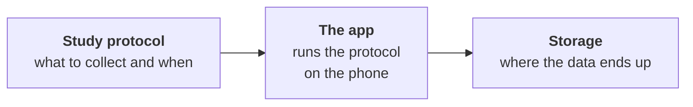

# CARP Docs agent guide

This repository is the developer documentation for the Copenhagen Research Platform (CARP), published at
https://docs.carp.dk. It is a [Fumadocs](https://fumadocs.dev) site on TanStack Start with a Material 3
Expressive theme (M3E web components through `@m3e/react`). Pages are MDX files in `content/docs`.

This file says how to write and edit those pages: the writing style, the page layouts, the MDX components,
the icons and the pictures. The rules describe what the pages already do; where pages disagree, they follow
the majority. Some existing pages and images break a rule. Do not copy them, and do not fix them unless asked.

## Ground rules

- The readers are developers who already build Flutter apps. Write technical documentation with no beginner
  framing, and link to Flutter's, Apple's and Google's own guides for platform basics.
- API reference is not generated here. Link to the package's API docs on pub.dev.
- Code samples were ported verbatim from the package repositories, known bugs included. Do not change what a
  ported sample does without the maintainer's confirmation; report the problem instead. Comment-only fixes are
  fine, and so are whitespace fixes that do not change what the code does; in YAML, indentation is code.
- Apply these rules to the text you write or change. Do not restyle the rest of a page or section unless
  asked; list the differences you noticed instead.
- Every push to `main` builds the site and deploys it to docs.carp.dk. Do not commit or push unless asked.

## Project

Use Bun: `bun install` applies the M3E fix in `patches/`, which npm and pnpm skip.

| Command | Purpose |
| --- | --- |
| `bun run dev` | Start the dev server at http://localhost:3000/docs |
| `bun run types:check` | Type-check with `tsc` |
| `bun run lint` | Lint with oxlint |
| `bun run build` | Build for production. It fails on MDX syntax errors, missing images and unknown code languages. It does not fail on broken links or Mermaid errors. |

| What | Where |
| --- | --- |
| Pages | `content/docs/**/*.mdx`, ordered by each folder's `meta.json` |
| Images | `public/images/<section>/` |
| MDX components available in pages | `src/components/mdx.tsx` (`getMDXComponents`) |
| Material 3 component wrappers | `src/components/m3e/mdx/`, exported from its `index.ts` |
| Icons | `src/components/ui/icons.tsx` (`materialIcons`), logos in `src/components/ui/brand-icons.tsx` |
| Navbar menus | `src/lib/layout.shared.tsx` |
| Changelog sources | `src/lib/changelog.ts` (`changelogSources`) |
| Colors, type and component styles | `src/styles/` |

Do not edit `src/routeTree.gen.ts` (generated) or `.output/` (build output).

Commit messages have an imperative, sentence-case subject with no period and no prefix such as `feat:`, for
example "Fix broken and moved links in the docs". Add a body when the reason is not obvious: short paragraphs
or `- ` bullets, wrapped at 72 characters. Do not add `Co-Authored-By` or other AI attribution lines. The
README, comments in `src/` and commit messages use British spelling (colour, catalogue). Docs pages, code
samples included, use American spelling.

## Content structure

### Sections

| Section | Folder | Package |
| --- | --- | --- |
| Overview | `content/docs` | — |
| Mobile Sensing | `content/docs/mobile-sensing` | `carp_mobile_sensing` |
| Health | `content/docs/flutter-plugins/health` | `health` |
| Debug Toolkit | `content/docs/flutter-plugins/debug-toolkit` | `carp_debug_flutter` |
| Apple Watch Sensing | `content/docs/sampling-packages/apple-watch` | `carp_aware_package` |

Each package folder is a sidebar section (`"root": true` in its `meta.json`). The folders `flutter-plugins/`
and `sampling-packages/` only group packages the way the navbar does. They are not sections and have no
index page.

### meta.json

A folder's `meta.json` sets its sidebar title and icon and the order of its pages. Only listed pages appear in
the sidebar and in the previous and next links. An unlisted page still builds, so a missing entry is easy to
miss.

```json
{
  "title": "Debug Toolkit",
  "description": "carp_debug_flutter",
  "icon": "Bug",
  "root": true,
  "pages": ["index", "installation", "quickstart", "production", "---Guides---", "environment", "data-sources", "built-in-tools", "custom-tools", "changelog", "---Links---", "[pub.dev](https://pub.dev/packages/carp_debug_flutter)", "[API reference](https://pub.dev/documentation/carp_debug_flutter/latest/)", "[GitHub](https://github.com/carp-dk/carp_debug_flutter)"]
}
```

| Entry | Meaning |
| --- | --- |
| `"index"` | The section's overview page. A root folder lists it first. A nested folder does not list it: its `index.mdx` becomes the folder's Overview row by itself. |
| `"<slug>"` | A page in this folder, without `.mdx`. |
| `"<folder>"` | A sub-folder with its own `meta.json`. |
| `"---Label---"` | A group label. Package sections use `---Concepts---`, `---Guides---`, `---Advanced---` and `---Reference---`, and end with `---Links---`. |
| `"[text](url)"` | A link row. Use it only in the `---Links---` group, for pub.dev, API reference and GitHub. |

- In a package section, set `description` to the pub.dev package name, and put `"changelog"` last, right
  before `---Links---`.
- A nested group's `meta.json` is one line: `{ "title": "Reading data", "icon": "Download", "pages": ["basic", "interval", "aggregate", "steps"] }`.
- List every page by name. Do not use `...`, `!name` or other Fumadocs shortcuts.

### Frontmatter

```yaml
---
title: Installation
description: Add carp_debug_flutter as a dev dependency and configure Android and iOS.
icon: Download
---
```

- Use only `title`, `description` and `icon`, in that order. Other keys are dropped without an error.
- `title`: one to four words in sentence case that name the subject: "Data types", "Production builds",
  "On-device storage". A gerund phrase is fine for a task area: "Reading data", "Using CAMS". Keep product
  names as they are written. A section's `index.mdx` uses the full product name ("CARP Mobile Sensing",
  "CARP Debug Toolkit", "Health", "Apple Watch Sensing"). The title is the page heading, the sidebar label,
  the browser title and the headline of the social card, so keep it under about 30 characters.
- `description`: one sentence of about 8 to 20 words (155 characters at most) that ends with a period. On a
  task page, start with the imperative verb: "Add ...", "Configure ...", "Fetch ...". On a concept or
  reference page, use a noun phrase or a "How ..." clause: "How the CARP components fit together, from study
  protocol to data upload." Write identifiers as plain text, never in backticks: "Add your own screens to the
  debug menu by implementing DebugTool." The description appears under the page heading and in search
  results, link previews, the social card and llms.txt, so do not repeat it as the first paragraph. Changelog
  pages keep the template's description.
- `icon`: set it on every page listed directly in a section's (or the Overview's) `meta.json`. Leave it off
  pages inside a nested group folder; the folder's `meta.json` icon shows instead. See [Icons](#icons).

### Add a page

1. Create `<slug>.mdx`, with a short kebab-case slug, in the section's folder from [Sections](#sections) or in
   a group folder inside it: for example `content/docs/flutter-plugins/health/<slug>.mdx`. The URL is `/docs/`
   plus the path under `content/docs` without `.mdx`; an `index.mdx` takes its folder's URL.
2. Write the frontmatter.
3. Add the slug to the folder's `meta.json`, in its group.
4. If the page belongs in a navbar menu (Get started or Mobile Sensing), add it to `src/lib/layout.shared.tsx`
   as `{ text, description, url, icon }`: the page title, a sentence-case fragment of 5 to 10 words with no
   final period, the absolute `/docs/...` path and the page's icon component (`<DownloadIcon />`). Menus are
   written by hand and are not generated from `meta.json`.
5. Link to it from related pages: a Next steps Card, a section index or a "See" sentence.

New pages are prerendered and added to the sitemap without further changes.

### Add a group folder

Create the folder, give it a one-line `meta.json` (title, icon and pages, without `index`) and list the folder
in the parent's `pages`. An optional `index.mdx` introduces the group, takes the same title as the folder's
`meta.json` and links each page. Pages in the folder get no `icon`.

### Add a package section

1. Create `content/docs/flutter-plugins/<slug>/` or `content/docs/sampling-packages/<slug>/`, and add the slug
   to that grouping folder's `meta.json`.
2. Add a `meta.json` like the example above: `title` (display name), `description` (pub.dev name), `icon`,
   `"root": true`, and `pages` starting with `"index"` and ending with `"changelog"` and the `---Links---` group.
3. Add `index.mdx`, `installation.mdx`, `quickstart.mdx` and `changelog.mdx`, following
   [Page types](#page-types).
4. Add the package to `packages` in `src/lib/layout.shared.tsx`:
   `{ text, name, summary, url, icon: <XIcon />, category: 'plugin' }` (or `'sampling'`), and import the icon.
   `summary` follows the navbar description form above.
5. Add the section to `changelogSources` in `src/lib/changelog.ts`, keyed by its folder path under
   `content/docs`: `'flutter-plugins/<slug>': { package: '<pub.dev name>', repo: 'carp-dk/<repo>', branch: 'main', file: 'CHANGELOG.md' }`.
6. Add a Card to `content/docs/index.mdx`, a Card under "Package guides" in `content/docs/api-reference.mdx`
   and a row to the section table in `README.md`. If the package has no row in the package tables of
   `api-reference.mdx`, add one to the matching table.

## Writing style

### Voice

- Address the reader as "you". Never write "we", "our" or "us".
- Write in the present tense, also for what the software does next: "`configure()` resolves a stable device
  identifier", not "will resolve".
- Write instructions in the imperative, with the goal or condition first: "To allow the app to count steps,
  add the activity recognition permission to `android/app/src/main/AndroidManifest.xml`".
- State a limitation as the fact, then its consequence, then what to do: "This approach **loses data** whenever
  sending fails, for example when the phone is offline or the server is down. Keep the default on-phone
  database as a backup, or use a data manager."
- Use "must" and "must not" for hard requirements, never "should". Hedge only when the outcome depends on the
  device, the platform version, another app or what users do, and then with "may", never "might" or "could":
  "users may find a way to open it".
- Use "X, not Y" to rule out a likely misreading: "Add the measures to `watch`, not to `phone`."
- Give the default and the cost of an option: "A lower interval transfers data sooner but drains the battery
  faster."
- Do not use contractions: "does not", "cannot", "is not".
- Do not use filler, minimizing or marketing words (simply, just, easy, easily, obviously, please, note that,
  powerful, seamless, modern) or exclamation marks.
- Open a page with its subject, never with "This page ..." or "In this guide ...". If you must refer to the
  page, write "this page", not "this guide".
- Do not explain Flutter or Dart basics. Assume the reader can create a Flutter app and edit `pubspec.yaml`.

### Sentences and paragraphs

- Aim for about 12 words per sentence, and split any sentence over 25 words.
- Keep paragraphs to one or two sentences, three at most.
- Join a claim and its explanation with a colon, and two closely related clauses with a semicolon. After a
  colon, continue in lowercase unless a proper noun or code follows.
- Define a concept where it first matters: bold the term and define it in the same sentence. "For a study,
  write a **data manager**: a class that CARP calls for every measurement."
- Introduce an API by making it the subject, with a present-tense verb: "`carp_debug_flutter` adds a floating
  button to your app.", "`requestAuthorization()` asks the user to grant access to specific health data types."

### Mechanics

- Use American spelling: behavior, color, initialize, optimize, serialize, analyze, canceled, gray.
- Leave out the serial comma in a simple list: "phones, wearables and participants". Add it only when an item
  contains "and" or "or", or when the items are clauses: "request permissions, and read, write and delete
  health data".
- Do not use em dashes, en dashes or spaced hyphens in prose; use a colon, a semicolon or a new sentence. Use
  an en dash only in numeric ranges ("1–30 days", "0–100"), and "—" only in a table cell with no value.
- Write "for example", never "e.g.", and replace "i.e." with "that is" or a colon. Use "such as" inside a noun
  phrase and "and so on" instead of "etc.". A sentence-initial "For example," takes a comma.
- Spell out numbers from one to nine ("three options"). Use numerals for 10 and above and for versions, units,
  durations and percentages: "every 15 minutes", "iOS 16.0", "5%".
- Write a minimum version or level with "or later": "iOS 15.0 or later", "set `minSdk` to 24 or later".
- Use straight quotes. Use quotation marks only for text shown on screen (messages, permission strings); put
  literal values in backticks.
- Use parentheses only for short qualifiers: an acronym expansion, a default, a unit or a platform:
  "(default `true`)", "(Android only)". Do not put clauses or links in them.
- Expand an abbreviation at its first use on a page, full term first: "operating system (OS)". Leave common
  ones (BMI, ECG, UUID, SDK) and CARP unexpanded; [Terminology](#terminology) says where to expand CAMS and
  CAWS.
- Use "→" only in UI paths and value mappings: "`HEART_RATE` → `BEATS_PER_MINUTE`".
- Do not use italics. Do not trail off with an ellipsis in prose; write the full list. Use three ASCII periods
  only in code, and copy a UI label that contains "…" exactly as shown.

### Formatting in prose

Put these in backticks: package names (`carp_mobile_sensing`), classes, methods, properties, parameters, enum
values, literals (`true`, `null`), file and folder paths, commands, flags, permissions, `Info.plist` and
manifest keys, XML elements, measure type strings and Xcode target names (`Runner`).

- Write a method or function with empty parentheses: `configure()`, `tryDeployment()`. Leave them off
  classes, properties, parameters and callbacks (`SmartPhoneClientManager`, `client.measurements`,
  `onApply`), and off a method name that is the link text of its pub.dev page. The Health Reading data and
  Writing data groups and the Deleting data page write method names without parentheses, as in the
  method-page opening under [Health](#health). New pages there do the same.
- When the value matters, write a property and its value in one span: `deleteAfterTransfer: false`.
- Write project paths relative to the Flutter project root, with no leading slash. End a path to a folder
  with a slash: `android/app/src/main/AndroidManifest.xml`, `ios/Runner/`.
- Write a placeholder in angle brackets inside backticks, lowercase with underscores:
  `data/data/<package_name>/databases/`.
- Never write `<` followed by anything but a space, or `{`, in prose outside backticks. MDX reads `<` as a JSX
  tag and `{` as a JavaScript expression, and the build or the page fails. Put generics and operators in
  backticks: `List<HealthDataPoint>`, `<=`.
- Do not put Markdown in frontmatter or in a component's `title`. Write identifiers there as plain text.
- Use backticks in a heading only when the section documents that identifier: "## `EnvEntry` reference",
  "### `fileTransferInterval`".

Use bold for:

- UI labels, exactly as shown, including capitals and "&": **Device & App**, **Minimum Deployments**;
- UI paths, as one bold span with arrows: **Runner → General**, **Settings → Battery**;
- a term in the sentence that defines it;
- the lead-in of a list item, with the colon inside the bold:
  `- **Inspect and search:** lists every visible key with its runtime type and value.`;
- one or two words that carry a warning, sparingly: **not**, **only**, **must**.

### Terminology

| Write | Not | Notes |
| --- | --- | --- |
| CARP | Carp | Expanded once, in the Introduction: "CARP (Copenhagen Research Platform)". Do not expand it on other pages. |
| CARP Mobile Sensing (CAMS), then CAMS | CAMS (CARP Mobile Sensing) | Expand it at the first mention on a page outside the Mobile Sensing section. |
| CARP Web Services (CAWS), then CAWS | CARP Web Service | CARP's server. Expand it once per page. |
| CARP web portal | CARP Portal | Where researchers set up studies and download data. |
| Google Health Connect, then Health Connect | Android Health Connect | The full name at the first mention on the Health landing page and on pages outside the Health section. |
| Apple Health | — | The store and the app ("the Apple Health app"). |
| HealthKit | — | Apple's framework and the Xcode capability. |
| Apple Watch, then the watch | apple watch | "smartwatch" is the generic device. |
| watchOS, iOS, macOS, iPhone, Xcode | WatchOS, IOS, XCode | Also at the start of a sentence. |
| Swift Package Manager, CocoaPods, Android Studio | SwiftPM, SPM | The vendors' spelling, in full every time. |
| Flutter, Dart, pub.dev | Pub.dev | pub.dev is always lowercase and never in backticks. |
| participant | user, subject | A person in a CARP study. Health and Debug Toolkit pages say "the user" for the person using the app. Keep "user" in API terms such as user task (`UserTask`). |
| study protocol, then protocol | — | — |
| measure, measurement | — | A measure says what to collect (`Measure`); a measurement is one collected data point (`Measurement`). Never swap them. |
| data endpoint, data manager, sampling package, trigger, task, deployment, primary device | Data Endpoint | Lowercase in prose. Use the class name in backticks only for the API itself. |
| plugin, package | — | "the `health` plugin", then "the plugin". "package" for Dart packages and sampling packages. |
| dev dependency | dev-dependency, `dev_dependency` (as a noun) | `dev_dependencies` for the pubspec section. |
| a SQLite database, a `SQLiteDataEndPoint` | an SQLite database | — |
| API reference | API Reference | The generated docs on pub.dev. |
| lifecycle, subtype, preinstalled, Wi-Fi | life cycle, sub-type, pre-installed, WiFi | — |
| sign in (verb), sign-in (noun) | — | — |

### Headings

- Use `##` and `###` only. The page heading comes from the frontmatter title, so never write `#`.
- Write headings in sentence case, with no end punctuation and no links.
- Name a task section with an imperative verb phrase: "## Configure Android", "## Read health data". Name a
  concept or reference section with a noun phrase: "## Study lifecycle", "## Units". Use "How ... works" for
  a mechanism. Do not start a heading with a gerund ("Getting access") or an article ("The ...").
- Reuse the standard section names: "Prerequisites", "Requirements", "Features", "How it works",
  "Troubleshooting", "Platform differences", "Next steps" ("Next step" above a single Card). Do not add
  "Overview", "Introduction", "Summary" or "Conclusion" sections.
- Mark a section that applies to one platform with the platform in parentheses at the end of its heading:
  "## Delete by UUID (iOS)".
- Give sibling headings the same form, and keep every heading on a page unique: headings become anchors.
- Renaming a heading changes its anchor. Search `content/docs` for links to the old `#anchor` and update them.

### Lists and tables

- Use `-` for bullets and `1.` for ordered lists. Introduce a list or table with a lead-in that ends with a
  colon, unless it follows a heading directly.
- When the items complete the lead-in sentence, start each item in lowercase, end it with a semicolon and end
  the last one with a period. Otherwise start each item with a capital and end it with a period. An item that
  is only an identifier, a path or a link takes no period.
- Use a numbered list for a sequence that the system or other people perform. Use `<Steps>` for a procedure
  the reader performs.
- Use a table, not a list, for items that share two or more attributes: options, parameters, platforms, file
  locations, comparisons.
- Write table headers in sentence case and separate them with `| --- |`. Name the first column after the item:
  Option, Parameter, Property, Field, Platform, Method.
- End a cell with a period when it holds a sentence. Leave values, identifiers and short fragments without one.
- Never leave a body cell empty. Write "None" in a descriptive cell with nothing to list, "—" for no value or
  no default, and "Yes" or "No" for booleans. Only the top-left cell of a comparison table stays empty.
- Parameter tables use `| Parameter | Type | Required | Description |`, with names and types in backticks and
  Yes or No under Required. When optional parameters have defaults, add a `Default` column after Required and
  write "—" for a parameter without one. An option table without a Default column ends the description with
  "Default: `value`."
- In a comparison table, leave the top-left cell empty, give each option a column and bold the row headers.

### Links

- Link docs pages with absolute paths, with no trailing slash and no extension:
  `[Data managers](/docs/mobile-sensing/data-managers)`. Add `#anchor` for a section, and use a bare
  `#anchor` within the page. Never use relative paths.
- Point to another page with one of these sentences, using the target page's title as the link text:
  `See [Page title](/docs/...).`, `See [Page title](/docs/...) for <what it covers>.`,
  `To <goal>, see [Page title](/docs/...).` or `For <topic>, see [Page title](/docs/...).`. Never put a "see"
  link in parentheses. Inside a sentence, link a lowercase phrase instead: "the
  [companion watch app](/docs/sampling-packages/apple-watch/watch-app)".
- For a section on another page, use the section heading as the link text:
  `For examples of each value type, see [Value types](/docs/flutter-plugins/health/reading/basic#value-types).`
  Keep the page title when the heading means little on its own, such as "Files" or "Configure iOS":
  `See [Installation](/docs/mobile-sensing/installation#configure-ios).`
- Never use "here", "this page" or "this issue" as link text.
- pub.dev URLs:
  - package page: `https://pub.dev/packages/<package>`. In prose, the link text is the backticked package
    name: "[`carp_backend`](https://pub.dev/packages/carp_backend) is a separate Flutter package". Use the link
    text "pub.dev" only where the link stands for the site: the landing-page Chips, the `---Links---` row, the
    pub.dev column of `api-reference.mdx` and the changelog intro;
  - API reference: `https://pub.dev/documentation/<package>/latest/`, link text "API reference";
  - a class: `https://pub.dev/documentation/<package>/latest/<library>/<Class>-class.html`;
  - a member: `https://pub.dev/documentation/<package>/latest/<library>/<Class>/<member>.html`;
  - release history: `https://pub.dev/packages/<package>/changelog`.
- Documentation links always use `latest`. Library paths change between releases, so open a class or member
  link before you add it.
- GitHub: link a repository by its project name (PulmonaryMonitor for `pulmonary_monitor_app`), and a folder
  with a lowercase phrase that names what it holds ("the
  [CAMS demo app](https://github.com/carp-dk/carp.sensing-flutter/tree/main/apps/carp_mobile_sensing_app)").
  Link a file with its backticked file name, at `https://github.com/carp-dk/<repo>/blob/<branch>/<path>`, where
  the branch is the repository's default: `main` for most, `master` for `pulmonary_monitor_app`. Link an issue
  as `[issue #530](https://github.com/carp-dk/carp.sensing-flutter/issues/530)`.
- Support channels: `[Discord](https://discord.gg/sswpqGvnf5)`, the repository's GitHub issues and
  `[support@carp.dk](mailto:support@carp.dk)`.
- External links open in a new tab by themselves. Do not write HTML `<a>` tags.

### Code samples

- Give every fence a language: `dart`, `bash`, `yaml`, `xml` (`AndroidManifest.xml`, `Info.plist`), `kotlin`
  (`build.gradle.kts`), `swift`, `ruby` (`Podfile`), `json` or `text`. A language Shiki does not know, such as
  `gradle`, `plist` or `env`, fails the build.
- Name the file with `title` on the fence, relative to the Flutter project root, for example
  `title="ios/Runner/Info.plist"` after the language. Use it for config files, platform files and complete
  files. Do not title partial Dart snippets, and never name the file in a comment on the first line.
- Introduce a block with a sentence that ends with a colon: "Replace the contents of `lib/main.dart` with:". A
  block that opens a Step or Tab, or that sits under a heading naming it, needs no lead-in.
- After a block, explain only what is not obvious, in one or two sentences. A complete example is the
  exception: explain each numbered stage.
- Show imports in complete examples, in the first Dart sample of an installation or quickstart page and when a
  sample uses another package. Start other snippets at the relevant statement.
- Elide code with `// ...` on its own line (say what is left out: `// ... the rest of your app`) or with
  `(...)` in a call.
- Mark lines the reader adds to an existing file with `// [!code ++]` and lines to remove with `// [!code --]`
  (`#` or `<!-- -->` comments in other languages). Highlight with `// [!code highlight]`. Line numbers,
  `{1,3}` ranges, `// [!code focus]` and `noCopy` have no effect here.
- In code you write, make comments sentence-case fragments without a final period. In a complete example,
  number the stages (`// 1. Create the protocol`) and explain them after the block. Trailing comments are
  short lowercase labels: `// kcal`, `// required on iOS`. Do not restyle the comments of ported samples; fix
  one only when it is wrong.
- Write shell commands in a `bash` block, one command per line, with no `$` prompt. Show expected output as a
  comment under the command: `# -> no matches`.
- Add runtime dependencies with `flutter pub add <package>`. Show `pubspec.yaml` (`title="pubspec.yaml"`) only
  for a dev dependency, a Git source or a path source.
- Use realistic values or obvious placeholders (`'your-client-id'`, `https://my-server.example.com`,
  `dk.carp.myapp`), and give units in a trailing comment: `value: 70.5, // kg`.
- Do not use `tab="..."` on fences or ```` ```npm ```` blocks. Use `<Tabs>` for alternatives.

### Platform differences

- Put Android first in Tabs and sentences, and in new tables and lists. When you edit a table or list that
  puts iOS first, as the landing-page requirement tables and most Health bullet lists do, keep its order.
- For a one-line difference, start the sentence with "On Android," or "On iOS,", or add "(Android only)".
- For short per-platform instructions or notes, use platform Tabs; see [Tabs and Tab](#tabs-and-tab).
- For multi-step setup, give each platform its own `##` or `###` ("## Configure Android", "## Configure iOS"),
  or its own platform setup page.
- List requirements (versions, SDK levels) in the landing page's Requirements table.
- A package for one platform says so in a Callout near the top of its landing and installation pages and in
  the Requirements table. It uses no platform Tabs.

## Page types

### Package landing page

The section's `index.mdx`:

```mdx
---
title: CARP Debug Toolkit
description: An in-app debugging toolkit for CARP apps and other Flutter apps.
icon: Bug
---

`carp_debug_flutter` adds a floating button to your app.

<Chips>
<Chip href="https://pub.dev/packages/carp_debug_flutter" icon="Package" tone="primary">pub.dev</Chip>
<Chip href="https://pub.dev/documentation/carp_debug_flutter/latest/" icon="Description" tone="tertiary">API reference</Chip>
<Chip href="https://github.com/carp-dk/carp_debug_flutter" icon="Code" tone="success">GitHub</Chip>
</Chips>
```

1. One or two short paragraphs that make the backticked package name the subject and say what it does.
2. The Chips row above, always with these three Chips in this order.
3. Optionally, a Callout for a version or platform limit.
4. `## Features`: feature Cards (title and icon, no `href`) or bullets.
5. `## Requirements`: a two-column table with one row per platform or tool, such as
   `| Component | Requirement |` with Dart SDK, Flutter, Android and iOS rows.
6. `## How it works`: a diagram of the mechanism, or `<Steps>` with the reader's main stages, optionally
   followed by a short example that configures the package and makes its core call.
7. `## Next steps`: Cards to Installation, Quickstart and the main guides.

A large section may add a `## Documentation map` with one Card per page after Next steps.

### Installation

`title: Installation`, `icon: Download`, and a description such as "Add carp_mobile_sensing to a Flutter app
and configure Android and iOS." Open with one sentence that sums up the procedure; when Steps follow
directly, that sentence is their lead-in and ends with a colon. Then use `<Steps>`, or one imperative `##` per
stage: add the dependency, configure Android, configure iOS, verify the setup. An optional
`## Troubleshooting` has one Accordion per symptom. End with `## Next steps`, or with `## Next step` and one
Card when the setup continues on another page.

### Quickstart

`title: Quickstart`, `icon: Bolt`. Open with the outcome in one sentence. Then:

1. `## Prerequisites`: bullets, each linking to the page that covers it;
2. `<Steps>` that build the app, or `## Complete example` with one runnable program whose stages are numbered
   comments;
3. `## How it works`: one table row or `###` per numbered stage;
4. optionally `## Troubleshooting`: one Accordion per symptom;
5. `## Next steps`: Cards.

### Concept, reference and guide pages

- Concept and reference pages open by defining the subject, use noun-phrase headings and put parallel items in
  tables. A page in a `---Concepts---` group is a concept page even when it shows configuration: write the
  setup as imperative lead-ins under noun-phrase headings.
- Guide pages open with what the reader achieves and use one imperative `##` per task.
- A page about several parallel items may open with a table of the items that links each one to its section.
- These pages end on their last section or with a one-line pointer: "For the available data managers, see
  [Data managers](/docs/mobile-sensing/data-managers)." Introduction, Quickstart and Architecture end with
  `## Next steps`.

### Group index page

The `index.mdx` of a group folder (Storing data, Reading data, Writing data, The watch app) introduces the
group in one to three sentences and links every page, usually with Cards. When the pages are alternatives,
compare them in a table before or after the Cards.

### Changelog page

Copy this template and change the package name and the repository. When the changelog is not at the
repository root, also change its path in the link text and URL, as the Mobile Sensing changelog does with
`carp_mobile_sensing/CHANGELOG.md`. Use the same values as the section's entry in `changelogSources`.
`<Changelog />` fetches the release notes in the browser, and it renders nothing unless the section is in
`changelogSources`.

```mdx
---
title: Changelog
description: Release notes for carp_debug_flutter, newest first.
icon: History
---

The release notes come from [`CHANGELOG.md`](https://github.com/carp-dk/carp_debug_flutter/blob/main/CHANGELOG.md) in the `carp_debug_flutter` repository, and the dates are the versions' publish dates on [pub.dev](https://pub.dev/packages/carp_debug_flutter/changelog). Versions without a date are not on pub.dev.

<Changelog />
```

### Next steps

`## Next steps` holds only a `<Cards>` grid of two to four Cards (up to seven on Overview pages). Follow
[Cards and Card](#cards-and-card) for their titles, icons and bodies. In a chain of setup pages, use
`## Next step` with one Card that points to the next page.

## Section conventions

These rules override the general rules for pages in that section.

### Overview

- Pages describe CARP as a whole, so expand CARP Mobile Sensing (CAMS) and CARP Web Services (CAWS) at their
  first mention and say "participant" for the person in a study.
- Package sections do not appear in the Overview sidebar. Readers reach them through the navbar, the section
  picker and the Cards on `index.mdx` and `api-reference.mdx`.

### Mobile Sensing

- The docs cover API level 2.x, as the warning Callout on the landing page says. Flag a component that does
  not support 2.x in a warning Callout where the component is documented, as the Firebase section of Data
  managers does.
- Link a class to its pub.dev page at its first mention on a page.
- When a page needs a generic protocol, reuse the house example: steps, ambient light, screen and battery,
  with `name: 'Tracking steps, light, screen, and battery'`, copied exactly, and `SQLiteDataEndPoint()`.
- Say where examples come from: "The examples on this page come from the
  [PulmonaryMonitor](https://github.com/carp-dk/pulmonary_monitor_app) app."

### Health

- `health` is a standalone Flutter plugin, so these pages use no CARP study terms. The person using the app is
  "the user".
- Write the access levels READ and WRITE as bare uppercase words in prose ("requires WRITE permission"), and
  "read-only" before a noun. Write data types as bare enum constants in backticks: `STEPS`, not
  `HealthDataType.STEPS`.
- Method pages follow this order: an opening that makes the method the subject ("`getTotalStepsInInterval`
  returns a single total step count for a time period."), `## Signature` with the Dart signature in a code
  block and a parameter table, `## Return value`, task sections, `## Examples` with one `###` per example,
  `## Error handling`, `## Platform differences` and `## Related`. A page that covers several methods gives
  each method its own `##` instead of `## Signature`.
- `## Platform differences` holds platform Tabs with three or four bullets each.
- Method pages end with `## Related`: three or four bullets of the form
  `- [Workouts](/docs/flutter-plugins/health/writing/workouts): exercise sessions`, with no end punctuation.
  Concept pages (Permissions, Data types, Health Connect) end with `## See also` and Cards.
- Samples assume a configured `health` instance and `DateTime` values named `start`, `end` or `time`. Method
  pages show no imports.
- Link only to the API reference root and name the class or method in the sentence.
- Contrast recommended and discouraged code with `// ✅` and `// ❌` comments.

### Debug Toolkit

- The package is a dev dependency; keep that in every setup sample.
- Write tool names as bold UI labels in prose (**Environment & Servers**, **Shared Preferences**,
  **Database**, **Device & App**, **Logs & Errors**). Headings and Card titles use "and" instead of "&".

### Apple Watch Sensing

- The package supports iOS and watchOS only.
- Write "the phone" and "the watch", and "companion watch app" at the first mention, then "watch app". Apple's
  **Watch** app on the iPhone is a different app; bold it as a UI label.
- The watch-app setup is a chain of pages. Each page except the last ends with `## Next step` and one Card to
  the next page; Build and verify ends with `## Next steps`.
- Give the default and the trade-off of every setting.

## Components

All components below work in every page without imports. They are registered in `src/components/mdx.tsx`.

### Writing JSX in MDX

```mdx
<Callout type="warning" title="Data loss">

This approach **loses data** whenever sending fails, for example when the phone is offline or the server is down. Keep the default on-phone database as a backup, or use a data manager.

</Callout>
```

- Put an opening tag that wraps Markdown on its own line, then a blank line, the Markdown, a blank line and the
  closing tag on its own line. Text on the opening tag's line makes the element inline: it holds no
  paragraphs, lists or code blocks, and its closing tag must follow the text on the same line, as in
  `<Chip ...>pub.dev</Chip>`. Text next to only one of the two tags fails the build.
- Put a container and its own items on consecutive lines at column 0, with no blank line between their tags:
  `<Steps>` then `<Step ...>`, `</Tab>` then `<Tab ...>`, `</Card>` then `</Cards>`. Do not indent JSX or the
  fences inside it.
- A component inside a Step, Tab, Card or Accordion is part of that tag's Markdown, so keep the blank lines
  around it: `<Step ...>`, a blank line, `<Tabs ...>`; `</Callout>`, a blank line, `</Tab>`.
- Keep short labels on the tag's line: `<Chip ...>pub.dev</Chip>`. On a line of their own they become a
  paragraph inside the control.
- Attribute values are literal text, so Markdown in `title="..."` shows as typed. Write arrays with single
  quotes in braces (`items={['Android', 'iOS']}`) and boolean props bare (`persist`, `defaultOpen`).
- Props are not type-checked. A misspelled prop is ignored, an unknown Callout type renders as a blue Note and
  an unknown icon renders nothing, or an empty colored square on a Card. A misspelled component name stops
  the page from rendering. Copy names and values from this file.
- Use Markdown for headings, links, images, tables and code. Raw `<a>`, ``, `<table>`, `<h2>` and `<pre>`
  tags skip the theme's versions.
- HTML comments fail the build; use `{/* ... */}`. Autolinks in angle brackets (`<https://...>`,
  `<support@carp.dk>`) also fail the build; use `[text](url)`.
- `:::note` admonitions and `> [!NOTE]` alerts are not enabled and render as plain text. Use `<Callout>`.
- Do not put `##` or `###` headings inside a component. They lose their styling but still appear in the page's
  table of contents.

### Which component

| Need | Use |
| --- | --- |
| A side note, tip or warning | `<Callout>` |
| A procedure the reader performs | `<Steps>` and `<Step title>` |
| One example for Android and one for iOS, or other alternatives | `<Tabs>` and `<Tab>` |
| Links to related pages | `<Cards>` and `<Card title href icon>` |
| A grid of features | `<Cards>` and `<Card title icon>`, without `href` |
| Two phone screenshots side by side | `<Cards>` and two `<Card title>`, each with one image |
| Troubleshooting entries, or detail most readers skip | `<Accordions>` and `<Accordion title>` |
| A package's pub.dev, API reference and GitHub links | `<Chips>` on its landing page |
| The files the reader creates | `<Files>`, `<Folder>` and `<File>` |
| A package's release notes | `<Changelog />` on its changelog page |
| A flow or sequence diagram | A ```` ```mermaid ```` fence |
| An image | `` |

### Callout

```mdx
<Callout type="tip" title="Use a physical device">

Simulators have no step counter or real battery, so they produce very little data.

</Callout>
```

| Prop | Values |
| --- | --- |
| `type` | `info` (shows "Note"), `tip` ("Tip") or `warning` ("Warning"). Always set it. |
| `title` | Optional text that replaces the default title. |

- `warning`: data loss, a security or production risk, an action that silently breaks the build or data
  collection, a requirement that applies to every reader, or a platform limit. `tip`: a recommendation or
  shortcut. `info`: a side fact, a consequence, a related link or a step that only readers on an optional
  path need, such as a migration: "If you switch a project from CocoaPods to Swift Package Manager, run
  `pod deintegrate` first."
- The body is one to three sentences: the fact, then the action. A short list or one code block is allowed.
- Add a `title` of one to six words when a few words can state the subject or the rule: "Data loss", "Watch
  target only", "Not sure which to pick?". Use sentence case and no period. Leave the title off when it would
  only repeat a one-sentence body, and off every Callout inside a Step or Tab.
- Place a Callout right after the paragraph, code or step it qualifies, and do not stack Callouts.
- Do not use the `success` and `error` types, the `warn` and `idea` aliases or the `actions` prop.

### Steps and Step

````mdx
<Steps>
<Step title="Create a Flutter app">

```bash
flutter create my_first_carp_app
cd my_first_carp_app
```

</Step>
<Step title="Add the CARP packages">

```bash
flutter pub add carp_core carp_mobile_sensing
```

</Step>
</Steps>
````

- Use one `<Step>` per action. Its `title` is an imperative verb phrase in sentence case with no period, and
  plain text: "Add the Info.plist keys", "Gate the toolkit in main()".
- Keep a Step to its action: a sentence or two and the code, Tabs or Callout that the action needs. When the
  title already says what to do, use the body for the reason or the result.
- Introduce the Steps with a lead-in that ends with a colon and gives the count when it is fixed: "Adding
  sampling to a Flutter app takes three steps:". Under a heading that names the procedure, the lead-in is
  optional.
- A Step holds no Cards and no headings.
- Numbering starts at 1 in every `<Steps>`, so keep one procedure in one block. Step titles appear in the
  table of contents but have no anchor.
- Do not use `<Stepper>`; it hides all but the current step.

### Tabs and Tab

```mdx
<Tabs items={['Android', 'iOS']} groupId="platform" persist>
<Tab value="Android">

Set `minSdk` to 24 or later in `android/app/build.gradle.kts`.

</Tab>
<Tab value="iOS">

In Xcode, select **Runner → General** and set **Minimum Deployments** to 15.0 or later.

</Tab>
</Tabs>
```

- Always give `<Tabs>` an `items` array, and put only `<Tab>` elements inside it. Without `items` no tab
  labels render, and anything else between the Tabs is dropped without an error.
- `items` and the `<Tab>` children pair by position, so keep the same number and order. More items than Tabs
  crashes the page. Set each `value` to its `items` string exactly.
- For a platform split, always write `<Tabs items={['Android', 'iOS']} groupId="platform" persist>`, Android
  first. The group remembers the reader's platform across pages.
- For other alternatives, leave out `groupId` and `persist`: `<Tabs items={['pub.dev', 'Git', 'Local path']}>`.
  When tabs show different classes, use the class name as the label, without backticks.
- Introduce Tabs with a sentence that ends with a colon, unless they open a Step or follow a heading that
  names them.
- Keep a Tab short: a sentence or two with a code block, a few bullets or a Callout. A Tab holds no headings.

### Cards and Card

```mdx
<Cards>
<Card title="Installation" href="/docs/mobile-sensing/installation" icon="Download">

Add the package and configure Android and iOS.

</Card>
<Card title="Using CAMS" href="/docs/mobile-sensing/usage" icon="Code">

Define a study protocol, deploy it and start sampling.

</Card>
</Cards>
```

| Prop | Rules |
| --- | --- |
| `title` | Required. For a link Card, the target page's title, or the section's heading when `href` ends in `#anchor`. Plain text. |
| `href` | An absolute `/docs/...` path. It makes the whole Card one link. |
| `icon` | A `materialIcons` key: the target page's icon, or a topic icon when `href` ends in `#anchor` or the page is in a group folder; see [Which icon](#which-icon). An unknown name leaves an empty colored square. |
| `tone`, `variant` | Do not set. Icon colors cycle by position: primary, tertiary, success, warning. |

- Always put Cards in `<Cards>`, a two-column grid that becomes one column on phones.
- Write props in the order `title`, `href`, `icon`, and use the block form above: the body on its own line
  between blank lines.
- The body is one sentence of about 10 words that ends with a period: imperative for a task, a noun phrase for
  a topic. When another Card already links the page, copy its text. Otherwise shorten the target page's
  description to about 10 words by dropping the package name and trailing detail: "Override --dart-define
  launch arguments and switch servers at runtime with DebugEnv." becomes "Override launch arguments and switch
  servers at runtime."
- A linked Card holds no links, buttons or chips, and only one paragraph.
- A feature Card has `title` and `icon` and no `href`, and a body of one or two sentences.
- A screenshot Card has only a `title` and holds one image; see [Screenshots](#screenshots).

### Chips and Chip

Use Chips only for the link row on a package landing page, exactly as in
[Package landing page](#package-landing-page). Keep the label on the tag's line.

### Accordions and Accordion

```mdx
<Accordions>
<Accordion title="No data returned">

Check that the permissions are granted and that data exists for the time range. Other causes:

- On Android, Health Connect is not synced.
- On iOS, the device is locked.

</Accordion>
</Accordions>
```

- Always wrap Accordions in `<Accordions>`. Only one opens at a time; `type="multiple"` lets several stay open.
- Use them for `## Troubleshooting`, one per symptom: the title states the symptom and the body starts with
  the fix. Also use them for optional detail that most readers skip. Never hide a required step in an
  Accordion.
- `title` is sentence case, plain text and has no period. Accordions cannot be linked to.

### Files, Folder and File

```mdx
<Files>
<Folder name="ios" defaultOpen>
<Folder name="CarpWatch Watch App" defaultOpen>
<File name="CarpWatchSensorController.swift" />
<File name="CarpWatchApp.swift" />
</Folder>
</Folder>
</Files>
```

Place the tree right after the sentence that names the files. Give folders `defaultOpen` and self-close every
`<File />`. Do not use ```` ```files ```` fences: they keep only the last top-level entry.

### Changelog

`<Changelog />` takes no props and belongs only in a section's `changelog.mdx`; see
[Changelog page](#changelog-page).

### Components not used in pages

These exist for the theme's component catalogue and are not used in CARP pages: `TypeTable` and
`AutoTypeTable` (use a Markdown parameter table instead), `Stepper`, `Banner`, `InlineTOC`, `Preview`,
`GraphView`, `GithubInfo` (or `GitHubInfo`), `Button`, `IconButton`, `ButtonGroup`, `Tooltip`, `Dialog`,
`Icon`, `Badge`, `Divider`, `List`, `ListItem`, `Progress`, `LoadingIndicator`, `Skeleton`, `ProgressExample`,
the Tabs parts `TabsList`, `TabsTrigger` and `TabsContent` (use `items` on `<Tabs>` instead) and the form
controls (`TextField`, `TextArea`, `Checkbox`, `Switch`, `RadioGroup`, `Select`, `Slider`). `CodeBlock`,
`Pre`, `DynamicCodeBlock`, `ImageZoom`, `Mermaid` and the `CodeBlockTabs` parts are produced from Markdown and
are not written by hand. Use a catalogue component only when asked, and check its props in
`src/components/m3e/mdx/` first. The live catalogue is in the template repository's
`content/docs/test/components`.

## Icons

Icons are Material Symbols Rounded (unfilled, weight 400, grade 0, optical size 24), stored as SVG paths in
`src/components/ui/icons.tsx`. Refer to an icon by its key in `materialIcons`: PascalCase and case-sensitive.
`Download` works; `download`, `file_download` and other Material ligature names do not.

| Where | Syntax | Unknown name |
| --- | --- | --- |
| Frontmatter | `icon: Download` | Falls back to the Lucide icon of that name, which does not match the set, and then to a generic page or folder icon. Use `materialIcons` keys only. |
| `meta.json` | `"icon": "Download"` | Same as frontmatter. |
| `Card`, `Chip`, `Accordion`, `File` | `icon="Download"` | No fallback: an empty square on a Card, nothing elsewhere. |
| `Callout` | No `icon` prop | The type sets the icon. |
| Navbar (`src/lib/layout.shared.tsx`) | `icon: <DownloadIcon />`, imported from `@/components/ui/icons` | A string renders as text. |

Nothing checks icon names at build time. Check each name against the list below.

### Which icon

Give each page one icon and reuse it wherever the page appears: its frontmatter, every Card that links to it
and its navbar entry. A group folder keeps its icon in `meta.json`, and Cards that link to the group use it.
Pages inside a group have no frontmatter icon: give each one a topic icon from the table below, such as
`Cloud` for CARP Web Services, and use it on every Card that links to the page. Some existing Cards and the
navbar's Introduction entry differ; list such differences instead of changing them.

| Page or topic | Icon |
| --- | --- |
| Docs home, Overview | `Book` |
| Installation | `Download` |
| Quickstart | `Bolt` |
| Changelog | `History` |
| API reference, pub.dev | `Package` |
| Introduction | `Info` |
| Terminology | `School` |
| Architecture | `Hub` |
| Software architecture | `Layers` |
| Domain model | `AccountTree` |
| Measure types, data types | `Dataset` |
| Using a package, source code | `Code` |
| Extending, custom tools | `Extension` |
| Best practices | `Star` |
| App task model | `Checklist` |
| Storing data | `Database` |
| Data managers | `Storage` |
| On-device storage, phone | `Smartphone` |
| CARP Web Services, cloud | `Cloud` |
| Custom backend, servers | `Server` |
| Configuration, environment | `Tune` |
| Settings | `Settings` |
| Android setup, Health Connect | `Android` |
| iOS setup | `Iphone` |
| Permissions | `Lock` |
| Privacy, production builds, capabilities | `Shield` |
| Reading data | `Download` |
| Writing data | `Upload` |
| Deleting data | `Delete` |
| Runtime state, timelines | `Timeline` |
| Built-in tools | `Build` |
| Mobile Sensing | `Sensors` |
| Health | `Heart` |
| Debug Toolkit | `Bug` |
| Apple Watch Sensing, wearables | `Watch` |

Feature Cards, and Cards that link to a section of a page, use a topic icon for their subject, for example
`Schedule` (timing and background work), `Sync` (data transfer), `Mic` (audio), `Quiz` (surveys and
questions), `Science` (cognitive tests) or `Terminal` (logs). The package Chips use `Package` (pub.dev),
`Description` (API reference) and `Code` (GitHub).

### Available icons

`AccountTree`, `Android`, `ArrowDown`, `ArrowLeft`, `ArrowRight`, `ArrowUp`, `Battery`, `Bloodtype`,
`Bluetooth`, `Bolt`, `Book`, `Bug`, `Build`, `Check`, `CheckCircle`, `Checklist`, `ChevronDown`, `Clipboard`,
`Cloud`, `Code`, `Copy`, `Database`, `Dataset`, `Delete`, `Description`, `Download`, `Edit`, `Error`,
`Extension`, `ExternalLink`, `FileText`, `Folder`, `Forum`, `Group`, `Hash`, `Heart`, `Help`, `History`, `Hub`,
`Info`, `Insights`, `Iphone`, `Key`, `Layers`, `Lightbulb`, `Link`, `Location`, `Lock`, `Mail`, `Menu`,
`MessageCircle`, `Mic`, `Monitor`, `Monitoring`, `Moon`, `Notifications`, `Nutrition`, `Package`, `Play`,
`Quiz`, `RefreshCw`, `Rocket`, `Run`, `Schedule`, `School`, `Science`, `Search`, `Sensors`, `Server`,
`Settings`, `Shield`, `Shuffle`, `Sidebar`, `SidebarOpen`, `Smartphone`, `Square`, `SquarePen`, `Star`, `Stop`,
`Storage`, `Sun`, `Sync`, `Terminal`, `Timeline`, `Tune`, `Upload`, `Visibility`, `Warning`, `Watch`, `Web`,
`Widgets`, `Wifi`, `X`

Many keys differ from the Material ligature, so search `icons.tsx` for a ligature before you add it. In the
topic block, `Heart` is `favorite`, `Bug` is `bug_report`, `Server` is `dns`, `Book` is `menu_book`, `Iphone`
is `phone_iphone`, `Run` is `directions_run`, `Nutrition` is `restaurant`, `Package` is `package_2`, `Battery`
is `battery_full`, `Location` is `location_on`, `Play` is `play_arrow` and `Stop` is `stop_circle`. Among the
interface glyphs, `Monitor` is `computer` and `Square` is `stop`. `FileText` and `Description` draw the same
glyph, and so do `Copy` and `Clipboard`.

### Add an icon

1. Find the symbol on [Google Fonts](https://fonts.google.com/icons) with the Rounded style and the default
   axes (fill 0, weight 400, grade 0, optical size 24).
2. Copy the path data from
   `https://fonts.gstatic.com/s/i/short-term/release/materialsymbolsrounded/<ligature>/default/24px.svg`. Do
   not use the Outlined, Sharp or filled variants or other sizes.
3. Add an export in the topic block of `icons.tsx`, with single quotes:
   `export const CodeIcon = materialSymbol('code', ['<path data>']);`. Do not add a viewBox, size or fill.
4. Register it in `materialIcons` (`Code: CodeIcon,`). Only registered names work in pages.
5. Logos are not Material Symbols. Add one to `brand-icons.tsx` with a comment naming its source and license.
   Logos cannot be named in pages, and Lucide has none.

## Pictures and diagrams

| Content | Use |
| --- | --- |
| A flow or data path with up to about five nodes, or a sequence with up to four participants | A Mermaid fence |
| A layered architecture, a class or domain diagram, or a layout Mermaid cannot draw | An SVG file |
| A UI state the reader must recognize or set: a permission dialog, a settings toggle, a notification | A screenshot |
| Anything else | Text: bold UI labels and paths, or a numbered list |

Do not add decorative images, stock photos or third-party logos. The photo on the docs home page is the only
photo. The site also serves every page as Markdown (`/docs/<page>.md`, `llms-full.txt`) and to Ask AI. There,
an image is only its alt text, while a Mermaid diagram keeps its source. Social cards and the favicon need no
work: the card is generated from the page's title, description and section.

### Images

- Add an image with Markdown on a line of its own, with blank lines around it: ``.
  The site adds a border, lazy loading and a full-screen zoom viewer. Do not use ``, `<figure>`, captions,
  title strings, relative paths or external URLs.
- Put the file in `public/images/<section>/`, where `<section>` is the package folder's own name
  (`mobile-sensing`, `apple-watch`). Overview images go in `public/images/`. A missing file fails the build.
- Name new files in kebab-case after the subject and, for screenshots, the state shown:
  `watch-phone-handshake.svg`, `battery-power-saving-off.jpg`. Older Mobile Sensing files use snake_case; leave
  them. Delete an image when no page uses it any more.
- Do not add captions. Introduce the image in the sentence before it, ending with a colon when the sentence
  points at it. Follow every diagram with text that restates it: a numbered list for a sequence, bullets for
  components or a table for options.

### Alt text

Every image needs alt text. It names the zoom button and titles the viewer, and it is all that Markdown
readers and Ask AI see.

- Screenshot: one noun phrase of about 60 to 150 characters with no final period. Name the platform or app,
  the screen, then the state shown: "Android app battery settings for the CAMS example app with Unrestricted
  selected". Copy on-screen labels exactly, without quotes, and put displayed messages in straight double
  quotes.
- Diagram: the diagram's name or type, a colon, then its parts or steps in reading order, in at most about 290
  characters and with no final period: "Sequence: the watch app asks the phone for settings, the phone answers
  from the AppleWatchDevice in the deployed protocol, the AWARE sensors collect into the watch database,
  compressed chunk files are transferred every 15 minutes, and the phone turns the records into CAMS
  measurements". Put the key words first, because the viewer shows the alt text on one line. Write
  identifiers as plain text.

### Screenshots

- Capture portrait screens at native resolution (about 1080 pixels wide) and save them as JPEG. Use PNG only
  when you need transparency.
- Crop to the phone screen: no simulator or window frame. Remove the Flutter debug banner and any unrelated or
  personal notifications. Five existing screenshots break this rule (`task_list.png`, `task_list_done.png`,
  `battery_optimization_permission.jpg`, `background_notification.jpg` and `task_notification.jpg`); do not
  use them as a model.
- An image more than 1.2 times taller than wide is shown 280 pixels wide, at phone size.
- Show two related screenshots as a pair: `<Cards>` with two `<Card title="...">`, each holding only the image.
  The title is a sentence-case noun phrase for the screen or state, with no icon and no `href`. Put optional
  sets inside `<Accordions type="multiple">`, with a one-sentence instruction above each pair.

```mdx
<Cards>
<Card title="Unrestricted battery usage">


</Card>
<Card title="Background data usage">


</Card>
</Cards>
```

### SVG diagrams

- Draw for a light page on a transparent background. In the dark theme the site puts SVG images on a white
  canvas, so do not use `prefers-color-scheme`, `currentColor` or white shapes meant to be invisible.
- Keep a diagram no taller than 1.2 times its width; a taller one is shrunk to phone size.
- Keep labels and arrows out of the bottom-right corner. The Enlarge button covers about 110 by 44 screen
  pixels there, and on a phone, where the image shrinks to about 340 pixels wide, that is almost a third of
  the width.
- Give every `font-family` a generic fallback (`'SF Pro', sans-serif`, `Menlo, monospace`), and embed no
  external images: an SVG shown as an image loads no other files.
- An SVG under 4 KB (4,096 bytes) is inlined as a data URI, which the dark-theme canvas does not match, so its
  dark lines land on the dark page. Draw a diagram that small as a Mermaid fence instead.
- The existing SVGs predate these rules. None has a font fallback, and `cams_architecture_v2.svg` links three
  missing TIFF files and is taller than 1.2 times its width, so it shows 280 pixels wide.

### Mermaid

````mdx

````

- Write a ```` ```mermaid ```` fence, never `<Mermaid>`. The site colors diagrams from the theme and redraws
  them in dark mode, so add no `style`, `classDef`, `linkStyle` or `%%{init}%%` directives.
- Use `flowchart LR` for components and data flow, and `sequenceDiagram` for interactions over time.
- Give flowchart nodes meaningful ids and quoted labels: `CAWS[("CARP Web Services<br/>(CAWS)")]`. Break lines
  with `<br/>` at about 24 characters. Write titled nodes as `<b>Title</b><br/>detail`, with detail lines as
  lowercase fragments without a period. Label edges with `-->|label|`.
- Keep a flowchart under about 750 pixels wide: at most three nodes in a row, with lines of about 24
  characters, like the diagram above (about 610 pixels). A sequence diagram with four participants is already
  about 1,100 pixels wide, so use no more than four. Wider diagrams shrink until their text is hard to read,
  and they cannot be zoomed.
- In sequence diagrams, give each participant a one-letter id and a full label (`participant P as Phone app`),
  use `->>` for calls and `-->>` for replies, write method calls with `()`, and use `Note over X:` for
  internal steps and `loop ... end` for repetition.
- Use the same terms as the prose.
- A Mermaid syntax error does not fail the build: the page shows the diagram's source instead. Check every new
  or changed diagram in `bun run dev`.

## Theme code

These rules apply when you change `src/`.

- Colors: use the roles in `src/styles/color-roles.css` (`--md-sys-color-*` and `--docs-*`) or the Tailwind
  `bg-fd-*` and `text-fd-*` utilities. Never hard-code a color in a component. The exceptions are the social
  card in `src/lib/og.tsx` and the `theme-color` meta tags in `src/routes/__root.tsx`, which cannot read CSS
  variables; when you change a role they repeat, change them too. Define a new role in both the light
  (`:root`) and dark (`.dark`) blocks, because M3E falls back to its default purple for an undefined role.
- Primary blue marks what is interactive or selected. The brand red accent marks identity only (the logo and
  the page-title overline) and never signals state.
- The brand colors are CARP blue `#006398`, navy `#001d32` and red `#d61d41`. `src/styles/theme.css` defines
  all three, but only the red is read from there: the blue and navy are written out again in the roles in
  `color-roles.css`. To change a brand color, change it in both files and in `src/lib/og.tsx`.
- Contrast: at least 4.5:1 for text and 3:1 for indicators and control outlines, in both themes. Never show
  state by color alone.
- Tones go in `data-tone`: `primary`, `secondary`, `tertiary`, `neutral`, `info`, `success`, `warning` or
  `error` (`ColorTone` in `src/components/m3e/mdx/color.ts`). `tip` exists only for Callouts.
- Type: use the `m3-*` classes from `src/styles/typography.css`, such as `m3-title-medium`.
- Shape and spacing: 12px corners on containers, 8px on controls and inner items, fully rounded pills; 24px
  between block components; a 1px `outline-variant` edge on cards, code blocks and tables. Show elevation with
  tonal surface steps, not shadows.
- M3E: import each element from its own subpath (`import { M3eCard } from '@m3e/react/card';`), and start files
  that render M3E with `'use client'`. Use `Button` and `IconButton` from `@/components/ui/button` instead of
  the M3E elements. For an internal `href` on an M3E element, call `useAppLink(href)` from
  `src/components/m3e/link.ts` at the top of the component and pass the handler to `onClickCapture`. It is a
  hook, so render each linked item of a list through its own component. Style M3E through `--m3e-*` tokens on a
  `docs-*` class in `src/styles`, never by reaching into its shadow DOM, and give every component root the
  `not-prose` class.
- Accessibility: every control has a name and a visible primary focus ring and works with the keyboard alone.
  Respect `prefers-reduced-motion`.
- To add an MDX component, write the wrapper in `src/components/m3e/mdx/<name>.tsx` and export it from that
  folder's `index.ts`, which makes it available in every page. Put its styles in
  `src/styles/mdx-components.css`, fall back to a default for unknown prop values, and document it in this
  file.
- `@m3e/web` and `@m3e/react` are pinned to 2.9.2, and `@m3e/web` is patched through `patchedDependencies` in
  `package.json`. Upgrade both together. To keep the fix, run `bun patch @m3e/web`, make the changes again in
  `node_modules/@m3e/web` and run `bun patch --commit node_modules/@m3e/web`. To drop it, delete the patch file
  and its `patchedDependencies` entry.
- The theme is shared with the template repository `iarata/fumadocs-material-3-theme` (git remote `template`).
  The two are not synced; theme changes come over one commit at a time with `git cherry-pick`. This
  repository's `src` is the source of truth here.
- Check visual changes in the light and dark themes, at 390 pixels wide and with the keyboard only.

## Before you finish

- `bun run types:check`, `bun run lint` and `bun run build` pass.
- The build output has no `Failed to fetch /docs/...` lines. The build logs them for links to missing pages
  but does not fail.
- `#anchor` links, Card links and Mermaid diagrams work in `bun run dev`. The build checks none of them.
- New pages are listed in `meta.json`. A new section has a navbar entry, a changelog source, Cards on
  `index.mdx` and `api-reference.mdx`, and a row in the README section table.
- Frontmatter has a title, a one-sentence description with a period and, where needed, an icon from
  `materialIcons`.
- Prose has no em dashes, "e.g.", contractions or "we", and uses American spelling.
- Ported code samples behave as before, and you reported any problem you found in them.
- You checked the page with `bun run dev`, in both themes and at phone width.
