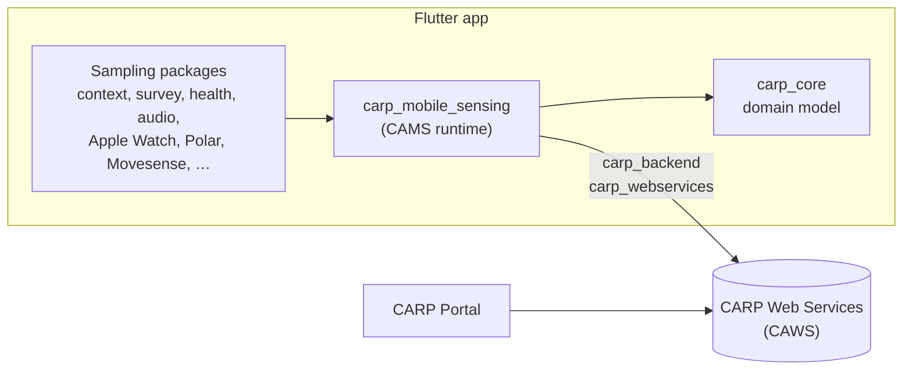
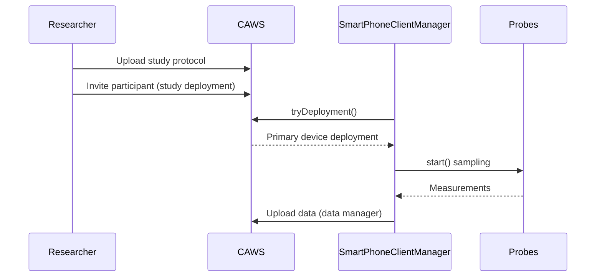

CARP is split into four parts:

- a platform-independent **domain model** (`carp_core`);
- a **client framework** that runs studies on the phone (CARP Mobile Sensing, CAMS);
- pluggable **sampling packages**;
- **backends** that deploy studies and store data (CARP Web Services, CAWS).

## Components

- Sampling packages, including those for wearables, plug into CAMS.
- CAMS builds on the `carp_core` domain model.
- CAMS communicates with CAWS through the `carp_backend` and `carp_webservices` packages.
- The CARP Portal connects to CAWS.

## Study lifecycle

1. The researcher uploads a study protocol to CAWS.
2. The researcher invites a participant, which creates a study deployment.
3. On the phone, `SmartPhoneClientManager` calls `tryDeployment()`, and CAWS returns the primary device deployment.
4. The client calls `start()` on its probes, which return measurements.
5. A data manager uploads the data to CAWS.

## Next steps

<Cards>
<Card title="CAMS software architecture" icon="AccountTree" href="/docs/mobile-sensing/software-architecture">

The CAMS runtime in detail.

</Card>
<Card title="Domain model" icon="Layers" href="/docs/mobile-sensing/domain-model">

Protocols, devices, triggers, tasks and measures.

</Card>
<Card title="API reference" icon="Package" href="/docs/api-reference">

Generated Dart API docs on pub.dev.

</Card>
</Cards>
