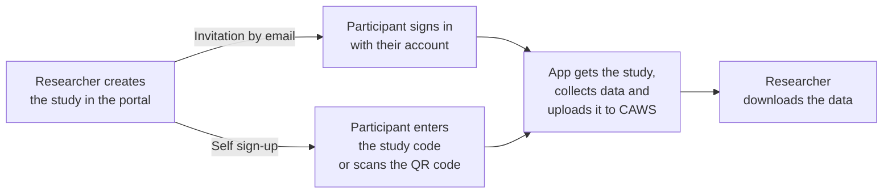

**CAWS (CARP Web Services)** is CARP's own server. Researchers do most of the work in the CARP web portal; the app signs in, fetches its study and uploads data.



Unlike [on-device storage](/docs/data-storage/on-device), **the protocol lives on the server**, not in the app. Researchers can change what is collected without releasing a new version of the app.

## How participants join

| | Invitation by email | Self sign-up with a code |
| --- | --- | --- |
| **How it works** | The researcher invites each person by email. They sign in with their own account. | The researcher turns on self sign-up and gets a 5-letter study code and a QR code. Anyone with the code can join. |
| **Participants are** | Known by email | Anonymous; no email or password needed |
| **Use for** | Studies where you need to know who is who | Classrooms, events and public studies, where many people join at once |
| **Limits** | One invitation per person | The researcher sets a maximum number of participants, and can turn sign-up off at any time |

## Getting access

To use CAWS you need access to the **CARP web portal**:

- **DTU researchers** can use the CAWS server hosted by DTU Health Tech.
- **Anyone planning a study** can contact the CARP team on [Discord](https://discord.gg/sswpqGvnf5) or at [support@carp.dk](mailto:support@carp.dk); the team will find a way to support it.
- **Run your own instance.** CAWS is open source: [carp-webservices-spring](https://github.com/carp-dk/carp-webservices-spring).

<Callout type="tip" title="CARP Studies app">

If you don't need your own app, the ready-made **CARP Studies app** is already connected to CAWS and supports both ways of joining. Many studies use it. See [carp.dk](https://carp.dk).

</Callout>

## Connect your app

<Callout type="warning" title="Before you write code">

Ask the CAWS team ([Discord](https://discord.gg/sswpqGvnf5) or [support@carp.dk](mailto:support@carp.dk)), or whoever runs your CAWS, to:

- **create your study**, with a protocol that sends data to CAWS;
- **invite a test participant** (you can invite yourself) or **turn on self sign-up** to get a study code;
- **register your app** for sign-in. You get a `clientId` and a `redirectURI` (plus an `anonymousRedirectURI` if you use study codes) to use below. The redirect address must also be set up in your Android and iOS projects.

Without these, sign-in fails or there is no study to fetch. The [CAMS demo app](https://github.com/carp-dk/carp.sensing-flutter/tree/main/apps/carp_mobile_sensing_app) shows a complete working setup.

</Callout>

<Steps>

<Step title="Add the CAWS packages">

```bash
flutter pub add carp_webservices carp_backend
```

On Android, these packages need a newer minimum SDK version. In `android/app/build.gradle.kts`, set `minSdk = 26`.

</Step>

<Step title="Configure the server and sign in">

Point the app at the server:

```dart
import 'package:carp_webservices/carp_auth/carp_auth.dart';
import 'package:carp_webservices/carp_services/carp_services.dart';
import 'package:carp_backend/carp_backend.dart';

// DTU's CAWS; use 'dev.carp.dk' while testing.
final uri = Uri(scheme: 'https', host: 'carp.computerome.dk');

await CarpAuthService().configure(
  CarpAuthProperties(
    authURL: uri,
    clientId: 'your-client-id',
    redirectURI: Uri.parse('your-app://auth'),
    anonymousRedirectURI: Uri.parse('your-app:/anonymous'), // only for study codes
    discoveryURL: uri.replace(pathSegments: ['auth', 'realms', 'Carp']),
  ),
);
CarpService().configure(CarpApp(name: 'My study app', uri: uri));
```

Then sign the participant in, depending on how they joined:

<Tabs items={['Invitation by email', 'Study code']}>

<Tab value="Invitation by email">

Show the CARP login page, where the participant signs in with their account:

```dart
await CarpAuthService().authenticate();
```

</Tab>

<Tab value="Study code">

Let the participant type the code (or scan the QR code), then:

```dart
final link = await CarpAuthService().magicLinkForCode('KXMTA');
await CarpAuthService().authenticateWithMagicLink(link);
```

This creates a new anonymous account for the participant and signs them in. The QR code holds a web address ending in `/api/self-signup/KXMTA`; the last path segment is the code.

</Tab>

</Tabs>

</Step>

<Step title="Enable the CAWS services">

Enable fetching studies and uploading data:

```dart
CarpParticipationService().configureFrom(CarpService());
CarpDeploymentService().configureFrom(CarpService());
DataManagerRegistry().register(CarpDataManagerFactory());
```

</Step>

<Step title="Fetch the participant's study and start it">

Instead of defining a protocol in the app, ask CAWS which study this participant has joined. This is the same for both ways of joining:

```dart
final invitations =
    await CarpParticipationService().getActiveParticipationInvitations();
if (invitations.isEmpty) return; // not part of any study yet

final study = SmartphoneStudy.fromInvitation(invitations.first);

final client = SmartPhoneClientManager();
await client.configure(deploymentService: CarpDeploymentService());
await client.addStudy(study);
await client.tryDeployment(study.studyDeploymentId, study.deviceRoleName);
client.resume();
```

</Step>

</Steps>

## Upload behavior

Because the study's protocol sends data to CAWS, the app saves data on the phone and uploads it automatically, every 10 minutes by default. If the phone is offline, it waits until it is back online.

For full details, see the [carp_backend package](https://pub.dev/packages/carp_backend) and [Data managers](/docs/mobile-sensing/data-managers#carp-web-services-caws). For the REST API that `carp_webservices` calls, see [Backend API](/docs/backend-api).
