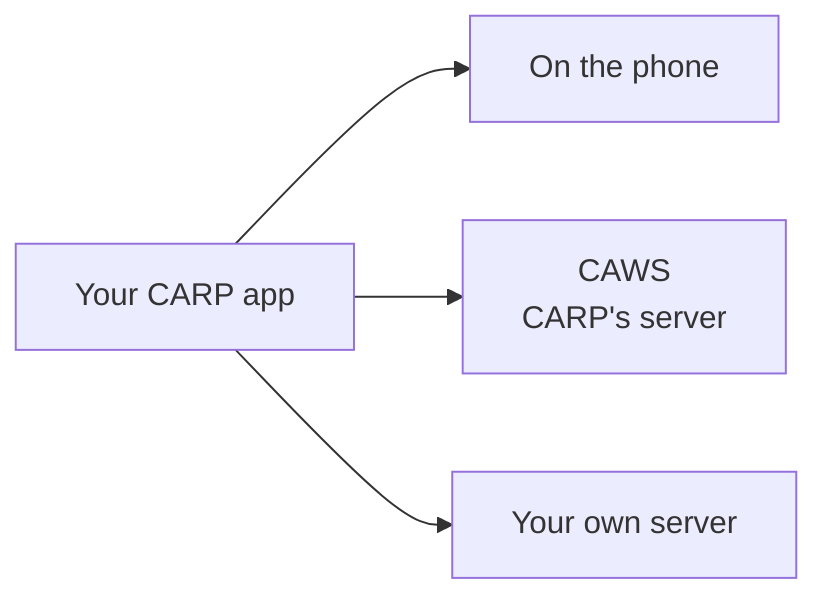

Every study must define where its measurements end up. CARP supports three options. You can start with one and switch later.

## Comparison

| | On the phone | CAWS | Your own server |
| --- | --- | --- | --- |
| **Use for** | Trying CARP, pilots, apps that never share data | Research studies with many participants | Organizations that already have a data platform |
| **Server** | None | CARP's, hosted for you or your own instance | Yours |
| **Study and participant management** | No | Yes, in the CARP web portal; participants join by email invitation or with a study code | You build it |
| **Setup** | None; this is the default | Request portal access ([Discord](https://discord.gg/sswpqGvnf5) or [support@carp.dk](mailto:support@carp.dk)), then add sign-in and a few lines of code | Depends on your server |
| **How researchers get the data** | Copy files off each phone | Download from the portal | Your own tools |

## Choose an option

<Cards>
<Card title="On-device storage" icon="Smartphone" href="/docs/data-storage/on-device">

For exploring CARP and building demos. This is what the quickstart app already does.

</Card>
<Card title="CARP Web Services" icon="Cloud" href="/docs/data-storage/caws">

For studies with participants. Study management, participant invitations and data download without building a server.

</Card>
<Card title="Custom backend" icon="Server" href="/docs/data-storage/custom-backend">

For organizations that already store data elsewhere, such as a hospital system or a company cloud.

</Card>
</Cards>

<Callout type="tip" title="Not sure which to pick?">

Start with on-device storage. Your measures and your app's screens can be reused when you move on. CAWS adds a sign-in step and moves the protocol to the server.

</Callout>
