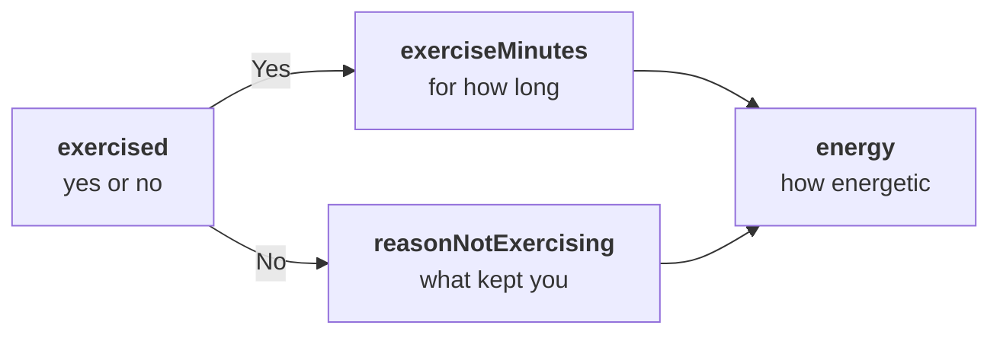

An [`RPNavigableOrderedTask`](https://pub.dev/documentation/research_package/latest/model/RPNavigableOrderedTask-class.html) shows its steps in list order, like an `RPOrderedTask`. A step can have a **navigation rule**: a rule that picks the next step when the participant leaves the step. Research Package has three rules:

| Rule | Next step | Reads the answer |
| --- | --- | --- |
| [`RPStepJumpRule`](#jump-to-a-step) | The step that the selected choice maps to | Yes |
| [`RPDirectStepNavigationRule`](#go-to-a-fixed-step) | Always the same step | No |
| [`RPStepReorganizerRule`](#keep-only-the-selected-steps) | The steps that the selected choices map to, in list order | Yes |

## Add navigation rules

This survey asks whether the participant exercised today, and asks a different follow-up question for each answer:

```dart
RPNavigableOrderedTask buildExerciseSurvey() {
  final exercised = RPQuestionStep(
    identifier: 'exercised',
    title: 'Did you exercise today?',
    answerFormat: RPChoiceAnswerFormat(
      answerStyle: RPChoiceAnswerStyle.SingleChoice,
      choices: [
        RPChoice(text: 'Yes', value: 1),
        RPChoice(text: 'No', value: 0),
      ],
    ),
  );
  final minutes = RPQuestionStep(
    identifier: 'exerciseMinutes',
    title: 'For how many minutes did you exercise?',
    answerFormat: RPIntegerAnswerFormat(
      minValue: 1,
      maxValue: 600,
      suffix: 'minutes',
    ),
  );
  final reason = RPQuestionStep(
    identifier: 'reasonNotExercising',
    title: 'What kept you from exercising?',
    answerFormat: RPTextAnswerFormat(hintText: 'For example, no time'),
  );
  final energy = RPQuestionStep(
    identifier: 'energy',
    title: 'How energetic do you feel right now?',
    answerFormat: RPSliderAnswerFormat(
      minValue: 0,
      maxValue: 10,
      divisions: 10,
    ),
  );
  final done = RPCompletionStep(
    identifier: 'done',
    title: 'Thank you',
    text: 'Your answers are saved.',
  );

  final task = RPNavigableOrderedTask(
    identifier: 'exerciseSurvey',
    steps: [exercised, minutes, reason, energy, done],
  );
  task.setNavigationRuleForTriggerStepIdentifier(
    RPStepJumpRule(answerMap: {0: 'reasonNotExercising'}),
    'exercised',
  );
  task.setNavigationRuleForTriggerStepIdentifier(
    RPDirectStepNavigationRule(destinationStepIdentifier: 'energy'),
    'exerciseMinutes',
  );
  return task;
}
```

`setNavigationRuleForTriggerStepIdentifier()` attaches a rule to its **trigger step**: the step, named by its identifier, after which the rule picks the next step. The task applies the rule when the participant leaves the trigger step with **NEXT** or by skipping it. A step without a rule continues with the next step in the list.

The example takes these paths:



The answer to `exercised` decides the path:

- **Yes:** the jump rule has no entry for `1`, so the task continues with `exerciseMinutes`. The direct rule of that step then skips `reasonNotExercising`.
- **No:** the jump rule maps `0` to `reasonNotExercising`, which skips `exerciseMinutes`.

Both paths continue with `energy` and end with `done`.

Each trigger step has one rule: a second rule for the same step replaces the first. `removeNavigationRuleForTriggerStepIdentifier()` removes the rule of a step.

## Jump to a step

[`RPStepJumpRule`](https://pub.dev/documentation/research_package/latest/model/RPStepJumpRule-class.html) jumps to the step that the answer to a choice question maps to:

| Parameter | Type | Required | Description |
| --- | --- | --- | --- |
| `answerMap` | `Map<int, String>` | Yes | Maps the `value` of a choice to the identifier of the step to jump to. |

The rule reads the value of the selected choice:

- In a multiple choice question, the choice that the participant selected first decides.
- A value without an entry continues with the next step in the list, so the map needs entries only for the answers that jump.
- An identifier that matches no step also continues with the next step in the list.
- After the jump, the task continues in list order from the new step.

A jump back to an earlier step repeats the steps in between. The result keeps only the last answer to each step.

## Go to a fixed step

[`RPDirectStepNavigationRule`](https://pub.dev/documentation/research_package/latest/model/RPDirectStepNavigationRule-class.html) always goes to the same step, forward or back:

| Parameter | Type | Required | Description |
| --- | --- | --- | --- |
| `destinationStepIdentifier` | `String` | Yes | The identifier of the step to go to. |

Use it to join two branches again, as the rule on `exerciseMinutes` does in the example. A destination that matches no step ends the task, as after the last step. A completion step at the end of the list then does not appear.

## Keep only the selected steps

[`RPStepReorganizerRule`](https://pub.dev/documentation/research_package/latest/model/RPStepReorganizerRule-class.html) keeps the follow-up steps of the choices that the participant selects and drops the others. It suits a multiple choice question with one follow-up step per choice:

| Parameter | Type | Required | Description |
| --- | --- | --- | --- |
| `reorderingMap` | `Map<int, String>` | Yes | Maps the `value` of each choice to the identifier of the step that the choice keeps. |

In this task, `exerciseFollowUp`, `workFollowUp` and `friendsFollowUp` are question steps with those identifiers, and `done` is a completion step:

```dart
final activities = RPQuestionStep(
  identifier: 'activities',
  title: 'What did you do today?',
  answerFormat: RPChoiceAnswerFormat(
    answerStyle: RPChoiceAnswerStyle.MultipleChoice,
    choices: [
      RPChoice(text: 'Exercise', value: 0),
      RPChoice(text: 'Work', value: 1),
      RPChoice(text: 'Meet friends', value: 2),
    ],
  ),
);

final task = RPNavigableOrderedTask(
  identifier: 'dayReview',
  steps: [activities, exerciseFollowUp, workFollowUp, friendsFollowUp, done],
);
task.setNavigationRuleForTriggerStepIdentifier(
  RPStepReorganizerRule(
    reorderingMap: {
      0: 'exerciseFollowUp',
      1: 'workFollowUp',
      2: 'friendsFollowUp',
    },
  ),
  'activities',
);
```

When the participant leaves the trigger step, the task rebuilds its list of steps from the steps it was created with. The new list holds:

1. every step up to and including the trigger step;
2. the later steps that the selected choices map to, in their order in the list;
3. the last step of the task, if it is a completion step.

When the participant selects **Exercise** and **Meet friends**, the task continues with `exerciseFollowUp`, `friendsFollowUp` and `done`. Despite its name, the rule does not change the order of the steps.

Map every choice of the trigger question: a selected choice without an entry keeps the participant on the trigger step. The rule replaces the `steps` of the task, so build a new task for each run.

## Back navigation

In a navigable task, the default bottom bar shows **BACK** from the second step on. Going back works like this:

- **BACK** follows the steps that the participant visited, not the order of the list.
- When the participant goes back to a trigger step and changes the answer, the rule applies again to the new answer. A reorganizer rule then rebuilds the list from the original steps.
- The task result keeps the answers to steps on a path that the participant left. See [Results by step type](/docs/flutter-plugins/research-package/results#results-by-step-type).

The top bar of a navigable task shows no position, such as "2 of 5", because branching changes the number of steps.

## Limitations

Navigation rules have these limits:

- Jump and reorganizer rules read the selected choices, so their trigger step must be a question step with an `RPChoiceAnswerFormat`. With another answer format, the participant cannot leave the trigger step.
- Keep the trigger question required. A skipped trigger question keeps the participant on the step, even when the participant chose an answer first. If the task has no answers yet, the rule may instead branch on the answer from an earlier run of the task.
- Put the deciding question in a question step of its own, not in a form step. A rule on a form step looks for a question with the identifier of the form itself. Without one, the participant cannot leave the form.
- The task supports only the three rule classes themselves. With any other rule class, including a subclass of one of the three, the participant cannot leave the trigger step.

## Navigation rules in JSON

In JSON, `stepNavigationRules` maps the identifier of each trigger step to its rule, and the keys of `answerMap` and `reorderingMap` are strings. The rules of the exercise survey look like this:

```json
{
  "stepNavigationRules": {
    "exercised": {
      "__type": "RPStepJumpRule",
      "answerMap": { "0": "reasonNotExercising" }
    },
    "exerciseMinutes": {
      "__type": "RPDirectStepNavigationRule",
      "destinationStepIdentifier": "energy"
    }
  }
}
```

An `RPNavigableOrderedTask` in JSON needs `stepNavigationRules`, also when it holds no rules: `{}`. For the rest of the format, see [JSON surveys](/docs/flutter-plugins/research-package/json).
