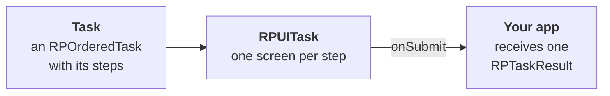

`research_package` shows surveys and informed consent flows in a Flutter app and returns the participant's answers as structured results. It is a Flutter implementation of Apple's [ResearchKit](https://www.researchandcare.org/researchkit/). You define a task as a list of steps, and the package shows one screen per step on Android and iOS.

The package is part of CARP and works in any Flutter app. In a [CARP Mobile Sensing](/docs/mobile-sensing) (CAMS) study, `carp_survey_package` turns these tasks into app tasks and stores their results as measurements. See [Survey Sampling Package](/docs/sampling-packages/survey).

<Chips>
<Chip href="https://pub.dev/packages/research_package" icon="Package" tone="primary">pub.dev</Chip>
<Chip href="https://pub.dev/documentation/research_package/latest/" icon="Description" tone="tertiary">API reference</Chip>
<Chip href="https://github.com/carp-dk/research.package" icon="Code" tone="success">GitHub</Chip>
</Chips>

<Callout type="info" title="Version 3.2.0 in CAMS apps">

These pages document `research_package` 4.0.0, while apps that also use `carp_survey_package` or `cognition_package` get 3.2.0, because both packages require version 3. Tasks, steps, answer formats and results have the same API in both versions, but the permission API differs. For the differences, see [Migrate to 4.0](/docs/flutter-plugins/research-package/migration).

</Callout>

## Features

<Cards>
<Card title="Surveys" icon="Quiz">

Build surveys from instruction, question, form, timer and completion steps, with seven answer formats.

</Card>
<Card title="Informed consent" icon="HowToReg">

Explain the study section by section, ask for permissions in context and collect a signature.

</Card>
<Card title="Branching" icon="AltRoute">

Skip questions, or keep only the steps that earlier answers select, with navigation rules.

</Card>
<Card title="Localization" icon="Translate">

The package's own texts come in seven languages, and every text in a task can be a translation key.

</Card>
<Card title="Results" icon="Dataset">

Each run returns one `RPTaskResult` with the answers and their timestamps, which serializes to JSON.

</Card>
<Card title="Activity steps" icon="Psychology">

Run interactive tests that log timings and gestures, such as the cognitive tests in `cognition_package`.

</Card>
</Cards>

## Requirements

| Component | Requirement |
| --- | --- |
| Dart SDK | 3.12 or later |
| Flutter | 3.44 or later |
| Android | API level 24 (Android 7.0) or later |
| iOS | 15.0 or later |

The Android and iOS minimums come from the `video_player` plugin, which plays videos in instruction steps. To ask for permissions in a consent flow, your app adds a plugin such as `permission_handler`, which brings its own requirements. See [Permissions](/docs/flutter-plugins/research-package/permissions).

## How it works



The flow has three stages:

1. Your app builds a task: an [`RPOrderedTask`](https://pub.dev/documentation/research_package/latest/model/RPOrderedTask-class.html) with a list of steps, in which each question step has an answer format.
2. [`RPUITask`](https://pub.dev/documentation/research_package/latest/ui/RPUITask-class.html) shows the steps one screen at a time and records a result for each step that collects an answer.
3. After the last step, `RPUITask` calls `onSubmit` with one [`RPTaskResult`](https://pub.dev/documentation/research_package/latest/model/RPTaskResult-class.html) and closes its route.

A task with one slider question, shown on a new route:

```dart
final task = RPOrderedTask(
  identifier: 'stressCheck',
  steps: [
    RPQuestionStep(
      identifier: 'stressNow',
      title: 'How stressed do you feel right now?',
      answerFormat: RPSliderAnswerFormat(
        minValue: 0,
        maxValue: 10,
        divisions: 10,
      ),
    ),
    RPCompletionStep(
      identifier: 'done',
      title: 'Thank you',
      text: 'Your answer is saved.',
    ),
  ],
);

Navigator.of(context).push(
  MaterialPageRoute<void>(
    builder: (_) => RPUITask(
      task: task,
      onSubmit: (RPTaskResult result) => print(jsonEncode(result)),
    ),
  ),
);
```

## Next steps

<Cards>
<Card title="Installation" href="/docs/flutter-plugins/research-package/installation" icon="Download">

Add the package, its localization delegates and its translation files.

</Card>
<Card title="Quickstart" href="/docs/flutter-plugins/research-package/quickstart" icon="Bolt">

Build a short survey and print the answers as JSON.

</Card>
<Card title="Tasks and steps" href="/docs/flutter-plugins/research-package/tasks-and-steps" icon="AccountTree">

Task classes and every step type, with their parameters.

</Card>
<Card title="Informed consent" href="/docs/flutter-plugins/research-package/informed-consent" icon="HowToReg">

Build a consent flow with sections, permissions and a signature.

</Card>
</Cards>
