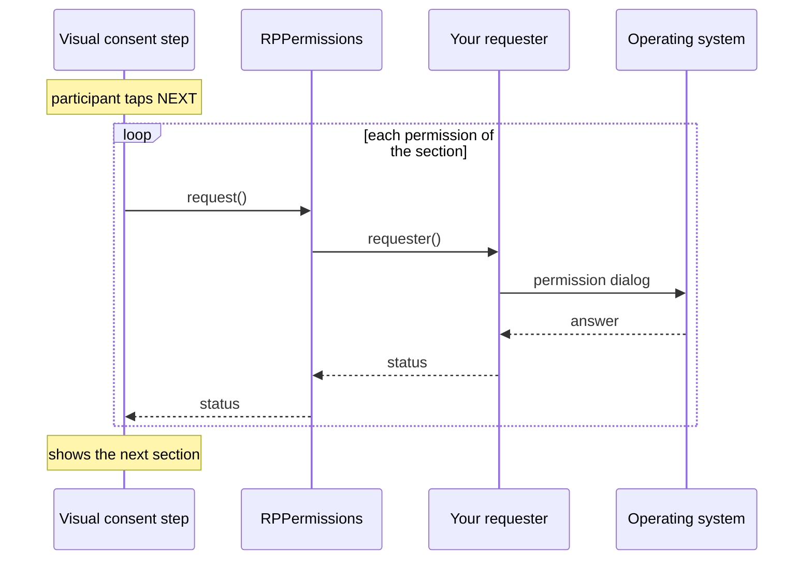

A consent section can explain why the study needs an operating system (OS) permission, such as location or microphone access. With `askPermission`, the visual consent step asks for the permission while the participant reads that explanation.

Research Package decides when to ask, and your app decides how. The app provides a **permission requester**: a function that asks the OS and returns the outcome.

Research Package 4.0.0 does not talk to the OS itself, so apps that ask for no permissions link no permission plugins. The `health` plugin, for example, links Apple HealthKit, and App Store review rejects apps that link HealthKit without using it.

<Callout type="info" title="Version 3.2.0 in CAMS apps">

CARP Mobile Sensing (CAMS) apps with `carp_survey_package` get `research_package` 3.2.0, which asks through `permission_handler` and `health` itself and takes no requester. In 3.2.0, `healthDataTypes` takes `HealthDataType` values. The sections, results and platform setup on this page apply to 3.2.0 too.

</Callout>

## How it works

With `askPermission: true`, the visual consent step asks for the permissions of a section when the participant taps **NEXT** on it:



The sequence has these stages:

1. The participant taps **NEXT** on a section that lists permissions.
2. For each permission of the section, in list order, the step calls [`RPPermissions.request`](https://pub.dev/documentation/research_package/latest/ui/RPPermissions/request.html), which calls your requester. A permission that the participant already granted in this step is not asked for again.
3. Your requester shows the OS dialog and returns an [`RPPermissionStatus`](https://pub.dev/documentation/research_package/latest/model/RPPermissionStatus.html).
4. The step records the status and shows the next section, also after a denial.
5. When the participant leaves the last section, the step adds an [`RPPermissionResult`](https://pub.dev/documentation/research_package/latest/model/RPPermissionResult-class.html) with every status to the task result.

**BACK** is hidden on a section until its permissions have been asked for, so the participant cannot leave the explanation without seeing the dialog. When the participant goes back and taps **NEXT** on the section again, the step asks again for every permission that is not granted.

## Declare the permissions

List the permissions in `permissions` on the section that explains them, and set `askPermission: true` on the visual consent step:

```dart
final locationSection = RPConsentSection(
  type: RPConsentSectionType.Location,
  summary: 'The app records where you are every 15 minutes.',
  content:
      'Your location shows how much time you spend at home, at work and '
      'outdoors. It stays on your phone until the study ends.',
  permissions: [RPPermissionType.location],
);

final consentSections = RPVisualConsentStep(
  identifier: 'consentSections',
  consentDocument: document,
  askPermission: true,
);
```

The section type sets only the title and the illustration, so a section asks for nothing without `permissions`. A section may list several permissions, which the step asks for one at a time. [`RPPermissionType`](https://pub.dev/documentation/research_package/latest/model/RPPermissionType.html) has these values:

| Permission type | Asks for | Section type |
| --- | --- | --- |
| `location` | Location while the app is in use | `Location` |
| `locationAlways` | Location also while the app is in the background | `Location` |
| `microphone` | The microphone | `Microphone` |
| `camera` | The camera | `Camera` |
| `notification` | Showing notifications | `Notification` |
| `activityRecognition` | The physical activity of the participant, such as walking or running | `ActivityRecognition` |
| `sensors` | Body sensors, such as heart rate, on Android, and motion data on iOS | — |
| `bluetooth` | Bluetooth, for example to connect to a wearable | `Bluetooth` |
| `ignoreBatteryOptimizations` | An exemption from battery optimization, so that sensing keeps running in the background (Android only) | `BackgroundSensing` |
| `health` | Read access to the health data types in `healthDataTypes` | `Health` or `HealthDataCollection` |

For the section types, see [Section types](/docs/flutter-plugins/research-package/informed-consent#section-types).

## Write a requester

A requester has the type [`RPPermissionRequester`](https://pub.dev/documentation/research_package/latest/ui/RPPermissionRequester.html): a function that takes an `RPPermissionType` and an optional named `healthDataTypes` list, and returns a `Future<RPPermissionStatus>`.

A requester built on the [`permission_handler`](https://pub.dev/packages/permission_handler) plugin covers every permission type except `health`. Add version 12 of the plugin:

```bash
flutter pub add "permission_handler:^12.0.0"
```

Version 13 of the plugin requires `compileSdk` 37 on Android, which is higher than the Flutter default.

Then add `lib/permissions.dart`, a requester based on the [`permissions.dart`](https://github.com/carp-dk/research.package/blob/master/example/lib/permissions.dart) of the example app. It reads no health data, so it does not link HealthKit:

```dart title="lib/permissions.dart"
import 'package:flutter/foundation.dart';
import 'package:permission_handler/permission_handler.dart' as ph;
import 'package:research_package/research_package.dart';

/// Asks the OS for a permission on behalf of Research Package
Future<RPPermissionStatus> requestPermission(
  RPPermissionType type, {
  List<String> healthDataTypes = const [],
}) async {
  switch (type) {
    case RPPermissionType.location:
      return statusOf(await ph.Permission.locationWhenInUse.request());
    case RPPermissionType.locationAlways:
      // Background location needs foreground location first, on both platforms
      final foreground = statusOf(
        await ph.Permission.locationWhenInUse.request(),
      );
      if (foreground != RPPermissionStatus.granted) return foreground;
      return statusOf(await ph.Permission.locationAlways.request());
    case RPPermissionType.microphone:
      return statusOf(await ph.Permission.microphone.request());
    case RPPermissionType.camera:
      return statusOf(await ph.Permission.camera.request());
    case RPPermissionType.notification:
      return statusOf(await ph.Permission.notification.request());
    case RPPermissionType.activityRecognition:
      // iOS has no such permission; the data comes from the motion sensors
      return statusOf(
        await (defaultTargetPlatform == TargetPlatform.iOS
                ? ph.Permission.sensors
                : ph.Permission.activityRecognition)
            .request(),
      );
    case RPPermissionType.sensors:
      return statusOf(await ph.Permission.sensors.request());
    case RPPermissionType.bluetooth:
      // Android asks for the two Nearby devices permissions in one dialog
      if (defaultTargetPlatform == TargetPlatform.android) {
        final statuses = await [
          ph.Permission.bluetoothScan,
          ph.Permission.bluetoothConnect,
        ].request();
        return statuses.values
            .map(statusOf)
            .firstWhere(
              (status) => status != RPPermissionStatus.granted,
              orElse: () => RPPermissionStatus.granted,
            );
      }
      return statusOf(await ph.Permission.bluetooth.request());
    case RPPermissionType.ignoreBatteryOptimizations:
      // iOS grants background execution through background modes instead
      if (defaultTargetPlatform != TargetPlatform.android) {
        return RPPermissionStatus.unsupported;
      }
      return statusOf(await ph.Permission.ignoreBatteryOptimizations.request());
    case RPPermissionType.health:
      // This app reads no health data
      return RPPermissionStatus.unsupported;
  }
}

/// Converts a permission_handler status to a Research Package status
RPPermissionStatus statusOf(ph.PermissionStatus status) => switch (status) {
  ph.PermissionStatus.granted ||
  ph.PermissionStatus.limited ||
  ph.PermissionStatus.provisional => RPPermissionStatus.granted,
  ph.PermissionStatus.denied => RPPermissionStatus.denied,
  ph.PermissionStatus.permanentlyDenied => RPPermissionStatus.permanentlyDenied,
  ph.PermissionStatus.restricted => RPPermissionStatus.restricted,
};
```

Most types map to one `permission_handler` permission. Four need more:

- **`locationAlways`:** asks for foreground location first, because both platforms grant background location only after it.
- **`bluetooth`:** asks on Android for `bluetoothScan` and `bluetoothConnect` in one dialog, and reports the first status that is not `granted`.
- **`activityRecognition`:** asks on iOS for the motion sensors, because iOS has no activity recognition permission.
- **`ignoreBatteryOptimizations`:** is `unsupported` on iOS. On Android, the system asks the participant to exempt the app from battery optimization.

The `limited` and `provisional` statuses of `permission_handler`, such as provisional notifications on iOS, count as `granted`.

## Register the requester

Pass the requester to [`ResearchPackage.ensureInitialized`](https://pub.dev/documentation/research_package/latest/research_package/ResearchPackage/ensureInitialized.html) at the start of `main()`:

```dart
import 'package:flutter/material.dart';
import 'package:research_package/research_package.dart';

import 'permissions.dart'; // [!code ++]

void main() {
  ResearchPackage.ensureInitialized(); // [!code --]
  ResearchPackage.ensureInitialized(permissionRequester: requestPermission); // [!code ++]
  runApp(const MyApp());
}
```

`RPPermissions.request()` passes each request to the requester, and handles two failures:

- Without a requester, every permission is recorded as `unsupported`, and no dialog appears. Only the console says why, with a message that ends in `cannot be requested, because no RPPermissions.requester has been set.`
- An exception in the requester is recorded as `unknown`, and the consent flow continues.

A later call of `ensureInitialized()` without a requester keeps the one set earlier. You can also set `RPPermissions.requester` directly.

Declare `healthDataTypes` as an optional named parameter with a default, `{List<String> healthDataTypes = const []}`. A requester with a `required` parameter does not match `RPPermissionRequester`, and the app does not compile.

## Ask for health data

Health data is not one permission: HealthKit and Google Health Connect grant access per data type. A section that lists the `health` permission names its data types in `healthDataTypes`, and the requester asks for them through the [`health`](https://pub.dev/packages/health) plugin:

<Steps>
<Step title="Add the health plugin">

```bash
flutter pub add "health:^13.0.0"
```

The plugin requires Android `minSdk` 26 or later and iOS 15.0 or later.

</Step>
<Step title="Configure Android and iOS for health data">

<Tabs items={['Android', 'iOS']} groupId="platform" persist>
<Tab value="Android">

Health Connect needs these changes:

- `minSdk` 26 or later in `android/app/build.gradle.kts`;
- a `MainActivity` that extends `FlutterFragmentActivity`;
- one read permission per data type, such as `android.permission.health.READ_STEPS`;
- the Health Connect package and its rationale intent under `<queries>`;
- the rationale intent filter on `MainActivity` and the `ViewPermissionUsageActivity` activity alias.

For the full setup, see [Installation](/docs/sampling-packages/health/installation#configure-android) in the Health Sampling section.

</Tab>
<Tab value="iOS">

Add the **HealthKit** capability to the `Runner` target, and the `NSHealthShareUsageDescription` and `NSHealthUpdateUsageDescription` keys to `ios/Runner/Info.plist`. Without the capability, the HealthKit sheet does not appear. See [iOS](/docs/flutter-plugins/health/platform-setup/ios) in the Health section.

</Tab>
</Tabs>

</Step>
<Step title="Ask for health data in the requester">

Add this function to `lib/permissions.dart`, and return `await requestHealthData(healthDataTypes)` in the `RPPermissionType.health` case:

```dart
import 'package:health/health.dart';

// ... the rest of lib/permissions.dart

/// Asks for read access to the health data types with these names
Future<RPPermissionStatus> requestHealthData(List<String> types) async {
  final health = Health();
  final healthTypes = types.map(HealthDataType.values.byName).toList();

  // Health Connect is a separate app below Android 14, and may be missing
  if (!await health.isHealthConnectAvailable()) {
    await health.installHealthConnect();
    return RPPermissionStatus.unsupported;
  }

  // Asking again when every type is granted can block, so check first
  if (await health.hasPermissions(healthTypes) ?? false) {
    return RPPermissionStatus.granted;
  }

  return await health.requestAuthorization(healthTypes)
      ? RPPermissionStatus.granted
      : RPPermissionStatus.denied;
}
```

</Step>
<Step title="List the data types on a section">

```dart
import 'package:health/health.dart';

final healthSection = RPConsentSection(
  type: RPConsentSectionType.HealthDataCollection,
  summary: 'The app reads these data from your health app:',
  dataTypes: [
    RPDataTypeSection(
      dataName: 'Steps',
      dataInformation: 'Your daily step count.',
    ),
    RPDataTypeSection(
      dataName: 'Sleep',
      dataInformation: 'When you fall asleep and wake up.',
    ),
  ],
  permissions: [RPPermissionType.health],
  healthDataTypes: [
    HealthDataType.STEPS.name,
    HealthDataType.SLEEP_ASLEEP.name,
  ],
);
```

Each entry is the name of a [`HealthDataType`](https://pub.dev/documentation/health/latest/health/HealthDataType.html), such as `'STEPS'`. A `health` permission without `healthDataTypes` asks for nothing and is recorded as `unsupported`.

</Step>
</Steps>

The requester asks for read access only. It records these outcomes:

- On Android, Health Connect reports the real outcome. When Health Connect is not available, the requester opens its page in the app store and records `unsupported`.
- On iOS, `granted` means only that the HealthKit sheet appeared. HealthKit does not tell an app whether the participant allowed read access, so check the data that arrives instead.

A misspelled data type name throws in the requester, and the permission is recorded as `unknown`.

## Configure Android and iOS

Each permission needs an entry on each platform. The requester on this page needs these entries:

| Permission type | Android manifest | iOS `Info.plist` key | CocoaPods macro |
| --- | --- | --- | --- |
| `location` | `ACCESS_FINE_LOCATION` or `ACCESS_COARSE_LOCATION` | `NSLocationWhenInUseUsageDescription` | `PERMISSION_LOCATION_WHENINUSE=1` |
| `locationAlways` | `ACCESS_FINE_LOCATION` and, on Android 10 or later, `ACCESS_BACKGROUND_LOCATION` | `NSLocationWhenInUseUsageDescription` and `NSLocationAlwaysAndWhenInUseUsageDescription` | `PERMISSION_LOCATION=1` |
| `microphone` | `RECORD_AUDIO` | `NSMicrophoneUsageDescription` | `PERMISSION_MICROPHONE=1` |
| `camera` | `CAMERA` | `NSCameraUsageDescription` | `PERMISSION_CAMERA=1` |
| `notification` | `POST_NOTIFICATIONS`, on Android 13 or later | None | `PERMISSION_NOTIFICATIONS=1` |
| `activityRecognition` | `ACTIVITY_RECOGNITION`, on Android 10 or later | `NSMotionUsageDescription` | `PERMISSION_SENSORS=1` |
| `sensors` | `BODY_SENSORS` | `NSMotionUsageDescription` | `PERMISSION_SENSORS=1` |
| `bluetooth` | `BLUETOOTH_SCAN` and `BLUETOOTH_CONNECT`; `BLUETOOTH` on Android 11 or earlier | `NSBluetoothAlwaysUsageDescription` | `PERMISSION_BLUETOOTH=1` |
| `ignoreBatteryOptimizations` | `REQUEST_IGNORE_BATTERY_OPTIMIZATIONS` | None | None |
| `health` | See [Ask for health data](#ask-for-health-data) | `NSHealthShareUsageDescription` and `NSHealthUpdateUsageDescription` | None |

### Android

Declare each permission in `android/app/src/main/AndroidManifest.xml`, above `<application>`. For the location section on this page:

```xml title="android/app/src/main/AndroidManifest.xml"
<manifest xmlns:android="http://schemas.android.com/apk/res/android">
    <uses-permission android:name="android.permission.ACCESS_FINE_LOCATION"/> <!-- [!code ++] -->
    <application
```

A permission that the manifest does not declare is recorded as `denied`, and no dialog appears. Below Android 13, `notification` shows no dialog either: its status says whether notifications are turned on for the app.

### iOS

Add a usage description for each permission to `ios/Runner/Info.plist`. iOS shows it in the permission dialog:

```xml title="ios/Runner/Info.plist"
<key>NSLocationWhenInUseUsageDescription</key>
<string>Your location shows how much time you spend at home, at work and outdoors.</string>
```

How `permission_handler` enables a permission depends on how the app links its plugins:

<Tabs items={['Swift Package Manager', 'CocoaPods']}>
<Tab value="Swift Package Manager">

The plugin enables each permission that has its usage description in `Info.plist`, and `notification` by default. Build with `flutter run` or `flutter build ios`. A build started from Xcode cannot find `Info.plist` and leaves out every permission except `notification`, so their requests are recorded as `permanentlyDenied`.

</Tab>
<Tab value="CocoaPods">

Enable each permission with its macro in the `post_install` block of `ios/Podfile`. A permission without its macro is recorded as `permanentlyDenied`, and no dialog appears:

```ruby title="ios/Podfile"
post_install do |installer|
  installer.pods_project.targets.each do |target|
    flutter_additional_ios_build_settings(target)
    target.build_configurations.each do |config| # [!code ++]
      config.build_settings['GCC_PREPROCESSOR_DEFINITIONS'] ||= [ # [!code ++]
        '$(inherited)', # [!code ++]
        'PERMISSION_LOCATION_WHENINUSE=1', # [!code ++]
      ] # [!code ++]
    end # [!code ++]
  end
end
```

</Tab>
</Tabs>

## Read the permission statuses

The visual consent step records its `RPPermissionResult` under its own identifier. Its `statuses` map holds one `RPPermissionStatus` for each permission that the step asked for:

```dart
void checkLocation(RPTaskResult result) {
  final permissions = result.getStepResultForIdentifier('consentSections');
  if (permissions is RPPermissionResult) {
    final location = permissions.statuses[RPPermissionType.location];
    print('Location: ${location?.name ?? 'not asked'}');
  }
}
```

A denial never blocks the consent flow, so read the statuses to know what the app may collect:

| Status | Meaning |
| --- | --- |
| `granted` | The participant granted the permission. For `health` on iOS, the HealthKit sheet appeared. |
| `denied` | The participant denied the permission, and the app may ask again. |
| `permanentlyDenied` | The OS shows no dialog for the permission any more. The participant must grant it in the system settings. |
| `restricted` | The OS does not allow the permission, for example because of parental controls. |
| `unsupported` | The permission does not exist on this platform, `health` has no data types, or no requester is set. |
| `unknown` | No status was available, for example because the requester threw an exception. |

The step adds the result only when it asked for at least one permission. The result is also in the partial result that `onCancel` receives after **DISAGREE**, because the visual consent step comes before the review step. In JSON, `statuses` uses the names of the values:

```json
{
  "__type": "RPPermissionResult",
  "identifier": "consentSections",
  "startDate": "2026-10-27T09:12:03.512894",
  "endDate": "2026-10-27T09:13:40.207731",
  "statuses": {
    "location": "granted",
    "microphone": "denied"
  }
}
```

`startDate` is when the visual consent step appeared, and `endDate` is when the participant left its last section.

## Ask outside a consent flow

`RPPermissions.request()` also works outside a consent flow, through the same requester. For example, to ask for notifications when the participant turns on reminders:

```dart
Future<bool> enableReminders() async {
  final status = await RPPermissions.request(RPPermissionType.notification);
  return status == RPPermissionStatus.granted;
}
```

For `health`, pass the data types as well: `RPPermissions.request(RPPermissionType.health, healthDataTypes: ['STEPS'])`. The call never throws.

## Troubleshooting

<Accordions>
<Accordion title="No permission dialog appears">

Pass the requester to `ResearchPackage.ensureInitialized()`: without a requester, every status is `unsupported`. Also check that the visual consent step has `askPermission: true` and that the section lists the permission in `permissions`. See [Register the requester](#register-the-requester).

</Accordion>
<Accordion title="Every permission is denied on Android">

Declare the permission in `android/app/src/main/AndroidManifest.xml`. An undeclared permission is recorded as `denied` without a dialog.

</Accordion>
<Accordion title="A permission is permanently denied on iOS without a dialog">

With CocoaPods, enable the macro of the permission in `ios/Podfile`, as in the [Podfile example](#ios). With Swift Package Manager, add the usage description to `Info.plist`, then delete `~/Library/Developer/Xcode/DerivedData`, so that the plugin reads the file again.

</Accordion>
<Accordion title="Permissions are permanently denied in builds from Xcode">

Build with `flutter run` or `flutter build ios`. With Swift Package Manager, `permission_handler` finds `Info.plist` only in builds started from the project folder. To build from Xcode, run these commands in the project folder, then restart Xcode:

```bash
launchctl setenv PERMISSION_HANDLER_INFO_PLIST "$PWD/ios/Runner/Info.plist"
rm -rf ~/Library/Developer/Xcode/DerivedData
```

</Accordion>
<Accordion title="Health data access is unsupported">

Add `healthDataTypes` to the section that lists `health`. On Android, also check that Health Connect is installed: when it is missing, the requester opens its store page and records `unsupported`. After installing it, the participant can go back to the section and tap **NEXT** to be asked again.

</Accordion>
</Accordions>
