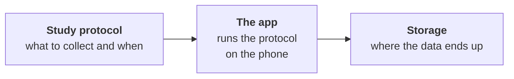

CARP (Copenhagen Research Platform) is a free, open-source toolkit for building mobile apps that collect data for research and health studies. CARP apps are Flutter apps: you add CARP packages from pub.dev, describe what to collect and when in a study protocol, and CARP Mobile Sensing runs that protocol on the phone and stores or uploads the measurements.

## Data sources

<Cards>
<Card title="Phone sensors" icon="Smartphone" href="/docs/mobile-sensing/measure-types">

Steps, location, activity (walking, running, still), screen on/off (Android only), battery, light and noise.

</Card>
<Card title="Wearables" icon="Heart" href="/docs/api-reference#wearables">

Heart rate and more from devices such as Apple Watch, Polar and Movesense.

</Card>
<Card title="Surveys" icon="Forum" href="/docs/mobile-sensing/app-task-model">

Surveys and questionnaires the participant fills in, and short cognitive tests.

</Card>
<Card title="Health apps" icon="Book" href="/docs/flutter-plugins/health">

Data already stored in Apple Health or Google Health Connect.

</Card>
</Cards>

## How CARP works

1. **The study protocol** defines what to collect, from which device, and when. For example: collect steps and screen events continuously, or show a survey every morning at 8:00.
2. **The app** runs on the participant's phone and executes the protocol. The CARP framework that does this is **CARP Mobile Sensing (CAMS)**.
3. **Storage** is where the data goes: kept on the phone, uploaded to CARP's own server (**CAWS**), or sent to a server you already run. See [Storing data](/docs/data-storage).

## Components

| Component | Packages | Role |
| --- | --- | --- |
| **carp_core** | `carp_core` | Platform-independent domain model. |
| **CARP Mobile Sensing (CAMS)** | `carp_mobile_sensing` | Client framework that runs studies on the phone and collects the data. |
| **Sampling packages** | For example `carp_context_package`, `carp_polar_package` | Pluggable packages that add new kinds of data and devices to CAMS. |
| **CARP Web Services (CAWS)** | `carp_webservices`, `carp_backend` | Backend that deploys studies and stores data. The packages connect a CAMS app to CAWS. |
| **CARP web portal** | None | Web portal where researchers set up studies on CAWS, invite participants and download data. |

See [Architecture](/docs/architecture) for how the components interact, and the [API reference](/docs/api-reference) for every package.

## Next steps

<Cards>
<Card title="Quickstart" icon="Bolt" href="/docs/quickstart">

Build a Flutter app that collects steps, battery and app lifecycle data.

</Card>
<Card title="Terminology" icon="School" href="/docs/concepts">

Protocols, measures, triggers, tasks, deployments and data endpoints.

</Card>
<Card title="Architecture" icon="Hub" href="/docs/architecture">

How the CARP components fit together, from study protocol to data upload.

</Card>
<Card title="Storing data" icon="Database" href="/docs/data-storage">

Keep data on the phone, upload it to CAWS, or send it to your own server.

</Card>
</Cards>
