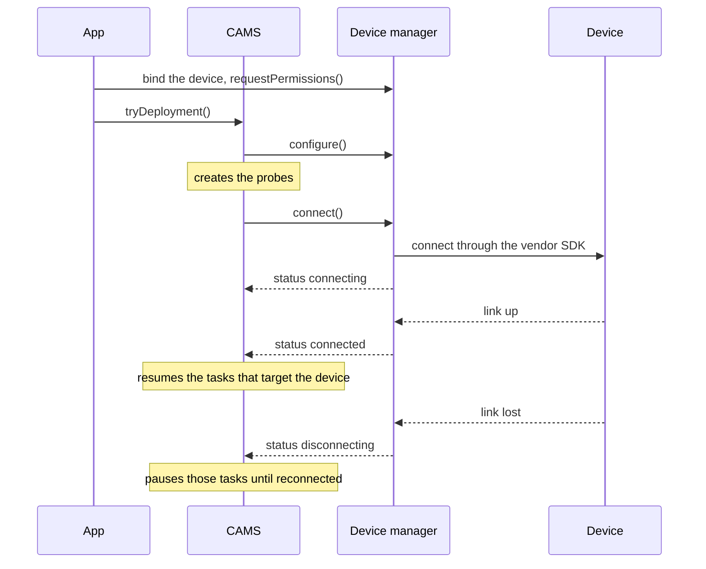

Some measures run outside the phone: on a Bluetooth Low Energy (BLE) wearable or on an online service, such as a web API. A sampling package for such measures defines the device for the study protocol.

The package also provides a **device manager**: the object that CARP Mobile Sensing (CAMS) uses to configure, connect and monitor the device. The package's probes read their data through the device manager.

The barometer example needs none of this: its measures run on the phone, and [`SmartphoneSamplingPackage`](https://pub.dev/documentation/carp_mobile_sensing/latest/domain/SmartphoneSamplingPackage-class.html) supplies the phone's device manager. To continue with a package whose measures run on the phone, see [Privacy and data formats](/docs/mobile-sensing/building-sampling-packages/privacy-and-formats).

The examples on this page are two small packages of their own. The pollen web service is built like [`WeatherService`](https://pub.dev/documentation/carp_context_package/latest/carp_context_package/WeatherService-class.html) in the [context package](https://github.com/carp-dk/carp.sensing-flutter/tree/main/packages/carp_context_package), and the BLE thermometer like the devices of the [Polar package](https://github.com/carp-dk/carp.sensing-flutter/tree/main/packages/carp_polar_package). Both use the namespace `com.example`; use a namespace that you control.

## Choose the base classes

Each kind of device has its own base classes in CAMS:

| Device | Configuration | Registration | Device manager | Example |
| --- | --- | --- | --- | --- |
| Online service, or a service on the phone | [`ServiceConfiguration`](https://pub.dev/documentation/carp_mobile_sensing/latest/domain/ServiceConfiguration-class.html) | [`ServiceRegistration`](https://pub.dev/documentation/carp_mobile_sensing/latest/domain/ServiceRegistration-class.html) | [`ServiceManager`](https://pub.dev/documentation/carp_mobile_sensing/latest/runtime/ServiceManager-class.html) | `WeatherService` in the context package, [`HealthService`](https://pub.dev/documentation/carp_health_package/latest/health_package/HealthService-class.html) in the [health package](https://github.com/carp-dk/carp.sensing-flutter/tree/main/packages/carp_health_package) |
| BLE device | [`BLEDevice`](https://pub.dev/documentation/carp_mobile_sensing/latest/domain/BLEDevice-class.html) | [`BLEDeviceRegistration`](https://pub.dev/documentation/carp_mobile_sensing/latest/domain/BLEDeviceRegistration-class.html) or a subclass | [`BLEDeviceManager`](https://pub.dev/documentation/carp_mobile_sensing/latest/runtime/BLEDeviceManager-class.html) | [`PolarDevice`](https://pub.dev/documentation/carp_polar_package/latest/carp_polar_package/PolarDevice-class.html) in the Polar package, [`ESenseDevice`](https://pub.dev/documentation/carp_esense_package/latest/esense/ESenseDevice-class.html) in the [eSense package](https://github.com/carp-dk/carp.sensing-flutter/tree/main/packages/carp_esense_package) |
| Other hardware with a battery | [`CamsDevice`](https://pub.dev/documentation/carp_mobile_sensing/latest/domain/CamsDevice-class.html) | [`HardwareDeviceRegistration`](https://pub.dev/documentation/carp_mobile_sensing/latest/domain/HardwareDeviceRegistration-class.html) or a subclass | [`HardwareDeviceManager`](https://pub.dev/documentation/carp_mobile_sensing/latest/runtime/HardwareDeviceManager-class.html) | None in the CARP packages |
| The phone's own sensors | None | None | None: extend `SmartphoneSamplingPackage` | The barometer example |

<Callout type="info" title="Class names in CAMS 1.x">

CAMS 1.x called these classes `OnlineService`, `OnlineServiceManager` and `BTLEDeviceManager`. CAMS 2.x has none of them: use `ServiceConfiguration`, `ServiceManager` and `BLEDeviceManager`.

</Callout>

## Define the device configuration

A **device configuration** describes a device's role in a study protocol: its type, its role name and its settings. The pollen service's configuration holds the key for the service's API:

```dart
/// A pollen web service, added to a protocol as a connected device
@JsonSerializable(includeIfNull: false, explicitToJson: true)
class PollenService extends ServiceConfiguration<ServiceRegistration> { // [!code highlight]
  /// The device type, which must equal the JSON type of this class
  static const String DEVICE_TYPE = // [!code highlight]
      '${CamsDevice.CAMS_DEVICE_NAMESPACE}.PollenService'; // [!code highlight]

  /// The default name of the service's role in a protocol
  static const String DEFAULT_ROLE_NAME = 'Pollen Service';

  /// The key for the service's API
  String apiKey;

  PollenService({
    super.roleName = PollenService.DEFAULT_ROLE_NAME, // [!code highlight]
    required this.apiKey,
  });

  @override
  Function get fromJsonFunction => _$PollenServiceFromJson;
  factory PollenService.fromJson(Map<String, dynamic> json) =>
      FromJsonFactory().fromJson<PollenService>(json);
  @override
  Map<String, dynamic> toJson() => _$PollenServiceToJson(this);
}
```

- **Device type:** `CamsDevice` builds the JSON type from the class name, here `dk.carp.cams.devices.PollenService`. CAMS finds the device manager for a device in the protocol by this string. A `DEVICE_TYPE` that differs from it makes CAMS skip the device, with the warning "A device of type 'dk.carp.cams.devices.PollenService' is not available on this device".
- **Class name:** keep it stable and distinctive. Saved protocols and deployments refer to the type, so renaming the class breaks them. CAMS also keeps only the first device manager registered for a type.
- **Role name:** names the device in a protocol and must be unique there. CAMS stores the device's registration under it.
- **Default values:** qualify them with the class name, as in `PollenService.DEFAULT_ROLE_NAME`. `json_serializable` copies a default into the generated code, where an unqualified name does not compile.
- **Settings:** put them in fields that the device manager or the probes read, such as `apiKey`. CAMS ignores the `defaultSamplingConfiguration` of a connected device: probes look only at the primary device's, so set a measure's configuration on the measure itself.

<Callout type="warning" title="Settings are stored in plain text">

The configuration's JSON holds every field in plain text, API keys included. CAMS saves it with the protocol and the deployment on the phone, and CARP Web Services (CAWS) keeps the protocols that are uploaded to it. Use a key that is restricted to the study and that you can revoke.

</Callout>

## Write the device manager

The device manager configures and connects the device on the phone. `ServiceManager` and `HardwareDeviceManager` extend [`DeviceManager`](https://pub.dev/documentation/carp_mobile_sensing/latest/runtime/DeviceManager-class.html), and `BLEDeviceManager` extends `HardwareDeviceManager`, which adds the battery level. Extend `ServiceManager` for a service and `BLEDeviceManager` for a BLE device, and implement these members:

| Member | `ServiceManager` | `BLEDeviceManager` | When CAMS uses it |
| --- | --- | --- | --- |
| `displayName` | Implement | Implemented as `bleName ?? bleAddress` | Apps show it, and `createRegistration()` can use it. |
| `canConnect` | Implement | Implement | CAMS connects the device when it deploys or restores the study, only if this is `true`. |
| `onConfigure()` | Implement | Implemented; call `super` if you override it | Runs once, synchronously, when CAMS configures the manager. Keep it light. |
| `createRegistration()` | Implement | Implement | CAMS calls it about 5 seconds after each change to `connected` and stores the result in the deployment. |
| `onHasPermissions()` | Optional, default `true` | Implemented; call `super` if you override it | `connect()` checks it first and sets `disconnected` when it is `false`. |
| `onRequestPermissions()` | Implement | Implemented; call `super` if you override it | Runs when the app calls `requestPermissions()`. CAMS never calls it. |
| `onConnect()` | Implement | Implement | `connect()` sets the status that it returns. |
| `onDisconnect()` | Implement | Implement | Runs when the app calls `disconnect()`, after CAMS has paused the device's tasks. |
| `batteryLevel` | None | Implement | Read only by your `createRegistration()`. |

Do not override `configure()`, `connect()`, `disconnect()`, `hasPermissions()`, `requestPermissions()` or `pair()`. They are marked `@nonVirtual`, and CAMS relies on what they do around your callbacks.

The pollen service's manager creates the API client from the configuration:

```dart
/// The device manager of a [PollenService]
class PollenServiceManager
    extends ServiceManager<PollenService, ServiceRegistration> {
  PollenClient? _client;

  PollenServiceManager() : super(PollenService.DEVICE_TYPE);

  /// The client of the service's API, or null until CAMS has configured this
  /// manager with a [PollenService] that has an API key
  PollenClient? get client {
    final apiKey = configuration?.apiKey;
    if (apiKey == null || apiKey.isEmpty) return null;
    return _client ??= PollenClient(apiKey);
  }

  @override
  String? get displayName => 'Pollen Service';

  @override
  bool get canConnect => client != null; // [!code highlight]

  @override
  void onConfigure() {}

  @override
  ServiceRegistration createRegistration() => ServiceRegistration(
    deviceDisplayName: displayName,
    isConnected: isConnected,
  );

  @override
  Future<void> onRequestPermissions() async {}

  @override
  Future<DeviceStatus> onConnect() async => // [!code highlight]
      client != null ? DeviceStatus.connected : DeviceStatus.disconnected; // [!code highlight]

  @override
  Future<bool> onDisconnect() async => true;
}
```

`PollenClient` stands for the client of your service's API. The manager reports `connected` as soon as the client exists, and the probe handles network failures per request.

CAMS connects devices when it deploys the study and at each app start. It also connects a device when a task that targets another device, such as the phone, starts one of its measures. A service that reports `disconnected` stays disconnected until one of these happens, unless the app calls `connect()`.

## Read the device in a probe

A probe reaches its device through its `deviceManager`, which the registry sets to the package's manager. Narrow its type with a getter, and collect the data through it. The pollen package has one data class and one probe:

```dart
/// The pollen index that the service reports, from 0 (none) to 5 (very high)
@JsonSerializable(includeIfNull: false, explicitToJson: true)
class PollenIndex extends Data {
  int index;

  PollenIndex({required this.index}) : super();

  @override
  String get jsonType => PollenSamplingPackage.POLLEN_INDEX; // [!code highlight]

  @override
  Function get fromJsonFunction => _$PollenIndexFromJson;
  factory PollenIndex.fromJson(Map<String, dynamic> json) =>
      FromJsonFactory().fromJson<PollenIndex>(json);
  @override
  Map<String, dynamic> toJson() => _$PollenIndexToJson(this);
}

/// Collects one [PollenIndex] each time its task is triggered
class PollenProbe extends MeasurementProbe {
  @override
  PollenServiceManager get deviceManager => // [!code highlight]
      super.deviceManager as PollenServiceManager; // [!code highlight]

  @override
  Future<Measurement?> getMeasurement() async {
    final client = deviceManager.client;
    if (client == null) {
      return Measurement.fromData(
        Error(message: '$runtimeType - No PollenService in the protocol'),
      );
    }
    try {
      return Measurement.fromData(
        PollenIndex(index: await client.fetchIndex()),
      );
    } catch (error) {
      return Measurement.fromData(
        Error(message: '$runtimeType - Cannot read the pollen index: $error'),
      );
    }
  }
}
```

A [`MeasurementProbe`](https://pub.dev/documentation/carp_mobile_sensing/latest/runtime/MeasurementProbe-class.html) fits a service that answers one request each time the task runs. The probe returns an [`Error`](https://pub.dev/documentation/carp_core/latest/common/Error-class.html) measurement instead of throwing.

After an exception, a `MeasurementProbe` does not pause itself, and its task then ignores every second trigger. The probe also reports a missing `PollenService`: every probe gets its package's manager, also when the protocol has no such device.

CAMS creates and initializes the probes before it connects the devices, so a probe sees its device in different states:

| Point | Device | `deviceManager` of the probe |
| --- | --- | --- |
| `create()` in the package | Configured, not connected | Not set |
| Probe constructor and field initializers | Configured, not connected | Not set: reading it throws a `LateInitializationError` |
| `onInitialize()` | Configured, not connected | Set |
| `onResume()` and the `stream` getter | Usually connected, because CAMS resumes a device's tasks when it connects; the link may drop in between | Set |

- **Create a probe for every measure type:** CAMS skips a measure whose `create()` returns `null`, and it calls `create()` before the device connects. `carp_movesense_package` creates its temperature probe only when it already knows the sensor model, which it learns after connecting, so the measure collects nothing.
- **Keep `onInitialize()` free of device calls:** a probe whose `onInitialize()` returns `false` stays `Created` and ignores every later resume. The activity and heart rate probes of `carp_movisens_package` return `false` while the sensor's Bluetooth service is missing, which it is until the sensor connects.
- **Check the device when the probe resumes:** in `onResume()`, or in the `stream` getter of a [`StreamProbe`](https://pub.dev/documentation/carp_mobile_sensing/latest/runtime/StreamProbe-class.html), which CAMS reads when the probe resumes. The thermometer's probe under [Write a BLE device manager](#write-a-ble-device-manager) does this.

## Expose the device in the package

The package tells CAMS which device its measures run on and gives CAMS the device manager. Implement [`SamplingPackage`](https://pub.dev/documentation/carp_mobile_sensing/latest/domain/SamplingPackage-class.html) directly, as the BLE packages do:

```dart
/// The sampling package of the pollen service
class PollenSamplingPackage implements SamplingPackage {
  static const String NAMESPACE = 'com.example';
  static const String POLLEN_INDEX = '$NAMESPACE.pollenindex';

  final PollenServiceManager _deviceManager = PollenServiceManager(); // [!code highlight]

  @override
  String get deviceType => PollenService.DEVICE_TYPE; // [!code highlight]

  @override
  PollenServiceManager get deviceManager => _deviceManager; // [!code highlight]

  @override
  DataTypeSamplingSchemeMap get samplingSchemes =>
      DataTypeSamplingSchemeMap.from([
        DataTypeSamplingScheme(
          CamsDataTypeMetaData(
            type: POLLEN_INDEX,
            displayName: 'Pollen Index',
            timeType: DataTimeType.POINT,
            dataEventType: DataEventType.ONE_TIME,
          ),
        ),
      ]);

  @override
  List<DataTypeMetaData> get dataTypes => samplingSchemes.dataTypes;

  @override
  Probe? create(String type) => switch (type) {
    POLLEN_INDEX => PollenProbe(),
    _ => null,
  };

  @override
  void onRegister() {
    // Register the classes that CAMS deserializes from JSON
    FromJsonFactory().registerAll([
      PollenService(apiKey: ''), // [!code highlight]
      PollenIndex(index: 0),
    ]);
  }
}
```

- `deviceType` returns `DEVICE_TYPE`. `register()` registers the manager under it in the [`DeviceController`](https://pub.dev/documentation/carp_mobile_sensing/latest/runtime/DeviceController-class.html), and CAMS matches it with the type of the device in the protocol.
- `deviceManager` returns the same instance every time, kept in a `final` field. `register()` gives that instance to the device controller, where CAMS configures and connects it. The registry gives the getter's result to every probe it creates. A getter that builds a new manager gives the probes a manager that CAMS never configures or connects.
- `onRegister()` registers the device configuration and the data class for JSON, because CAMS decodes them when it restores a saved study. For what else it registers, see [Sampling package class](/docs/mobile-sensing/building-sampling-packages/sampling-package-class).
- [`CamsDataTypeMetaData`](https://pub.dev/documentation/carp_mobile_sensing/latest/domain/CamsDataTypeMetaData-class.html) lists only the measure's own runtime permissions. The permissions to reach a device, such as Bluetooth, belong to the device manager.

A package supports one device type. For several types, register one package per device type. The context package does this from its `onRegister()` for its location, weather and air quality services.

Packages that share a device type must share one manager instance, because the device controller keeps the first manager registered for a type.

## Add the device to a protocol

App developers add the service to a protocol as a connected device of the phone and target the measure's task at the service. Show this in your package's README:

```dart
final phone = Smartphone();
final pollenService = PollenService(apiKey: 'your-api-key');
protocol
  ..addPrimaryDevice(phone)
  ..addConnectedDevice(pollenService, phone); // [!code highlight]

// Read the pollen index every 3 hours
protocol.addTaskControl(
  PeriodicTrigger(period: const Duration(hours: 3)),
  BackgroundTask(
    measures: [Measure(type: PollenSamplingPackage.POLLEN_INDEX)],
  ),
  pollenService, // [!code highlight]
);
```

CAMS resumes a task only while its target device is connected, and resumes it when the device connects. In a task that targets the phone, a device's stream probe can start before the device connects, find no stream and miss the connection. `POLLEN_INDEX` is a one-time measure, so it needs a trigger that repeats it: its probe collects once each time the task runs.

## Report the connection status

CAMS drives sampling on a device by the manager's `status`, a [`DeviceStatus`](https://pub.dev/documentation/carp_mobile_sensing/latest/runtime/DeviceStatus.html). Set it as the connection changes:

| Status | Set by | What CAMS does |
| --- | --- | --- |
| `unknown` | The constructor | Nothing. `connect()` refuses an unconfigured manager. |
| `configured` | `configure()` | Nothing. |
| `paired` | `pair()` of a BLE manager | Nothing. It counts as configured. |
| `connecting` | `connect()`, before it calls `onConnect()` | Nothing. `connect()` returns at once while connecting. |
| `connected` | `onConnect()` or your listener | Resumes every task that targets the device, and registers the device about 5 seconds later. |
| `reconnected` | Your listener, when a lost link is back | Resumes, 15 seconds later, the tasks that `disconnecting` paused. |
| `disconnecting` | Your listener, when the link is lost | Pauses the device's tasks, marks the running ones to be resumed and sets `disconnected`. |
| `disconnected` | `connect()` on missing permissions or an exception, and `disconnect()` | Nothing. |

The status setter emits only on a change, so setting `connected` a second time resumes nothing. A BLE connection runs like this:



1. The app binds the device to the manager and asks for the device's permissions.
2. When the study is deployed, CAMS configures the manager, creates the probes and calls `connect()`.
3. `onConnect()` starts the connection through the vendor's SDK and returns `connecting`.
4. When the link is up, the manager sets `connected`, and CAMS resumes the tasks that target the device.
5. When the link is lost, the manager sets `disconnecting`, and CAMS pauses those tasks until the manager sets `reconnected`.

Five rules follow from this:

- **Return the real status from `onConnect()`:** when a listener sets the status later, return `status`, not a constant. `connect()` sets the returned value, which overwrites what the listener set. `carp_movisens_package` returns `connecting` even on success, and when it has to scan for the sensor, as on iOS, nothing sets `connected` later. CAMS then never starts its tasks.
- **Map a lost link to `disconnecting` and its return to `reconnected`:** only `disconnecting` pauses the tasks so that `reconnected` resumes them. `carp_esense_package` and `carp_movesense_package` set `disconnected` instead, which pauses nothing.
- **Set `connected` only when the probes have what they need:** `carp_polar_package` sets `connected` when its first data type arrives, usually heart rate. Its other probes then start before their data types are available, and find none.
- **Time out the SDK's connect call:** `connect()` does nothing while the status is `connecting`, so a call that never completes blocks the device until a restart. On iOS, `carp_esense_package` stays `connecting` for about 83 minutes when the earbuds are missing. A timeout makes `connect()` set `disconnected`, so that a later `connect()` can try again.
- **Cancel the old listeners in `onConnect()`:** CAMS and apps call `connect()` again after a failed attempt. `carp_polar_package` and `carp_esense_package` add new listeners at every connection, so each event is handled more than once.

## Write a BLE device manager

A BLE package follows the same pattern with a `BLEDevice`, a registration class for the details it stores and a `BLEDeviceManager`. The thermometer's device class and registration class:

```dart
/// A BLE thermometer, added to a protocol as a connected device
@JsonSerializable(includeIfNull: false, explicitToJson: true)
class ThermoDevice extends BLEDevice<ThermoDeviceRegistration> { // [!code highlight]
  static const String DEVICE_TYPE =
      '${CamsDevice.CAMS_DEVICE_NAMESPACE}.ThermoDevice';
  static const String DEFAULT_ROLE_NAME = 'Thermometer';

  ThermoDevice({
    super.roleName = ThermoDevice.DEFAULT_ROLE_NAME,
    super.namePrefix = 'Thermo',
  });

  @override
  Function get fromJsonFunction => _$ThermoDeviceFromJson;
  factory ThermoDevice.fromJson(Map<String, dynamic> json) =>
      FromJsonFactory().fromJson<ThermoDevice>(json);
  @override
  Map<String, dynamic> toJson() => _$ThermoDeviceToJson(this);
}

/// The registration of a [ThermoDevice], with its firmware version
@JsonSerializable(includeIfNull: false, explicitToJson: true)
class ThermoDeviceRegistration extends BLEDeviceRegistration { // [!code highlight]
  String? firmwareVersion; // [!code highlight]

  ThermoDeviceRegistration({
    super.deviceDisplayName,
    super.registrationCreatedOn,
    super.isConnected,
    super.batteryChargingState,
    super.hardwareName,
    required super.bleAddress,
    super.bleName,
    this.firmwareVersion,
  });

  @override
  Function get fromJsonFunction => _$ThermoDeviceRegistrationFromJson;
  factory ThermoDeviceRegistration.fromJson(Map<String, dynamic> json) =>
      FromJsonFactory().fromJson<ThermoDeviceRegistration>(json);
  @override
  Map<String, dynamic> toJson() => _$ThermoDeviceRegistrationToJson(this);
}
```

`ThermoDevice` adds no fields, but the package needs the class anyway, because its name is the device type. CAMS does not use the scan settings of a `BLEDevice`, such as `namePrefix`: they are hints for the app's own scanner.

The manager connects through the vendor's SDK. `ThermoSdk` stands for that SDK: it connects to an address, reports the link on `linkEvents` and streams temperatures and battery levels.

```dart
/// The device manager of a [ThermoDevice]
class ThermoDeviceManager
    extends BLEDeviceManager<ThermoDevice, ThermoDeviceRegistration> {
  final ThermoSdk _sdk = ThermoSdk();
  final List<StreamSubscription<dynamic>> _subscriptions = [];
  bool _hasConnected = false;
  int? _batteryLevel;

  ThermoDeviceManager() : super(ThermoDevice.DEVICE_TYPE);

  /// Temperatures in degrees Celsius from the connected thermometer
  Stream<double> get temperatures => _sdk.temperatures;

  @override
  int? get batteryLevel => _batteryLevel;

  @override
  bool get canConnect => bleAddress != null;

  @override
  ThermoDeviceRegistration createRegistration() => ThermoDeviceRegistration(
    bleAddress: bleAddress ?? 'unknown',
    bleName: bleName,
    isConnected: isConnected,
    batteryChargingState: switch (batteryLevel) {
      final int level => HardwareDeviceRegistration.parseBatteryLevel(level),
      null => BatteryChargingState.unknown,
    },
    firmwareVersion: _sdk.firmwareVersion,
  );

  @override
  Future<DeviceStatus> onConnect() async {
    final address = bleAddress;
    if (address == null) return DeviceStatus.disconnected;

    // connect() can run more than once, so drop the old listeners first
    await _cancelSubscriptions(); // [!code highlight]
    _subscriptions
      ..add(_sdk.linkEvents.listen(_onLinkChanged))
      ..add(_sdk.batteryLevels.listen((level) => _batteryLevel = level));

    // A call that never completes would keep the status at connecting
    await _sdk.connect(address).timeout(const Duration(seconds: 30)); // [!code highlight]

    // The listener sets the status, and a constant here would overwrite it
    return status; // [!code highlight]
  }

  void _onLinkChanged(bool isUp) {
    if (isUp) {
      status = _hasConnected
          ? DeviceStatus.reconnected // [!code highlight]
          : DeviceStatus.connected; // [!code highlight]
      _hasConnected = true;
    } else {
      status = DeviceStatus.disconnecting; // [!code highlight]
    }
  }

  @override
  Future<bool> onDisconnect() async {
    await _cancelSubscriptions();
    await _sdk.disconnect();
    _hasConnected = false;
    return true;
  }

  Future<void> _cancelSubscriptions() async {
    for (final subscription in _subscriptions) {
      await subscription.cancel();
    }
    _subscriptions.clear();
  }
}
```

- `BLEDeviceManager` implements `onConfigure()`, `onHasPermissions()` and `onRequestPermissions()`. If you override them, call `super`: `onConfigure()` restores `bleAddress` and `bleName` from a stored registration, and the permission methods cover Bluetooth and, on Android, location.
- `canConnect` stays `false` until the app binds a thermometer, so CAMS does not try to connect a device it cannot find.
- `onDisconnect()` resets `_hasConnected`. The next connection after an explicit `disconnect()` then reports `connected`, which resumes the paused tasks, not `reconnected`, which resumes only the tasks that `disconnecting` paused.

The thermometer's probe streams data only while the thermometer is connected. `SkinTemperature` is the package's data class:

```dart
/// Collects [SkinTemperature] from the thermometer while it is connected
class ThermoProbe extends StreamProbe {
  @override
  ThermoDeviceManager get deviceManager =>
      super.deviceManager as ThermoDeviceManager;

  // CAMS reads the stream when the probe resumes. Until the thermometer is
  // connected, return null, and CAMS tries again at the next resume
  @override
  Stream<Measurement>? get stream => deviceManager.isConnected // [!code highlight]
      ? deviceManager.temperatures.map(
          (celsius) => Measurement.fromData(SkinTemperature(celsius: celsius)),
        )
      : null; // [!code highlight]
}
```

## Store device details in a registration

A **device registration** identifies the physical device that fills a role in a deployment, for example by its Bluetooth address. CAMS calls `createRegistration()` about 5 seconds after each change to `connected`.

CAMS sends the registration to the deployment service and stores it in the deployment, under the device's role name. The phone saves the deployment with the study.

At the next app start, what CAMS does with the stored registration depends on the deployment service:

| Deployment service | At the next start |
| --- | --- |
| The local deployment service, the default | CAMS passes the stored registration to `configure()`, and `BLEDeviceManager` takes `bleAddress` and `bleName` from it, so the device connects again by itself. |
| CAWS | CAMS sends CAWS only the base fields of the registration, and passes no registration to `configure()`. The app must bind the device again after every start. |

CAMS registers `BLEDeviceRegistration` and `ServiceRegistration` for JSON itself. A package needs a registration class of its own only for extra details, such as the thermometer's firmware version.

Extend one of the CAMS registration classes, so that CAMS can convert the registration for CAWS and read `isConnected` from it. Register the class in `onRegister()`:

```dart
@override
void onRegister() {
  FromJsonFactory().registerAll([
    ThermoDevice(), // [!code highlight]
    ThermoDeviceRegistration(bleAddress: ''), // [!code highlight]
    SkinTemperature(celsius: 0),
  ]);
}
```

At every start, `configure()` restores the saved studies from JSON, their registrations included. An unregistered registration class throws a [`SerializationException`](https://pub.dev/documentation/carp_serializable/latest/carp_serializable/SerializationException-class.html), and CAMS drops that study and every study saved after it, with the warning "Failed to load studies".

`carp_movesense_package` never registers its registration class, so its study fails to load at the first start after the sensor has connected. `carp_polar_package` registers its class, but stores a plugin enum in it that does not decode, with the same result.

- Test a JSON round trip of the registration with every field set, as `createRegistration()` sets them after a connection. See [Testing and publishing](/docs/mobile-sensing/building-sampling-packages/testing-and-publishing).
- Keep the registration class stable across versions of the package. CAMS passes a stored registration to the manager's `configure()`, and a registration of another class throws a `TypeError` there, so the study does not start.

## Bind a physical device

CAMS never scans for devices. The app finds the device, for example with its own Bluetooth scan, and binds it to the device manager before CAMS connects it. Document these steps for app developers:

```dart
// After configure(), the client's device controller holds the manager
final deviceController = SmartPhoneClientManager().deviceController;
final thermometer =
    deviceController.getDeviceManager(ThermoDevice.DEVICE_TYPE)
        as ThermoDeviceManager;

// CAMS never asks for the permissions to reach a device
if (!await thermometer.hasPermissions()) {
  await thermometer.requestPermissions(); // [!code highlight]
}

// Bind the thermometer that the app found in its own Bluetooth scan
thermometer
  ..bleAddress = foundAddress // [!code highlight]
  ..bleName = foundName; // [!code highlight]
```

1. The app gets the manager from the [`SmartPhoneClientManager`](https://pub.dev/documentation/carp_mobile_sensing/latest/runtime/SmartPhoneClientManager-class.html)'s device controller, which exists only after `configure()`.
2. It asks for the device's permissions with `requestPermissions()`. CAMS asks only for the permissions that measures declare. Without the device's permissions, `connect()` sets `disconnected` and logs "has not the permissions required to connect". On Android, `BLEDeviceManager` needs `Permission.bluetoothScan`, `Permission.bluetoothConnect` and `Permission.locationWhenInUse` on every Android version; on iOS it asks for `Permission.bluetooth`.
3. It sets `bleAddress` and `bleName` before CAMS configures the manager, which happens when the study is deployed. Calling `pair()` at that point instead sets the status to `paired`, which counts as configured. CAMS then skips `configure()`, so `onConfigure()` never runs and a later `connected` resumes nothing.
4. After CAMS has configured the manager, for example after a restart with CAWS, the app binds with `pair()` and calls `connect()` itself. CAMS does not connect a device when the app binds it or when a permission is granted later.

List the platform setup that the device needs in your README, such as the Bluetooth permissions in `AndroidManifest.xml` and the Bluetooth usage description in `Info.plist`. For a complete device page from the app developer's side, see [Connecting a device](/docs/sampling-packages/polar/connecting).

## Report battery and liveness

`HardwareDeviceManager`, and so `BLEDeviceManager`, has `batteryLevel` (percent, `null` when unknown) and `batteryEvents` (empty by default). CAMS reads neither: the level reaches the deployment only through your `createRegistration()`, as the [`BatteryChargingState`](https://pub.dev/documentation/carp_mobile_sensing/latest/domain/BatteryChargingState.html) that `HardwareDeviceRegistration.parseBatteryLevel()` derives from it. A level of 0–10% is `critical`, 11–20% `low`, 21–90% `normal` and 91–100% `full`.

No device manager sends heartbeats in CAMS 2.x. The `HEARTBEAT` measure of the built-in device package reports the phone only. To collect a device's battery level or connection state as data, define a measure for it in your package.

Cancel battery timers and listeners in `onDisconnect()`. `carp_movesense_package` polls the battery every 10 minutes with a timer that it never cancels.

## Next step

<Cards>
<Card title="Privacy and data formats" href="/docs/mobile-sensing/building-sampling-packages/privacy-and-formats" icon="Shield">

Add privacy functions and transformers to other data formats.

</Card>
</Cards>
