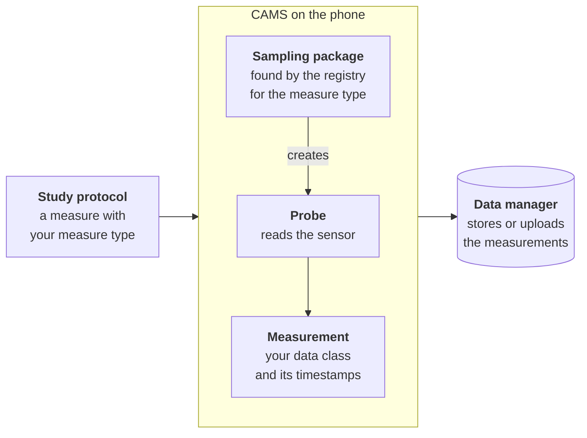

A **sampling package** adds measure types to CARP Mobile Sensing (CAMS). For each type, it defines the data class that holds the values of a measurement and the probe that collects them. For a wearable or an online service, it also connects the phone to the device.

Build one when no existing package collects the data your study needs; check [Measure types](/docs/mobile-sensing/measure-types) first. A package is a Flutter package of its own. You can use it in your app, share it with other CAMS apps or publish it on pub.dev.

<Callout type="info" title="Written for CAMS 2.5.1">

The pages and the example package target `carp_mobile_sensing` 2.5.1, `carp_core` 2.2.2 and `carp_serializable` 3.0.0. Where CAMS 2.5.1 has a defect that affects package authors, the page states the rule and the workaround.

</Callout>

## How it works

CAMS finds your package through the measure type in a study protocol:

1. A task in the study protocol holds a measure whose type is one of your package's measure types, such as `com.example.airpressure`.
2. When the phone gets the deployment, CAMS asks the [`SamplingPackageRegistry`](https://pub.dev/documentation/carp_mobile_sensing/latest/runtime/SamplingPackageRegistry-class.html) for the registered package that declares the type. That package's `create()` method returns a new probe for the measure.
3. When the task's trigger fires, CAMS resumes the probe. The probe reads the sensor and adds measurements, each holding an object of your data class and its timestamps.
4. CAMS applies the privacy schema and data format that the protocol selects. The data manager then stores or uploads each measurement.

## Parts of a sampling package

| Part | Based on | What it does | Page |
| --- | --- | --- | --- |
| Data class | [`Data`](https://pub.dev/documentation/carp_core/latest/common/Data-class.html) or [`SensorData`](https://pub.dev/documentation/carp_core/latest/common/SensorData-class.html) | Holds the values of one measurement and serializes them to JSON | [Data classes](/docs/mobile-sensing/building-sampling-packages/data-classes) |
| Probe | A [`Probe`](https://pub.dev/documentation/carp_mobile_sensing/latest/runtime/Probe-class.html) subclass, such as [`StreamProbe`](https://pub.dev/documentation/carp_mobile_sensing/latest/runtime/StreamProbe-class.html) | Collects the data while CAMS has it resumed | [Probes](/docs/mobile-sensing/building-sampling-packages/probes) |
| Sampling configuration | [`SamplingConfiguration`](https://pub.dev/documentation/carp_core/latest/common/SamplingConfiguration-class.html) or a subclass | Holds the settings of a measure, such as how often to sample; CAMS has classes you can reuse | [Sampling configurations](/docs/mobile-sensing/building-sampling-packages/sampling-configurations) |
| Package class | [`SmartphoneSamplingPackage`](https://pub.dev/documentation/carp_mobile_sensing/latest/domain/SmartphoneSamplingPackage-class.html), or [`SamplingPackage`](https://pub.dev/documentation/carp_mobile_sensing/latest/domain/SamplingPackage-class.html) for another device | Declares the measure types, creates the probes and registers the JSON classes | [Sampling package class](/docs/mobile-sensing/building-sampling-packages/sampling-package-class) |
| Device manager | A [`DeviceManager`](https://pub.dev/documentation/carp_mobile_sensing/latest/runtime/DeviceManager-class.html) subclass | Connects to a wearable or an online service; a package for the phone needs none | [Devices and services](/docs/mobile-sensing/building-sampling-packages/devices) |
| Privacy function | A [`DataTransformer`](https://pub.dev/documentation/carp_mobile_sensing/latest/domain/DataTransformer.html) function | Coarsens or hashes data before it is stored, in studies that ask for it | [Privacy and data formats](/docs/mobile-sensing/building-sampling-packages/privacy-and-formats) |

## Example package

Every page builds the same package, `barometer_sampling_package`, which reads the phone's barometer with the [`sensors_plus`](https://pub.dev/packages/sensors_plus) plugin. It adds two measure types:

| Measure type | Data class | Probe | Default sampling |
| --- | --- | --- | --- |
| `com.example.airpressure` | `AirPressure`: one reading in hectopascals (hPa) | `AirPressureProbe`, a `StreamProbe` | Every reading, requested once per second |
| `com.example.airpressuresummary` | `AirPressureSummary`: the count, mean, minimum and maximum of the readings in hPa | `AirPressureSummaryProbe`, a [`BufferingPeriodicStreamProbe`](https://pub.dev/documentation/carp_mobile_sensing/latest/runtime/BufferingPeriodicStreamProbe-class.html) | A 10-second window every 5 minutes |

Together, the pages show every source file of the package, so you can rebuild it, and explain the rule behind each part. The package also rounds both measures to whole hectopascals in studies that ask for privacy protection.

The package is an example, not a published CARP package. Its measure types use the namespace `com.example`, the reverse of `example.com`, a domain reserved for documentation. Use a namespace that you control in your own package.

## Prerequisites

- A Flutter app that runs a CAMS study and reads its measurements, as described in [Using CAMS](/docs/mobile-sensing/usage).
- Knowledge of study protocols, triggers, tasks and measures, as described in [Domain model](/docs/mobile-sensing/domain-model).
- A phone with the sensor that your package reads. The iOS Simulator, for example, has no barometer.

## Guide pages

<Cards>
<Card title="Package setup" href="/docs/mobile-sensing/building-sampling-packages/package-setup" icon="Folder">

Create the package, add its dependencies and generate its JSON code.

</Card>
<Card title="Data classes" href="/docs/mobile-sensing/building-sampling-packages/data-classes" icon="Dataset">

Define the classes that hold the values of each measurement.

</Card>
<Card title="Probes" href="/docs/mobile-sensing/building-sampling-packages/probes" icon="Radar">

Choose a probe base class and collect the data from the sensor.

</Card>
<Card title="Sampling configurations" href="/docs/mobile-sensing/building-sampling-packages/sampling-configurations" icon="Tune">

Give each measure default settings that a protocol can override.

</Card>
<Card title="Sampling package class" href="/docs/mobile-sensing/building-sampling-packages/sampling-package-class" icon="Extension">

Declare the measure types, create the probes and register the package.

</Card>
<Card title="Devices and services" href="/docs/mobile-sensing/building-sampling-packages/devices" icon="Bluetooth">

Add a device manager for a wearable or an online service.

</Card>
<Card title="Privacy and data formats" href="/docs/mobile-sensing/building-sampling-packages/privacy-and-formats" icon="Shield">

Protect sensitive values and convert data to other formats.

</Card>
<Card title="Testing and publishing" href="/docs/mobile-sensing/building-sampling-packages/testing-and-publishing" icon="CheckCircle">

Test the package, run it in an app and publish it.

</Card>
<Card title="Common pitfalls" href="/docs/mobile-sensing/building-sampling-packages/pitfalls" icon="Warning">

The rules that keep a sampling package from losing data.

</Card>
</Cards>
