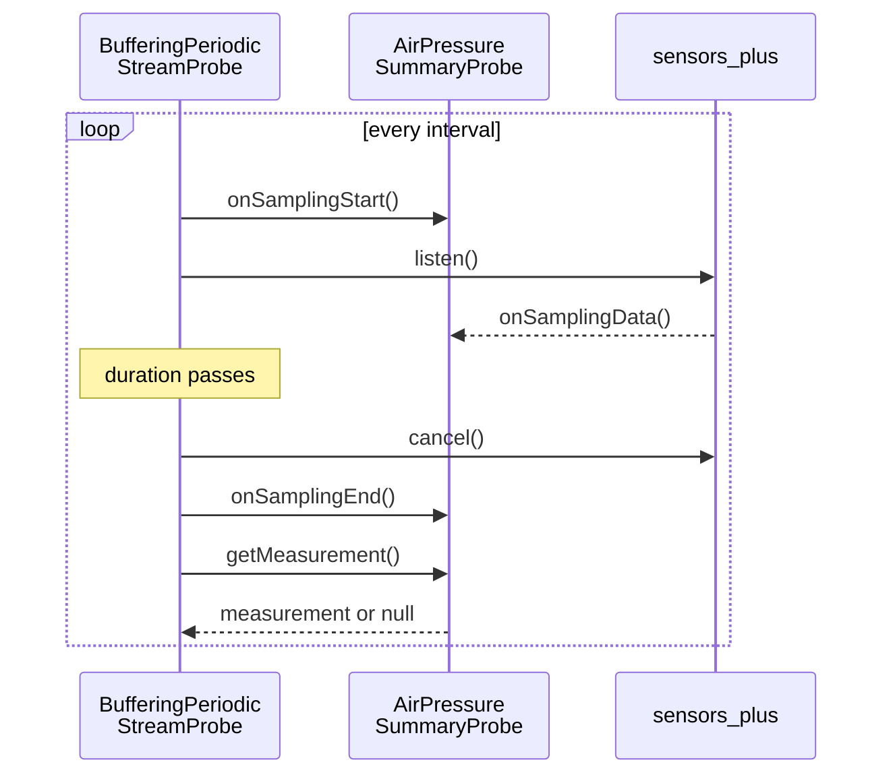

Write a probe for each measure type in your package. A **probe** collects the data of one measure: it reads a sensor, a device or a service, and turns what it reads into measurements. CARP Mobile Sensing (CAMS) creates one probe for each measure in a task, and resumes and pauses it while the study runs.

The barometer package has two probes. `AirPressureProbe` adds one `AirPressure` measurement for each barometer reading, and `AirPressureSummaryProbe` adds one `AirPressureSummary` for each sampling window.

## Choose a base class

CAMS has a base class for each common way to collect data. Extend the one that fits your data source and implement its abstract members:

| Base class | Collects | You implement | Configuration | Examples |
| --- | --- | --- | --- | --- |
| [`StreamProbe`](https://pub.dev/documentation/carp_mobile_sensing/latest/runtime/StreamProbe-class.html) | Every event of a stream, for as long as the probe is resumed | `stream` | Any | [`ScreenProbe`](https://pub.dev/documentation/carp_mobile_sensing/latest/sampling_packages/ScreenProbe-class.html), `AirPressureProbe` |
| [`MeasurementProbe`](https://pub.dev/documentation/carp_mobile_sensing/latest/runtime/MeasurementProbe-class.html) | One measurement each time the probe resumes, after which it pauses itself | `getMeasurement()` | Any | [`DeviceProbe`](https://pub.dev/documentation/carp_mobile_sensing/latest/sampling_packages/DeviceProbe-class.html), [`AppsProbe`](https://pub.dev/documentation/carp_apps_package/latest/apps/AppsProbe-class.html) |
| [`IntervalProbe`](https://pub.dev/documentation/carp_mobile_sensing/latest/runtime/IntervalProbe-class.html) | One measurement every `interval`, by polling | `getMeasurement()` | [`IntervalSamplingConfiguration`](https://pub.dev/documentation/carp_mobile_sensing/latest/domain/IntervalSamplingConfiguration-class.html) | [`BatteryProbe`](https://pub.dev/documentation/carp_mobile_sensing/latest/sampling_packages/BatteryProbe-class.html), [`WifiProbe`](https://pub.dev/documentation/carp_connectivity_package/latest/connectivity/WifiProbe-class.html) |
| [`BufferingPeriodicStreamProbe`](https://pub.dev/documentation/carp_mobile_sensing/latest/runtime/BufferingPeriodicStreamProbe-class.html) | One measurement per sampling window: every `interval`, it buffers a stream for `duration` | `bufferingStream`, `onSamplingStart()`, `onSamplingData()`, `onSamplingEnd()`, `getMeasurement()` | [`PeriodicSamplingConfiguration`](https://pub.dev/documentation/carp_mobile_sensing/latest/domain/PeriodicSamplingConfiguration-class.html) | [`LightProbe`](https://pub.dev/documentation/carp_mobile_sensing/latest/sampling_packages/LightProbe-class.html), [`NoiseProbe`](https://pub.dev/documentation/carp_audio_package/latest/media/NoiseProbe-class.html), `AirPressureSummaryProbe` |
| [`BufferingIntervalStreamProbe`](https://pub.dev/documentation/carp_mobile_sensing/latest/runtime/BufferingIntervalStreamProbe-class.html) | One measurement every `interval`, from a stream that it listens to all the time | `bufferingStream`, `onSamplingData()` and `getMeasurement()`; also `stream`, which it never reads | `IntervalSamplingConfiguration` | None in the CARP packages |
| [`PeriodicStreamProbe`](https://pub.dev/documentation/carp_mobile_sensing/latest/runtime/PeriodicStreamProbe-class.html) | Every event of a stream, but only inside sampling windows | `stream` | `PeriodicSamplingConfiguration` | None in the CARP packages |
| [`BufferingPeriodicProbe`](https://pub.dev/documentation/carp_mobile_sensing/latest/runtime/BufferingPeriodicProbe-class.html) | One measurement per sampling window, from data that the probe gathers itself | `onSamplingStart()`, `onSamplingEnd()`, `getMeasurement()` | `PeriodicSamplingConfiguration` | None in the CARP packages |
| [`Probe`](https://pub.dev/documentation/carp_mobile_sensing/latest/runtime/Probe-class.html) | Anything that the classes above do not fit, with your own start and stop | `onResume()`, `onPause()` and, if needed, `onInitialize()` and `onDispose()` | Any | [`AudioProbe`](https://pub.dev/documentation/carp_audio_package/latest/media/AudioProbe-class.html), [`HealthProbe`](https://pub.dev/documentation/carp_health_package/latest/health_package/HealthProbe-class.html) |
| [`StubProbe`](https://pub.dev/documentation/carp_mobile_sensing/latest/runtime/StubProbe-class.html) | Nothing, for a measure whose data comes from elsewhere | None | — | The error and task measures of CAMS |

The barometer package uses two of them:

- The probe for `AIR_PRESSURE` extends `StreamProbe`, because `sensors_plus` delivers the barometer as a stream and each reading is a measurement.
- The probe for `AIR_PRESSURE_SUMMARY` extends `BufferingPeriodicStreamProbe`, because it summarizes short windows and listens to the barometer only inside them. `BufferingIntervalStreamProbe` would keep the barometer on between windows.

The base class decides when a probe stops, not the metadata of its measure type. Stream and window probes run until CAMS pauses them, so start their measures with an [`ImmediateTrigger`](https://pub.dev/documentation/carp_mobile_sensing/latest/domain/ImmediateTrigger-class.html). A `MeasurementProbe` collects once each time it resumes, so give its measure a trigger that repeats, such as a [`PeriodicTrigger`](https://pub.dev/documentation/carp_mobile_sensing/latest/domain/PeriodicTrigger-class.html). For the two kinds of measures, see [Event-based and one-time measures](/docs/mobile-sensing/measure-types#event-based-and-one-time-measures).

<Callout type="warning" title="Match the configuration class">

Five of these base classes cast the probe's sampling configuration to the class in the Configuration column. Any other class, including the [`NoOptionsSamplingConfiguration`](https://pub.dev/documentation/carp_core/latest/common/NoOptionsSamplingConfiguration-class.html) of a measure type without a default, makes the cast throw inside `onResume()`, and the probe never starts. For defaults, see [Sampling configurations](/docs/mobile-sensing/building-sampling-packages/sampling-configurations).

</Callout>

## Probe lifecycle

CAMS creates the probes when it deploys a study on the phone, and again each time the app starts and restores the study. For each measure, the package that declares the measure type creates the probe in `create()`, and CAMS sets the probe's `deviceManager` and initializes it. CAMS then drives the probe with four lifecycle methods. They are marked `@nonVirtual`, so a probe implements the callbacks that they call:

| Method | When CAMS calls it | Callback | Resulting state |
| --- | --- | --- | --- |
| `initialize()` | Once, right after it creates the probe and before it connects the devices | `onInitialize()`, which is synchronous | `Initialized`; `Created` if the callback returns `false`, `Undefined` if it throws |
| `resume()` | When the trigger of the task fires, and again when CAMS restarts sampling | `onResume()` | `Resumed`; `PausedButShouldBeResumed` if the callback returns `false` |
| `pause()` | When the task stops, for example at the end of its `duration`, and when the study or the device pauses | `onPause()` | `Paused`; unchanged if the callback returns `false` |
| `dispose()` | When the study deployment stops, for example when the app calls `stopStudy()`, right after `pause()` | `onDispose()` | `Disposed` |

The states are values of [`ExecutorState`](https://pub.dev/documentation/carp_mobile_sensing/latest/runtime/ExecutorState.html). A probe has no restart or stop method of its own. When CAMS restarts sampling, for example when the app calls `resume()` on the client or a device reconnects, it calls `resume()` again. To stop sampling, it calls `pause()`.

The lifecycle leads to these rules:

- **Keep the constructor and `onInitialize()` light:** CAMS sets the probe's `deviceManager` and measure after the constructor runs, and reading `deviceManager` there throws a `LateInitializationError`. A probe whose `onInitialize()` returns `false` stays `Created` and ignores every later resume. To leave out a probe on a platform that it does not support, return `null` from `create()` instead.
- **Check in `onResume()`:** check the device, the permissions and the configuration there. Return `false` when the probe cannot start yet, and CAMS tries again at the next resume.
- **Never throw from `onResume()` or `onPause()`:** CAMS does not catch these errors, so the state does not change, and the error never reaches the measurement stream or the data manager. Catch the error, report it with `addError()` and return `false`.
- **Make `onResume()` safe to run twice:** CAMS can call it on a probe that is already resumed, for example when a repeating trigger fires again while the probes still run. See [Resume guard](#resume-guard).
- **Undo everything in `onPause()`:** stop what `onResume()` started, and make it safe to run twice.
- **Do not rely on `onDispose()`:** CAMS disposes a probe only when the study deployment stops, for example with `stopStudy()`. Removing a study or disposing the client only pauses it, and `dispose()` does not call `onPause()`.

## Write the barometer probes

`lib/barometer_probes.dart` is a part of the package library. It holds both probes and the `BarometerCheck` mixin that they share:

```dart title="lib/barometer_probes.dart"
part of 'barometer_sampling_package.dart';

/// Checks the barometer before a probe starts to listen to it
///
/// sensors_plus reports a missing barometer in two ways. On Android, the
/// barometer stream fails with a `NO_SENSOR` error. On iOS, sensors_plus only
/// logs the error and the stream stays silent, as it also does while iOS
/// waits for the user to allow motion access
mixin BarometerCheck on Probe {
  /// How long to wait for the first reading before starting anyway
  Duration get firstReadingTimeout => const Duration(seconds: 5);

  /// Waits for the first barometer reading, or for [firstReadingTimeout]
  ///
  /// Returns false, and reports the error with [addError], if the barometer
  /// stream fails first; otherwise returns true, also after a timeout
  Future<bool> checkBarometer(Duration samplingPeriod) async {
    try {
      await barometerEventStream(
        samplingPeriod: samplingPeriod,
      ).timeout(firstReadingTimeout).first;
    } on TimeoutException {
      warning(
        '$runtimeType - No barometer reading yet. The phone may have no '
        'barometer, or the user has not allowed motion access yet. '
        'Listening anyway.',
      );
    } catch (error) {
      // For example an Android phone without a barometer
      addError('$runtimeType - Cannot read the barometer: $error'); // [!code highlight]
      return false;
    }
    return true;
  }
}

/// Collects [AirPressure] from the phone's barometer, one measurement per
/// reading
///
/// The requested time between readings is the interval of its
/// [IntervalSamplingConfiguration]
class AirPressureProbe extends StreamProbe with BarometerCheck {
  /// The requested time between readings
  Duration get samplingPeriod => switch (samplingConfiguration) {
    IntervalSamplingConfiguration configuration => configuration.interval,
    _ => BarometerSamplingPackage.DEFAULT_SAMPLING_PERIOD,
  };

  @override
  Future<bool> onResume() async {
    if (!await checkBarometer(samplingPeriod)) return false; // [!code highlight]
    return super.onResume();
  }

  @override
  Stream<Measurement> get stream =>
      barometerEventStream(samplingPeriod: samplingPeriod).map(
        (reading) =>
            Measurement.fromData(AirPressure(pressure: reading.pressure)),
      );
}

/// Collects one [AirPressureSummary] per sampling window
///
/// Every [PeriodicSamplingConfiguration.interval], it buffers the barometer
/// readings for [PeriodicSamplingConfiguration.duration] and then reports
/// their count, mean, minimum and maximum. A window without readings adds no
/// measurement
class AirPressureSummaryProbe extends BufferingPeriodicStreamProbe
    with BarometerCheck {
  final List<double> _readings = [];
  int _windowStart = 0;
  int? _windowEnd;

  /// The requested time between readings in a window
  Duration get samplingPeriod => switch (samplingConfiguration) {
    AirPressureSummarySamplingConfiguration configuration =>
      configuration.samplingPeriod,
    _ => BarometerSamplingPackage.DEFAULT_SAMPLING_PERIOD,
  };

  @override
  Future<bool> onResume() async {
    // CAMS also resumes a probe that is already resumed, and a second
    // resume would start a second window timer
    if (state == ExecutorState.Resumed) return true; // [!code highlight]
    if (!await checkBarometer(samplingPeriod)) return false; // [!code highlight]
    return super.onResume();
  }

  @override
  Stream<dynamic> get bufferingStream =>
      barometerEventStream(samplingPeriod: samplingPeriod);

  @override
  void onSamplingStart() {
    _windowStart = DateTime.now().microsecondsSinceEpoch;
    _readings.clear();
  }

  @override
  void onSamplingData(dynamic event) {
    if (event is BarometerEvent) _readings.add(event.pressure);
  }

  @override
  void onSamplingEnd() => _windowEnd = DateTime.now().microsecondsSinceEpoch;

  @override
  Future<Measurement?> getMeasurement() async => _readings.isEmpty
      ? null
      : Measurement(
          sensorStartTime: _windowStart,
          sensorEndTime: _windowEnd,
          data: AirPressureSummary.fromReadings(_readings),
        );
}
```

### Sampling period

Both probes ask `sensors_plus` for a reading every `samplingPeriod`, which they take from their sampling configuration. CAMS resolves `samplingConfiguration` on each call: the override of the measure in the protocol, or else a default. For the order, see [How configuration lookup works](/docs/mobile-sensing/building-sampling-packages/sampling-configurations#how-configuration-lookup-works).

The probes read the configuration with a `switch` on its class and fall back to `DEFAULT_SAMPLING_PERIOD`:

- `AirPressureProbe` takes the `interval` of any `IntervalSamplingConfiguration`, which includes a `PeriodicSamplingConfiguration`.
- `AirPressureSummaryProbe` takes `samplingPeriod` from the package's own `AirPressureSummarySamplingConfiguration`, and uses 1 second with a plain `PeriodicSamplingConfiguration`.

Do not cast the configuration with `as` in your own code. A cast throws for any other class, and inside `onResume()` that stops the probe for good. [`GeofenceProbe`](https://pub.dev/documentation/carp_context_package/latest/carp_context_package/GeofenceProbe-class.html) in `carp_context_package` fails this way when a protocol gives its measure no configuration. Read the configuration in `onResume()`, in `stream` or in a window, not in the constructor: CAMS sets the measure of the probe only when it initializes the probe.

### Measurement stream

`StreamProbe` reads `stream` when it resumes, listens to it while resumed and adds each event as a measurement. It passes stream errors to `addError()` and keeps listening, and it cancels its subscription when it pauses. `AirPressureProbe` maps each [`BarometerEvent`](https://pub.dev/documentation/sensors_plus/latest/sensors_plus/BarometerEvent-class.html) to a [`Measurement`](https://pub.dev/documentation/carp_core/latest/data/Measurement-class.html) with `AirPressure` data.

Build the stream in the getter, as the example does, and make it a broadcast stream. [`barometerEventStream`](https://pub.dev/documentation/sensors_plus/latest/sensors_plus/barometerEventStream.html) returns one shared broadcast stream, and `map()` keeps it a broadcast stream, so CAMS can listen to it again after a second resume. A single-subscription stream throws "Bad state: Stream has already been listened to." on the second listen, and the probe goes silent.

Return `null` from `stream` while the probe cannot start, for example while its device is not connected. `StreamProbe` then returns `false` from `onResume()` and tries again at the next resume, as the Polar and eSense probes do.

### Sampling windows

`BufferingPeriodicStreamProbe` runs the windows and calls the hooks of the probe in this order:



1. Every `interval`, the base class calls `onSamplingStart()` and listens to `bufferingStream`.
2. It passes each event to `onSamplingData()`.
3. After `duration`, it cancels the subscription and calls `onSamplingEnd()` and `getMeasurement()`.
4. It adds the measurement unless it is `null`.

`AirPressureSummaryProbe` works like the `LightProbe` of CAMS. When a window starts, it notes the start time and clears its buffer. It then adds the pressure of each `BarometerEvent`, and at the end of the window it notes the end time and returns one `AirPressureSummary`. `onSamplingData()` receives `dynamic` events, so test the type of each one.

A window without readings returns `null`, and CAMS adds nothing. An [`Error`](https://pub.dev/documentation/carp_core/latest/common/Error-class.html) there would add an error measurement for each empty window: with the default configuration, one every 5 minutes.

The first window starts one `interval` after the probe resumes. With the defaults, the first summary therefore arrives about 5 minutes and 10 seconds after the study starts. When the probe pauses, CAMS drops the open window without calling `getMeasurement()`.

CAMS listens to `bufferingStream` again in each window, so it must be a broadcast stream or a new stream on each read. A stream that replays its last event repeats it in every window. For this reason, [`BluetoothProbe`](https://pub.dev/documentation/carp_connectivity_package/latest/connectivity/BluetoothProbe-class.html) in `carp_connectivity_package` lists the devices of the previous scan again.

### Timestamps

`AirPressureProbe` stamps each reading with `Measurement.fromData()`, which uses the time of the phone when the reading reaches Dart, in microseconds since the epoch. `AirPressureSummaryProbe` sets `sensorStartTime` and `sensorEndTime` to the start and end of the window, which makes each summary a time-span measurement.

CAMS does not set or check these times from the `TIME_SPAN` time type of the measure type: only the probe decides which times a measurement has. The `BLUETOOTH` measure of `carp_connectivity_package`, for example, declares `TIME_SPAN` but sets only a start time.

The example does not use `BarometerEvent.timestamp`. `sensors_plus` computes it from a boot time that it records once, so it does not follow later changes of the phone's clock. When your sensor reports a reliable time of its own, pass it to `Measurement.fromData()`, as the [`PedometerProbe`](https://pub.dev/documentation/carp_mobile_sensing/latest/sampling_packages/PedometerProbe-class.html) of CAMS does. For the units and time zones, see [Data classes](/docs/mobile-sensing/building-sampling-packages/data-classes).

### Resume guard

`AirPressureSummaryProbe.onResume()` returns `true` at once when the probe is already `Resumed`. CAMS calls `onResume()` again on a probe that is already resumed, for example when a repeating trigger fires again while the probes still run. `BufferingPeriodicStreamProbe` then starts a second window timer without canceling the first. In a test, a probe that was resumed twice opened twice as many windows. Windows also kept opening after `pause()`, which stops only the newest timer.

Inside `onResume()`, `state` is still the state from before this resume, so the guard sees `Resumed` only on a second resume. It does not cover a second resume that arrives while the first `onResume()` still runs, here during the barometer check of up to 5 seconds.

`PeriodicStreamProbe`, `BufferingPeriodicProbe`, `BufferingIntervalStreamProbe` and `BufferingPeriodicStreamProbe` need the guard. So does a probe that extends `Probe` and starts a subscription or a timer in `onResume()`. `StreamProbe` cancels its old subscription before it listens again, and `IntervalProbe` keeps one timer, so `AirPressureProbe` needs no guard. Do not add the guard to a probe that extends `MeasurementProbe` directly. Such a probe stays `Resumed` for 5 seconds after each collection, and for good after a failed one, so the guard would skip collections.

### Error handling

`sensors_plus` reports a missing barometer differently on each platform:

| Platform | What happens |
| --- | --- |
| Android | The barometer stream fails with a `NO_SENSOR` error. |
| iOS | The native `listen` call fails, Flutter only logs the error, and the stream stays silent. |

Without a check, the probes start in both cases and stay resumed. The first version of the example had none, like the sensor probes of CAMS. On the iOS Simulator, which has no barometer, both probes showed as resumed and collected nothing, without an error measurement. In a test that simulated an Android phone without a barometer, the window probe added a new `NO_SENSOR` error in every window and stayed resumed.

The `BarometerCheck` mixin runs first in `onResume()` of both probes. It waits for the first reading, the first error or a timeout of 5 seconds:

- **First reading:** the probe starts.
- **Error first:** the check reports the error with `addError()` and returns `false`, so the probe does not start. CAMS stores one error measurement, and no window opens.
- **Timeout:** the check logs a CAMS warning and starts the probe anyway. A silent stream may also mean that the first reading has not arrived yet. Giving up would lose the data of a working phone until the next resume, which for an `ImmediateTrigger` is usually the next app start.

`addError()` adds the error to the measurement stream of the probe: CAMS logs it as a warning, and the data manager stores it as a measurement with `dk.cachet.carp.error` data. Put the name of the probe in the message, as the example does, so that the stored message says which probe failed.

Errors after the first reading need no code: `StreamProbe` and `BufferingPeriodicStreamProbe` pass stream errors to `addError()` and keep running. Errors also reach the app as errors on `client.measurements`, where a listener without `onError` turns each one into an uncaught error. The example app therefore passes an `onError` handler.

The check runs before the base class checks permissions, which is fine here because the barometer measures declare none. If your measures declare permissions, call `hasRequiredPermissions()` before such a check.

### Stream cleanup

A probe must release its sensor when it pauses, or the plugin keeps the sensor running:

- `StreamProbe` and `BufferingPeriodicStreamProbe` cancel their own subscriptions, and `sensors_plus` stops the barometer when its last listener cancels.
- The check gets its first event with `timeout()` and `first`, which cancel the listener after the first event, the first error or the timeout. A test of the example confirms that the check leaves no listener behind.
- Do not keep a plugin stream in a field, and do not wrap one in `asBroadcastStream()` without an `onCancel` that cancels the source. Such a wrapper keeps the plugin subscribed after the probe pauses, as in the activity, eSense and Polar probes. A stored stream also delivers nothing after its device reconnects, as in the eSense probes.
- Never return a stream that completes, such as `Stream.empty()`. When it completes, `StreamProbe` closes the measurement stream of the probe for good, and every later measurement fails with "Bad state: Cannot add new events after calling close". Some plugins return `Stream.empty()` on platforms that they do not support, so return `null` from `create()` on those platforms.
- If your probe extends `Probe` and listens itself, cancel the old subscription before you listen again, and cancel it in `onPause()`. Close a controller that lives as long as the probe in `onDispose()`.

## Write a one-time probe

A one-time measure collects one value each time its task starts, such as the installed apps or the current weather. Its probe extends `MeasurementProbe` and implements `getMeasurement()`. For example, a barometer package that collects one reading per trigger, instead of every reading, creates this probe for `AIR_PRESSURE`:

```dart
/// Collects one [AirPressure] reading each time it is resumed
class AirPressureReadingProbe extends MeasurementProbe {
  @override
  Future<Measurement?> getMeasurement() async {
    try {
      final reading = await barometerEventStream(
        samplingPeriod: BarometerSamplingPackage.DEFAULT_SAMPLING_PERIOD,
      ).timeout(const Duration(seconds: 10)).first;
      return Measurement.fromData(AirPressure(pressure: reading.pressure));
    } catch (error) {
      // Return the error as data, so that the probe still pauses itself
      return Measurement.fromData( // [!code highlight]
        Error(message: '$runtimeType - Cannot read the barometer: $error'), // [!code highlight]
      ); // [!code highlight]
    }
  }
}
```

CAMS calls `getMeasurement()` each time the probe resumes, adds the measurement unless it is `null` and pauses the probe 5 seconds later. If `getMeasurement()` throws, CAMS adds the error but never pauses the probe: its task then ignores the next trigger. Return an `Error` measurement or `null` instead, as [`WeatherProbe`](https://pub.dev/documentation/carp_context_package/latest/carp_context_package/WeatherProbe-class.html) in `carp_context_package` does.

Put a one-time measure in a task of its own, with a trigger that repeats, such as `PeriodicTrigger(period: const Duration(minutes: 30))`. In a task with an event-based measure, the task stays resumed, and CAMS collects the one-time measure only at every second trigger. Describe the measure type with `dataEventType: DataEventType.ONE_TIME` in its [`CamsDataTypeMetaData`](https://pub.dev/documentation/carp_mobile_sensing/latest/domain/CamsDataTypeMetaData-class.html). CAMS does not read the value, but it documents the measure for protocol authors.

For a measure that reads the data stored since its last collection, see [Read history since the last collection](/docs/mobile-sensing/building-sampling-packages/sampling-configurations#read-history-since-the-last-collection).

## Next step

<Cards>
<Card title="Sampling configurations" href="/docs/mobile-sensing/building-sampling-packages/sampling-configurations" icon="Tune">

Give each measure default settings that a protocol can override.

</Card>
</Cards>
