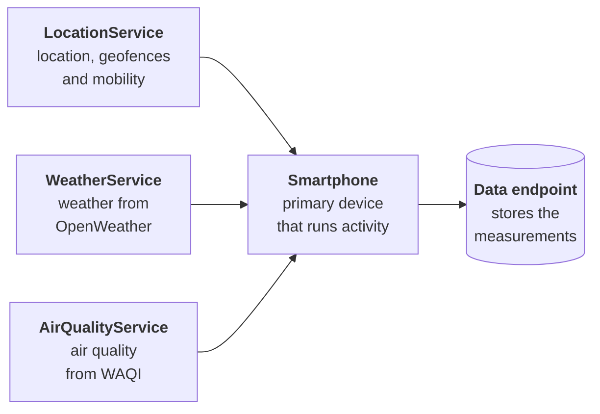

`carp_context_package` adds six context measures to a [CARP Mobile Sensing](/docs/mobile-sensing) (CAMS) study: location, physical activity, geofence events, mobility features, weather and air quality. Use it to study where participants go, how they move and what their environment is like.

The package builds on the [`location`](https://pub.dev/packages/location), [`activity_recognition_flutter`](https://pub.dev/packages/activity_recognition_flutter) and [`mobility_features`](https://pub.dev/packages/mobility_features) plugins. Weather comes from [OpenWeather](https://openweathermap.org/) and air quality from the [World Air Quality Index](https://waqi.info/) (WAQI) project; both services need an API key.

<Chips>
<Chip href="https://pub.dev/packages/carp_context_package" icon="Package" tone="primary">pub.dev</Chip>
<Chip href="https://pub.dev/documentation/carp_context_package/latest/" icon="Description" tone="tertiary">API reference</Chip>
<Chip href="https://github.com/carp-dk/carp.sensing-flutter/tree/main/packages/carp_context_package" icon="Code" tone="success">GitHub</Chip>
</Chips>

<Callout type="warning" title="Precise location required">

Every measure except `ACTIVITY` collects data only when the participant grants location access with precise location. `LOCATION` also needs location access all the time, and on Android so do `GEOFENCE` and `MOBILITY`. See [Permissions and background](/docs/sampling-packages/context/permissions).

</Callout>

## Features

<Cards>
<Card title="Location" icon="MyLocation">

Location fixes from the phone's location service, continuously or once per trigger. One `LocationService` sets the accuracy, distance and interval for the study.

</Card>
<Card title="Activity recognition" icon="DirectionsWalk">

Still, on-foot, walking, running, cycling and in-vehicle events from the phone's activity recognition, each with a confidence of at least 50%.

</Card>
<Card title="Geofences" icon="Fence">

Enter, dwell and exit events for circular geofences. The events can trigger other tasks in the protocol.

</Card>
<Card title="Mobility features" icon="Route">

Daily stops, moves, places, home stay, location entropy and distance traveled, computed on the phone.

</Card>
<Card title="Weather" icon="PartlyCloudyDay">

Current weather at the phone's position from OpenWeather, collected once per trigger.

</Card>
<Card title="Air quality" icon="Air">

The air quality index of the WAQI station nearest to the phone, collected once per trigger.

</Card>
</Cards>

## Measure types

The package provides six measure types in the `dk.cachet.carp` namespace:

| Measure type | Data | Android | iOS |
| --- | --- | --- | --- |
| [`dk.cachet.carp.location`](/docs/sampling-packages/context/location) | Location fixes from the phone's location service | Yes | Yes |
| [`dk.cachet.carp.activity`](/docs/sampling-packages/context/activity) | Recognized physical activity and its confidence | Yes | Yes |
| [`dk.cachet.carp.geofence`](/docs/sampling-packages/context/geofences) | Enter, dwell and exit events for one circular geofence | Yes | Yes |
| [`dk.cachet.carp.mobility`](/docs/sampling-packages/context/mobility) | Daily mobility features computed from location | Yes | Yes |
| [`dk.cachet.carp.weather`](/docs/sampling-packages/context/weather-and-air-quality) | Current weather from OpenWeather | Yes | Yes |
| [`dk.cachet.carp.airquality`](/docs/sampling-packages/context/weather-and-air-quality) | Air quality index from WAQI | Yes | Yes |

`WEATHER` and `AIR_QUALITY` are one-time measures, and the other four are event-based. For the difference, see [Event-based and one-time measures](/docs/mobile-sensing/measure-types#event-based-and-one-time-measures). Each measure's page documents its configuration, platform differences and data fields.

## Requirements

| Component | Requirement |
| --- | --- |
| Dart SDK | 3.10 or later |
| Flutter | 3.44 or later |
| `carp_mobile_sensing` | 2.4.0 or later |
| Android | API level 26 (Android 8.0) or later, with Google Play services for activity recognition |
| iOS | 15.0 or later, built with Swift Package Manager |
| API keys | An OpenWeather API key for weather and a WAQI token for air quality |

See [Installation](/docs/sampling-packages/context/installation) for the platform setup.

## How it works

The six measures run on four devices in the protocol: the phone itself and three services, which CAMS treats as connected devices of the phone:

- **`Smartphone`:** the primary device. It runs `ACTIVITY` itself and collects the measurements of all four devices.
- **`LocationService`:** gives the phone's location to `LOCATION`, `GEOFENCE` and `MOBILITY`, and sets the accuracy, distance and interval that all three share.
- **`WeatherService` and `AirQualityService`:** hold the API keys of the two web services and run `WEATHER` and `AIR_QUALITY`.
- **Data endpoint:** stores the measurements, as in any CAMS study.

In the protocol, add each service as a connected device of the phone, and target each task at the device its measures run on. See [Services](/docs/sampling-packages/context/services).

## Next steps

<Cards>
<Card title="Installation" href="/docs/sampling-packages/context/installation" icon="Download">

Add the package to a CAMS app and configure Android and iOS.

</Card>
<Card title="Quickstart" href="/docs/sampling-packages/context/quickstart" icon="Bolt">

Build an app that collects activity, location and mobility features.

</Card>
<Card title="Services" href="/docs/sampling-packages/context/services" icon="Tune">

The three services, their settings and how they connect.

</Card>
<Card title="Permissions and background" href="/docs/sampling-packages/context/permissions" icon="Lock">

The permissions each measure needs and how collection continues in the background.

</Card>
</Cards>
