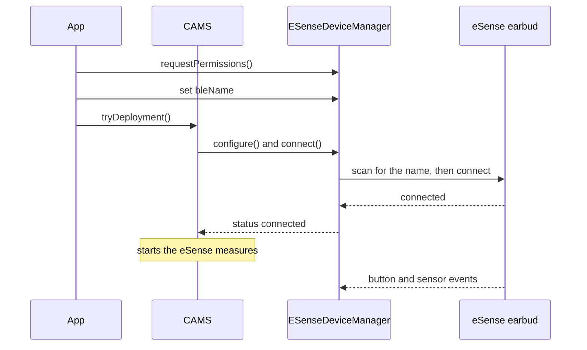

A study protocol names an eSense earable only by its role. To collect data, the app binds the role to a physical earbud on the phone. CARP Mobile Sensing (CAMS) then connects to the earbud over Bluetooth Low Energy (BLE):



1. The app asks for the Bluetooth permissions and gives `ESenseDeviceManager` the Bluetooth name of the earbud.
2. When CAMS deploys the study, it configures the device manager and calls `connect()`.
3. The `esense_flutter` plugin scans for an earbud with that name and connects to it. The status becomes `connected`, and the device manager sets the sampling rate.
4. CAMS starts the eSense measures, and the earbud sends button and sensor events.

## Add the device to the protocol

Add an [`ESenseDevice`](https://pub.dev/documentation/carp_esense_package/latest/esense/ESenseDevice-class.html) to the protocol as a connected device of the phone. Add the eSense measures to tasks that run on `eSense`, not on `phone`:

```dart
final phone = Smartphone();
final eSense = ESenseDevice(
  roleName: 'eSense',
  samplingRate: 20, // Hz
);

protocol
  ..addPrimaryDevice(phone)
  ..addConnectedDevice(eSense, phone);

protocol.addTaskControl(
  ImmediateTrigger(),
  BackgroundTask(
    measures: [
      Measure(type: ESenseSamplingPackage.ESENSE_BUTTON),
      Measure(type: ESenseSamplingPackage.ESENSE_SENSOR),
    ],
  ),
  eSense,
);
```

`ESenseDevice` takes these parameters:

| Parameter | Type | Required | Default | Description |
| --- | --- | --- | --- | --- |
| `roleName` | `String` | No | `'eSense'` | The role of the device in the protocol. Each role in a protocol needs a unique name. |
| `isOptional` | `bool` | No | `true` | Whether the study can run without the device. |
| `samplingRate` | `int` | No | `10` | The sampling rate of the motion data in hertz, from 1 to 100. |

The sampling rate belongs to the device, not to a measure. The device manager sets it on the earbud when it connects. The earbud treats it as a hint: depending on the Bluetooth connection, motion events may arrive faster or slower.

CAMS does not check the value, so keep it from 1 to 100. In release builds on Android, a value outside this range starts no sampling.

Like every [`BLEDevice`](https://pub.dev/documentation/carp_mobile_sensing/latest/domain/BLEDevice-class.html), `ESenseDevice` also has the scan settings `serviceUuids`, `namePrefix`, `minRssi`, `allowDuplicates` and `timeout`, which CAMS does not use. The protocol does not identify the physical earbud: you bind it on the phone.

## Request Bluetooth permissions

Neither CAMS nor the `esense_flutter` plugin asks for Bluetooth permissions by itself. The automatic permission requests of CAMS cover what the measures declare, and the eSense measures declare none. After you configure `SmartPhoneClientManager`, and before the earbud connects for the first time, get the [`ESenseDeviceManager`](https://pub.dev/documentation/carp_esense_package/latest/esense/ESenseDeviceManager-class.html) and call `requestPermissions()`:

```dart
final eSenseManager =
    SmartPhoneClientManager().deviceController.getDeviceManager(
      ESenseDevice.DEVICE_TYPE,
    ) as ESenseDeviceManager;

if (!await eSenseManager.hasPermissions()) {
  await eSenseManager.requestPermissions();
}
```

`requestPermissions()` shows the system dialogs one at a time, through `SmartPhoneClientManager().requestPermissions()`:

| Platform | Permissions requested | Checked before connecting |
| --- | --- | --- |
| Android | Bluetooth scan, Bluetooth connect and location while in use | Yes, on every Android version |
| iOS | Bluetooth | No |

On Android, `connect()` fails without these permissions: the log says that the permissions required to connect are missing, and the status becomes `disconnected`. On Android 12 or later, the participant must allow precise location, because the plugin declares `ACCESS_FINE_LOCATION`. On iOS with CocoaPods, the Bluetooth request needs the `PERMISSION_BLUETOOTH` macro; see [Installation](/docs/sampling-packages/esense/installation).

## Bind the earbud

`ESenseDeviceManager` connects by the **Bluetooth name** of the earbud, not by its address. Each left earbud has a unique name of the form `eSense-` and four digits, such as `eSense-0332`. The right earbud has no BLE interface.

To find the name, the eSense documentation suggests a Bluetooth scanner app, such as nRF Connect. Pairing the earbud in the phone's Bluetooth settings is not needed. According to the [eSense user documentation](https://www.esense.io/share/eSense-User-Documentation.pdf), the BLE interface works without pairing, which only audio needs.

The earbud accepts one BLE connection at a time and may become unstable if several phones or apps connect to it. If the participant also uses the earbuds for audio, the eSense documentation recommends the right earbud for audio and the left earbud for motion data. The data rate may drop when one earbud handles motion data, the microphone and music at the same time.

Bind the earbud in one of two ways:

<Tabs items={['Name', 'Scan result']}>
<Tab value="Name">

Set `bleName`, for example from a settings screen where the participant enters the name of the earbud:

```dart
eSenseManager.bleName = 'eSense-0332';
```

Setting the name does not change the status, so you can set it before the study is deployed. Set the right name before the first connection attempt: the device manager keeps using the name of that attempt until the app restarts.

</Tab>
<Tab value="Scan result">

Pass the address and name of a Bluetooth scan result to `pair()`, which sets the status to `paired`:

```dart
eSenseManager.pair(bleAddress: '00:04:79:00:0D:04', bleName: 'eSense-0332');
```

Always pass the advertised name as `bleName`: the device manager connects by name, and without one, it cannot connect, although the status is `paired`. Call `pair()` only when the status is `configured`, that is, after CAMS has configured the device manager for the deployment. CAMS treats `paired` as configured, so it never configures a manager that was paired earlier.

</Tab>
</Tabs>

## Connect to the earbud

When CAMS configures the deployment, it connects to the earbud if the device manager has a name and the Bluetooth permissions are granted. If you bind the earbud later, call `connect()` yourself:

```dart
final DeviceStatus status = await eSenseManager.connect();
```

`connect()` returns while the connection is being set up, usually with the status `connecting`. It does nothing while the device manager is connecting or connected, or before CAMS has configured it.

The plugin scans for a device with exactly that name and then connects to it. On Android, the scan lasts 5 seconds: if the earbud is not found, the status becomes `disconnected`, and neither CAMS nor the plugin tries again. On iOS, connecting may take several seconds, and while the earbud is not found, the status stays `connecting` for up to about 83 minutes.

When the earbud is connected, the status becomes `connected`. The device manager then sets the sampling rate from `samplingRate` and starts reading the battery voltage every 2 minutes. CAMS starts the tasks that run on the earbud.

To disconnect, call `disconnect()`. It pauses the eSense measures and disconnects from the earbud.

## Monitor the connection

`statusEvents` emits each new [`DeviceStatus`](https://pub.dev/documentation/carp_mobile_sensing/latest/runtime/DeviceStatus.html) of the earbud:

```dart
eSenseManager.statusEvents.listen((status) => print('eSense: ${status.name}'));
```

The device manager reports these statuses:

| Status | Meaning |
| --- | --- |
| `unknown` | CAMS has not configured the device manager yet. On Android, the status is also `unknown` for a moment when the first connection attempt starts. |
| `configured` | CAMS has configured the device manager for the deployment. |
| `paired` | `pair()` has bound a scan result. |
| `connecting` | A connection attempt is running, or the plugin has found the earbud and connects to it. |
| `connected` | The earbud is connected, and the eSense measures run. |
| `disconnected` | The earbud is not connected: it was not found, the link was lost, `disconnect()` was called or the permissions are missing. |

The eSense device manager does not use the statuses `reconnected` and `disconnecting`.

These properties of the device manager describe the earbud and the connection:

| Property | Type | Description |
| --- | --- | --- |
| `isConnected` | `bool` | `true` while the status is `connected`. |
| `canConnect` | `bool` | `true` once the device manager has a name. |
| `bleName` | `String?` | The Bluetooth name of the earbud. |
| `manager` | `ESenseManager?` | The `ESenseManager` of the `esense_flutter` plugin, for features that CAMS does not wrap. `null` until the device manager has a name. Commands sent to the earbud in quick succession fail, so space out your own calls. |

## Read the battery level

The earbud reports its battery voltage, not a level. While the earbud is connected, the device manager reads the voltage every 2 minutes. It estimates the level in percent with a linear formula: `(1.19 * voltage - 3.91) * 100`.

`batteryLevel` holds the last estimate, and `batteryEvents` emits each new one:

```dart
eSenseManager.batteryEvents.listen((level) => print('eSense battery: $level%'));
```

The first estimate arrives 2 minutes after the connection. Because the formula is linear, the estimate can fall below 0 or rise above 100. The battery level is not a measure, so CAMS does not store it, and there is no heartbeat measure for the earbud.

## Handle disconnections

When the earbud goes out of range or turns off, the status becomes `disconnected`. Neither CAMS nor the plugin connects to the earbud again by itself. Listen to `statusEvents` to detect a lost link.

<Callout type="warning" title="Known issue">

In version 2.1.0, the eSense measures collect no more data after a lost link, even when `connect()` connects to the earbud again. The probes keep listening to the event streams of the earlier connection. Restart the app to collect data again.

</Callout>

## Use one earbud per phone

CAMS keeps one device manager per device type, and the plugin connects to one earbud at a time. A phone therefore collects data from one eSense earbud. Add one `ESenseDevice` to a protocol.

## Restore the binding after a restart

Each time the earbud connects, CAMS registers it with the deployment as a `BLEDeviceRegistration`, with the name of the earbud as its device ID. CAMS also stores the registration on the phone, with the deployment. What happens after the app restarts depends on the deployment service:

| Deployment service | After a restart |
| --- | --- |
| On the phone (`SmartphoneDeploymentService`) | CAMS configures the device manager from the stored registration, which restores the name, and connects to the earbud again. |
| [CARP Web Services](/docs/data-storage/caws) (CAWS) | CAMS configures the device manager without the stored registration, because CAWS does not return it. Set `bleName` again after every start. |

## Troubleshooting

<Accordions>
<Accordion title="The status stays configured">

Bind the earbud: set `bleName` or call `pair()` with the name, and then call `connect()`. Without a name, CAMS does not connect to the earbud.

</Accordion>
<Accordion title="The status changes to disconnected right after connect()">

Grant the Bluetooth permissions with `requestPermissions()`. On Android, also check that the merged manifest declares both location permissions without `android:maxSdkVersion`. On Android 12 or later, the participant must allow precise location.

See [Request Bluetooth permissions](#request-bluetooth-permissions).

</Accordion>
<Accordion title="The status changes to disconnected after about 5 seconds">

Check that `bleName` matches the name of the earbud exactly and that the left earbud is on and near the phone. Also check that no other phone or app is connected to it.

Then call `connect()` again: on Android, the scan lasts 5 seconds, and CAMS does not try again by itself. If you correct `bleName`, restart the app first: the device manager keeps the name of its first connection attempt.

</Accordion>
<Accordion title="Button events arrive but motion events do not">

Set `samplingRate` to a value from 1 to 100. On Android, a rate outside this range starts no sampling in release builds.

</Accordion>
</Accordions>
