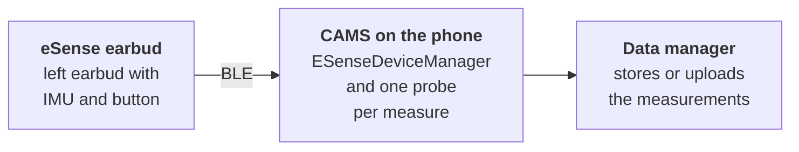

`carp_esense_package` connects a [CARP Mobile Sensing](/docs/mobile-sensing) (CAMS) study to an eSense earbud over Bluetooth Low Energy (BLE). It collects button presses and the raw accelerometer and gyroscope values of the earbud's inertial measurement unit (IMU) while the participant wears it.

[eSense](https://www.esense.io) is a research earable platform from Nokia Bell Labs, Cambridge. The package connects to the left earbud of the pair, which has the six-axis IMU, a button and the BLE interface. It uses the [`esense_flutter`](https://pub.dev/packages/esense_flutter) plugin.

<Chips>
<Chip href="https://pub.dev/packages/carp_esense_package" icon="Package" tone="primary">pub.dev</Chip>
<Chip href="https://pub.dev/documentation/carp_esense_package/latest/" icon="Description" tone="tertiary">API reference</Chip>
<Chip href="https://github.com/carp-dk/carp.sensing-flutter/tree/main/packages/carp_esense_package" icon="Code" tone="success">GitHub</Chip>
</Chips>

<Callout type="info" title="Hardware availability">

The eSense site states that the first generation of the eSense platform has reached its end of life and is no longer distributed.

</Callout>

## Features

<Cards>
<Card title="Button events" icon="TouchApp">

An event each time the participant presses or releases the button of the earbud.

</Card>
<Card title="Motion" icon="Motion">

Raw accelerometer and gyroscope values of the left earbud, at a sampling rate from 1 to 100 Hz.

</Card>
<Card title="Battery" icon="Battery">

A battery level that the device manager estimates from the voltage of the earbud every 2 minutes.

</Card>
</Cards>

## Measure types

The package provides two event-based measure types:

| Measure type | Data | Android | iOS |
| --- | --- | --- | --- |
| [`dk.cachet.carp.esense.button`](/docs/sampling-packages/esense/measure-types#button-events) | Button pressed or released | Yes | Yes |
| [`dk.cachet.carp.esense.sensor`](/docs/sampling-packages/esense/measure-types#motion) | Raw accelerometer and gyroscope values on three axes | Yes | Yes |

For the fields and how to convert the raw values, see [Measure types](/docs/sampling-packages/esense/measure-types).

## Requirements

| Component | Requirement |
| --- | --- |
| Dart SDK | 3.10 or later |
| Flutter | 3.38.1 or later |
| `carp_mobile_sensing` | 2.2.0 or later |
| Android | API level 24 (Android 7.0) or later, on a phone with BLE |
| iOS | 15.0 or later, with CocoaPods |
| Earable | The left earbud of an eSense pair |
| Testing | A physical phone, because emulators and simulators cannot connect to the earbud |

See [Installation](/docs/sampling-packages/esense/installation) for the platform setup.

## How it works

1. The study protocol names the earable only by its role: an `ESenseDevice` connected to the phone, with the sampling rate of the motion data.
2. On the phone, the app binds the role to an earbud with its Bluetooth name, such as `eSense-0332`. `ESenseDeviceManager` scans for that name and connects to the earbud.
3. When the earbud is connected, CAMS starts the eSense measures. Each button press or release and each motion packet becomes one measurement.
4. A data manager stores or uploads the measurements, as the data endpoint of the protocol specifies.

For the binding and the connection status, see [Connecting a device](/docs/sampling-packages/esense/connecting).

## Next steps

<Cards>
<Card title="Installation" href="/docs/sampling-packages/esense/installation" icon="Download">

Add the package and configure Bluetooth on Android and iOS.

</Card>
<Card title="Quickstart" href="/docs/sampling-packages/esense/quickstart" icon="Bolt">

Connect to an eSense earbud and print its button and motion events.

</Card>
<Card title="Connecting a device" href="/docs/sampling-packages/esense/connecting" icon="Bluetooth">

Bind an eSense earbud, connect to it and follow its status.

</Card>
<Card title="Measure types" href="/docs/sampling-packages/esense/measure-types" icon="Dataset">

The two eSense measure types, their raw values and timestamps.

</Card>
</Cards>
