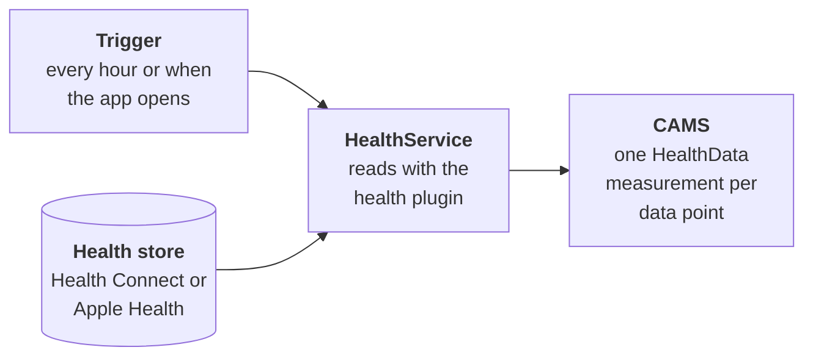

`carp_health_package` adds health data from Google Health Connect on Android and Apple Health on iOS to a [CARP Mobile Sensing](/docs/mobile-sensing) (CAMS) study. It reads what the phone, a wearable or a fitness app has stored, such as steps, heart rate, sleep, weight and workouts. Each data point becomes a measurement.

The package reads the data with the [`health` plugin](/docs/flutter-plugins/health) and exports that plugin. A protocol can ask for any [`HealthDataType`](https://pub.dev/documentation/health/latest/health/HealthDataType.html) that the plugin supports on the platform.

<Chips>
<Chip href="https://pub.dev/packages/carp_health_package" icon="Package" tone="primary">pub.dev</Chip>
<Chip href="https://pub.dev/documentation/carp_health_package/latest/" icon="Description" tone="tertiary">API reference</Chip>
<Chip href="https://github.com/carp-dk/carp.sensing-flutter/tree/main/packages/carp_health_package" icon="Code" tone="success">GitHub</Chip>
</Chips>

<Callout type="warning" title="Foreground only">

The package reads health data only while the app is in the foreground, and on iOS only while the phone is unlocked. A failed read loses no data, because the next read covers the same time span. To pick a trigger that fires while the app is in use, see [Choose a trigger](/docs/sampling-packages/health/collecting-data#choose-a-trigger).

</Callout>

## Features

<Cards>
<Card title="Background collection" icon="Schedule">

Add a health measure to a background task, and a trigger reads the data, for example every hour or each time the app opens.

</Card>
<Card title="Health app tasks" icon="Checklist">

A `HealthAppTask` puts a task on the participant's task list. Starting it asks for access to the data and reads it once.

</Card>
<Card title="Incremental reads" icon="Sync">

The first read goes 30 days back, and each later read continues where the previous one ended, also after an app restart.

</Card>
<Card title="Health Connect and Apple Health" icon="Heart">

One protocol works on both platforms. CAMS skips the data types that a platform does not offer and reads the others.

</Card>
</Cards>

## Measure types

| Measure type | Data | Android | iOS |
| --- | --- | --- | --- |
| [`dk.cachet.carp.health`](/docs/sampling-packages/health/collecting-data) | One data point of any health data type, such as a step count or a heart rate sample | Yes | Yes |

All health data shares this measure type, and the `healthDataType` field of each measurement names its kind. For the fields, see [Health data](/docs/sampling-packages/health/health-data). For the data types on each platform, see [Data types](/docs/sampling-packages/health/data-types).

## Requirements

| Component | Requirement |
| --- | --- |
| Dart SDK | 3.10 or later |
| Flutter | 3.38.1 or later |
| `carp_mobile_sensing` | 2.3.0 or later |
| Android | API level 26 (Android 8.0) or later, required by the `health` plugin |
| Android build | `compileSdk` 36 or later and Android Gradle plugin 8.9.1 or later, required by the Health Connect client |
| Health Connect | Part of Android 14 or later. On Android 13 and earlier, the participant installs the Health Connect app from Google Play. |
| iOS | 15.0 or later, with the HealthKit capability |
| Health data | Data in Health Connect or Apple Health, from the phone, a wearable or another app |

## How it works

Each time its trigger fires, a health measure reads the health store in three stages:

1. A trigger in the protocol starts the health measure on the [`HealthService`](https://pub.dev/documentation/carp_health_package/latest/health_package/HealthService-class.html), a connected device that stands for the health store on the phone.
2. The `health` plugin reads the measure's data types from Health Connect or Apple Health, covering the time since the previous read.
3. Each data point becomes a [`HealthData`](https://pub.dev/documentation/carp_health_package/latest/health_package/HealthData-class.html) measurement, which the study's data manager stores or uploads.

Before the first read, the participant must allow the app to read the data types. To ask for access, see [Permissions](/docs/sampling-packages/health/permissions).

## Next steps

<Cards>
<Card title="Installation" href="/docs/sampling-packages/health/installation" icon="Download">

Add the package and configure Health Connect and HealthKit.

</Card>
<Card title="Quickstart" href="/docs/sampling-packages/health/quickstart" icon="Bolt">

Build an app that reads steps and heart rate every hour.

</Card>
<Card title="Collecting data" href="/docs/sampling-packages/health/collecting-data" icon="Download">

Collect with background measures or health app tasks, and choose triggers.

</Card>
<Card title="Permissions" href="/docs/sampling-packages/health/permissions" icon="Lock">

Ask for access to health data and connect the health service.

</Card>
</Cards>
