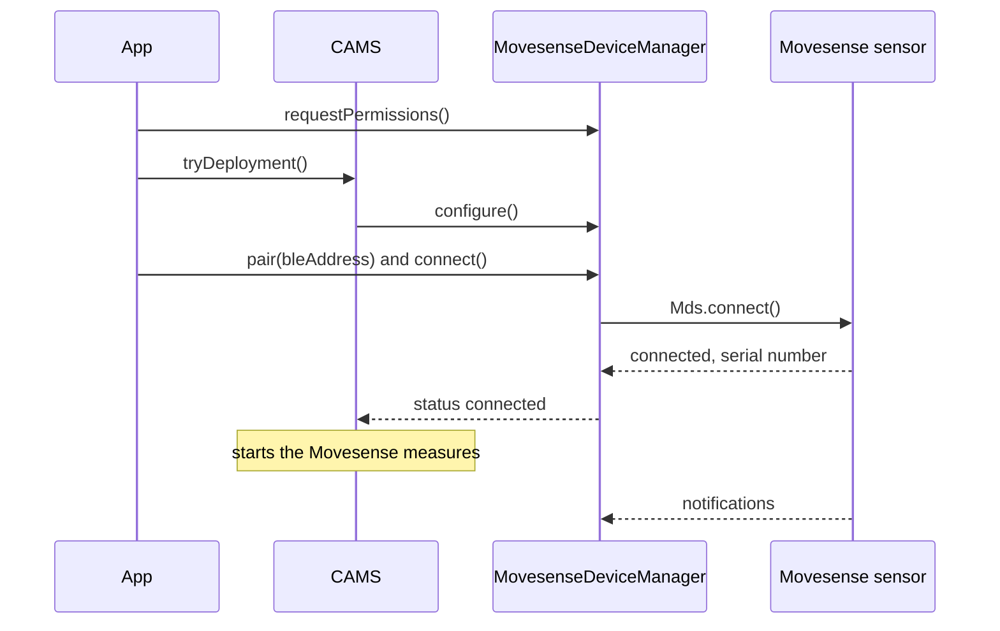

A study protocol names a Movesense sensor only by its role. To collect data, the app binds the role to a physical sensor on the phone. CARP Mobile Sensing (CAMS) then connects to the sensor over Bluetooth Low Energy (BLE):



1. The app asks for the Bluetooth permissions.
2. When CAMS deploys the study, it configures `MovesenseDeviceManager`.
3. The app binds the Bluetooth address of the sensor with `pair()`, usually from a scan, and calls `connect()`.
4. The device manager connects through the Movesense mobile library (MDS). When MDS reports the serial number of the sensor, the status becomes `connected`.
5. CAMS starts the Movesense measures, and each probe subscribes to its resource on the sensor.

## Add the device to the protocol

Add a [`MovesenseDevice`](https://pub.dev/documentation/carp_movesense_package/latest/carp_movesense_package/MovesenseDevice-class.html) to the protocol as a connected device of the phone. Add the Movesense measures to tasks that run on `movesense`, not on `phone`:

```dart
final phone = Smartphone();
final movesense = MovesenseDevice();

protocol
  ..addPrimaryDevice(phone)
  ..addConnectedDevice(movesense, phone);

protocol.addTaskControl(
  ImmediateTrigger(),
  BackgroundTask(measures: [Measure(type: MovesenseSamplingPackage.HR)]),
  movesense,
);
```

`MovesenseDevice` takes these parameters:

| Parameter | Type | Required | Default | Description |
| --- | --- | --- | --- | --- |
| `roleName` | `String` | No | `'Movesense ECG Device'` | The role of the device in the protocol. Each role in a protocol needs a unique name. |
| `isOptional` | `bool?` | No | `true` | Whether the study can run without the device. |
| `namePrefix` | `String?` | No | `'Movesense'` | A name filter for a Bluetooth scan in your app. CAMS itself does not scan. |

Like every [`BLEDevice`](https://pub.dev/documentation/carp_mobile_sensing/latest/domain/BLEDevice-class.html), `MovesenseDevice` also has the scan settings `serviceUuids`, `minRssi`, `allowDuplicates` and `timeout`, which CAMS does not use either. A protocol from [CARP Web Services](/docs/data-storage/caws) (CAWS) that leaves out `namePrefix` gets `'Movesense'` when CAMS reads it. The protocol does not identify the physical sensor: you bind it on the phone.

## Request Bluetooth permissions

CAMS does not ask for Bluetooth permissions by itself. Its automatic permission requests cover what the measures declare, and the Movesense measures declare none. After you configure `SmartPhoneClientManager`, and before the sensor connects for the first time, get the [`MovesenseDeviceManager`](https://pub.dev/documentation/carp_movesense_package/latest/carp_movesense_package/MovesenseDeviceManager-class.html) and call `requestPermissions()`:

```dart
final manager = SmartPhoneClientManager().deviceController.getDeviceManager(
  MovesenseDevice.DEVICE_TYPE,
) as MovesenseDeviceManager;

if (!await manager.hasPermissions()) {
  await manager.requestPermissions();
}
```

`requestPermissions()` shows the system dialogs one at a time, through `SmartPhoneClientManager().requestPermissions()`:

| Platform | Permissions requested | Checked before connecting |
| --- | --- | --- |
| Android | Bluetooth scan, Bluetooth connect and location while in use | Yes, on every Android version |
| iOS | Bluetooth | No |

On Android, `connect()` fails without these permissions: the log says that the permissions required to connect are missing, and the status becomes `disconnected`. On Android 12 or later, approximate location is enough, unless your app declares `ACCESS_FINE_LOCATION` for those versions; see [Installation](/docs/sampling-packages/movesense/installation#troubleshooting).

On iOS, the plugin starts Core Bluetooth when the app launches, so iOS may ask for Bluetooth access before your app calls `requestPermissions()`.

## Find the sensor

CAMS has no Bluetooth scanner. To find sensors, use the scan of the [`carp_movesense_flutter`](https://pub.dev/packages/carp_movesense_flutter) plugin, which reports only devices that advertise the Movesense services, or use your own scanner. Add the plugin as a direct dependency:

```bash
flutter pub add carp_movesense_flutter
```

The plugin also has a class named `MovesenseDevice`, so import only [`Mds`](https://pub.dev/documentation/carp_movesense_flutter/latest/carp_movesense_flutter/Mds-class.html) from it:

```dart
import 'package:carp_movesense_flutter/carp_movesense_flutter.dart' show Mds;
```

This scan collects the sensors in range for 10 seconds:

```dart
final sensors = <String, String>{}; // address -> name

Mds.startScan((name, address) {
  if (name != null && address != null) sensors[address] = name;
});
await Future.delayed(const Duration(seconds: 10));
Mds.stopScan();
```

The scan needs the Bluetooth permissions. A sensor's Bluetooth name is `Movesense` followed by its serial number, for example `Movesense 220330000122`. Show the names to the participant, or match the serial number of the sensor that the study handed out.

## Bind the sensor

Pass the address and name of a scan result to `pair()`, which sets the status to `paired`:

```dart
manager.pair(
  bleAddress: '0C:8C:DC:3F:B2:CD',
  bleName: 'Movesense 220330000122',
);
```

`MovesenseDeviceManager` connects by the Bluetooth address, which depends on the platform:

| Platform | Address | Example |
| --- | --- | --- |
| Android | The MAC address of the sensor | `0C:8C:DC:3F:B2:CD` |
| iOS | A UUID that iOS assigns to the sensor on this phone | `E2C56DB5-DFFB-48D2-B060-D0F5A71096E0` |

The iOS UUID differs between phones, so get the address from a scan on the phone that runs the study. `pair()` stores the address and name only; it does not create a Bluetooth bond with the sensor.

Call `pair()` only when the status is `configured`, that is, after CAMS has configured the device manager for the deployment. CAMS treats `paired` as configured, so it never configures a manager that was paired earlier.

## Connect to the sensor

When CAMS configures the deployment, it connects to the sensor if the device manager has an address and the Bluetooth permissions are granted. After you bind the sensor, call `connect()` yourself:

```dart
final DeviceStatus status = await manager.connect();
```

`connect()` returns while the connection is being set up, with the status `connecting`. It does nothing while the device manager is connecting or connected, or before CAMS has configured it.

When MDS reports the serial number of the sensor, the device manager reads the device information and sets the battery level. The status becomes `connected`, and CAMS starts the tasks that run on the sensor. If MDS reports an error, the device manager tells MDS to stop retrying, and the status becomes `disconnected`.

To disconnect, call `disconnect()`. It pauses the Movesense measures and disconnects MDS from the sensor.

## Monitor the connection

`statusEvents` emits each new [`DeviceStatus`](https://pub.dev/documentation/carp_mobile_sensing/latest/runtime/DeviceStatus.html) of the sensor:

```dart
manager.statusEvents.listen((status) => print('Movesense: ${status.name}'));
```

The device manager reports these statuses:

| Status | Meaning |
| --- | --- |
| `unknown` | CAMS has not configured the device manager yet. |
| `configured` | CAMS has configured the device manager for the deployment. |
| `paired` | `pair()` has bound a scan result. |
| `connecting` | A connection attempt is running. |
| `connected` | The sensor is connected, and the Movesense measures run. |
| `disconnected` | The sensor is not connected: the connection failed or was lost, `disconnect()` was called, or the address or the permissions are missing. |

The Movesense device manager does not use the statuses `reconnected` and `disconnecting`.

These properties of the device manager describe the sensor and the connection:

| Property | Type | Description |
| --- | --- | --- |
| `isConnected` | `bool` | `true` while the status is `connected`. |
| `canConnect` | `bool` | `true` once the device manager has a Bluetooth address. |
| `bleAddress` | `String?` | The Bluetooth address that `pair()` stored. |
| `bleName` | `String?` | The Bluetooth name of the sensor, such as `Movesense 220330000122`. |
| `serial` | `String?` | The serial number that MDS reported when the sensor connected. |
| `deviceInfo` | `Map<String, dynamic>?` | The device information of the sensor. `null` until the sensor has answered after the connection. |
| `movesenseDeviceType` | `MovesenseDeviceType` | The model, from the hardware type in `deviceInfo`: `MD` (`A1`), `HR_PLUS` (`H3`), `HR2` (`H4`) or `UNKNOWN`. |

## Read the battery level

Movesense sensors report only whether the battery is OK or low. The device manager turns this into a `batteryLevel` of 80% or 10%. It sets 80% when the sensor connects and asks the sensor every 10 minutes after that.

`batteryEvents` emits the level after each check:

```dart
manager.batteryEvents.listen((level) => print('Movesense battery: $level%'));
```

When the sensor disconnects, `batteryLevel` becomes `null`. The battery level is not a measure, so CAMS does not store it. There is no heartbeat measure for the sensor either: the CAMS heartbeat covers the phone only.

When CAMS registers the sensor with the deployment, the registration records the level as a battery charging state: `normal` for 80% and `critical` for 10%.

## Handle disconnections

When the link to the sensor is lost, MDS reports it, and the status becomes `disconnected`. The package adds no reconnection logic of its own. Listen to `statusEvents` to detect a lost link, and call `connect()` to connect again.

## Use one sensor per phone

CAMS keeps one device manager per device type, so a phone connects to one Movesense sensor at a time. Add one `MovesenseDevice` to a protocol, and bind each participant's phone to their own sensor.

## Restore the binding after a restart

Each time the sensor connects, CAMS registers it with the deployment as a `MovesenseDeviceRegistration`. The registration holds the Bluetooth address and name, the model and the device information of the sensor. CAMS also stores the registration on the phone, with the deployment.

What happens after the app restarts depends on the deployment service:

| Deployment service | After a restart |
| --- | --- |
| On the phone (`SmartphoneDeploymentService`) | CAMS configures the device manager from the stored registration, which restores the address, and connects to the sensor again. Version 3.1.0 cannot read the stored registration; see the known issue below. |
| CAWS | CAMS configures the device manager without the stored registration, because CAWS does not return it. Bind the sensor again after every start. |

<Callout type="warning" title="Known issue">

In version 3.1.0, CAMS cannot read back a stored Movesense registration, because the package does not register `MovesenseDeviceRegistration` for JSON. At the next start, loading the stored studies fails, and the log shows "Failed to load studies". Add and deploy the study again at every start, and bind the sensor again.

</Callout>

To bind the sensor again without a new scan, store its address in your app:

```dart
// After the study is deployed
if (manager.bleAddress == null) {
  final address = await loadSensorAddress(); // from your app's own storage
  if (address != null) {
    manager.pair(bleAddress: address);
    await manager.connect();
  }
}
```

If the sensor does not connect with a stored address, scan for it again.

## Troubleshooting

<Accordions>
<Accordion title="The status stays configured">

Bind the sensor with `pair()`, and then call `connect()`. Without an address, CAMS does not connect to the sensor.

</Accordion>
<Accordion title="The status changes to disconnected right after connect()">

Grant the Bluetooth permissions with `requestPermissions()`, as [Request Bluetooth permissions](#request-bluetooth-permissions) describes. On Android, also check that the participant allowed location; see [Installation](/docs/sampling-packages/movesense/installation#troubleshooting).

</Accordion>
<Accordion title="The status stays paired">

Call `connect()` after `pair()`. CAMS connects to the sensor by itself only when it configures a deployment.

</Accordion>
<Accordion title="A subscription fails with status 408">

Collect fewer streams at once, and connect again if the measures stop. The sensor may not keep up when it streams heart rate, ECG and inertial measurement unit (IMU) data at the same time. See [Sampling and timestamps](/docs/sampling-packages/movesense/measure-types#sampling-and-timestamps).

</Accordion>
</Accordions>
