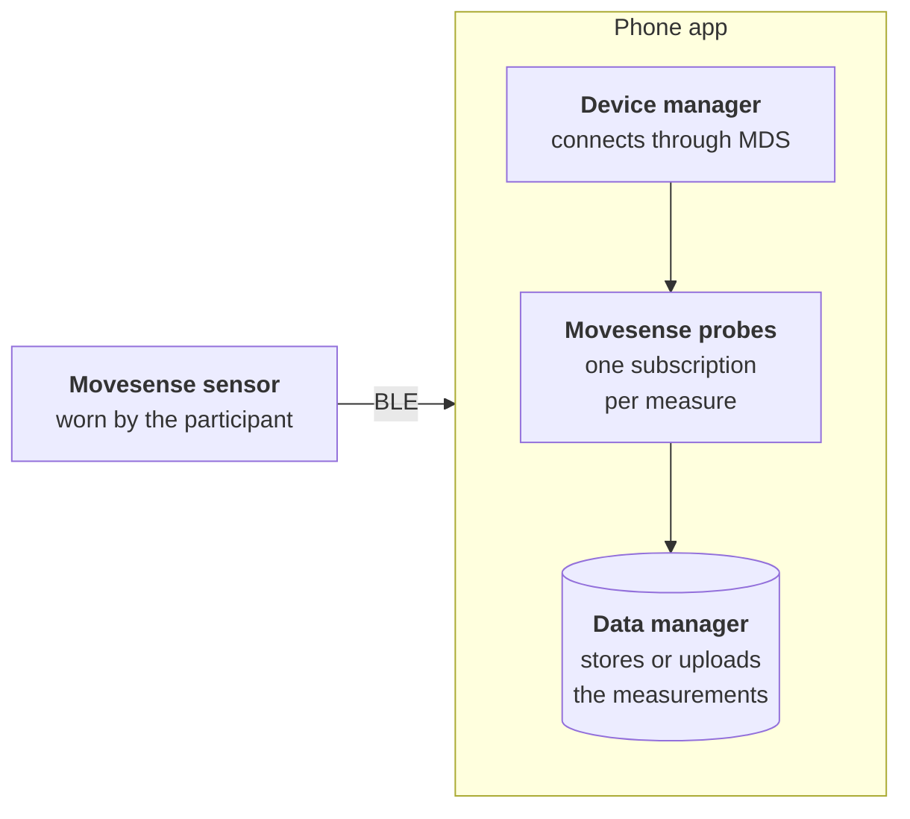

`carp_movesense_package` adds [Movesense](https://www.movesense.com/) sensors as connected devices to a [CARP Mobile Sensing](/docs/mobile-sensing) (CAMS) study. While worn, the sensor streams heart rate, RR intervals, single-channel ECG, movement and taps to the phone over Bluetooth Low Energy (BLE).

The package talks to the sensor through the Movesense mobile library (MDS), which the [`carp_movesense_flutter`](https://pub.dev/packages/carp_movesense_flutter) plugin bundles for Android and iOS.

<Chips>
<Chip href="https://pub.dev/packages/carp_movesense_package" icon="Package" tone="primary">pub.dev</Chip>
<Chip href="https://pub.dev/documentation/carp_movesense_package/latest/" icon="Description" tone="tertiary">API reference</Chip>
<Chip href="https://github.com/carp-dk/carp.sensing-flutter/tree/main/packages/carp_movesense_package" icon="Code" tone="success">GitHub</Chip>
</Chips>

## Features

<Cards>
<Card title="Heart rate" icon="Heart">

Average heart rate in beats per minute and an RR interval in milliseconds, computed by the sensor from its ECG signal.

</Card>
<Card title="ECG" icon="Ecg">

Single-channel ECG at 125 Hz, delivered in batches of raw samples with the sensor's own timestamp.

</Card>
<Card title="Motion" icon="Motion">

Samples from the sensor's inertial measurement unit (IMU) at 13 Hz, delivered in batches.

</Card>
<Card title="Taps" icon="TouchApp">

An event each time the participant taps the sensor. A tap can start another task, such as a 30-second ECG recording.

</Card>
</Cards>

## Measure types

The package provides six measure types in the `dk.cachet.carp.movesense` namespace:

| Measure type | Data | Android | iOS |
| --- | --- | --- | --- |
| [`dk.cachet.carp.movesense.deviceinformation`](/docs/sampling-packages/movesense/measure-types#device-information) | Model, serial number and firmware version of the sensor | Yes | Yes |
| [`dk.cachet.carp.movesense.state`](/docs/sampling-packages/movesense/measure-types#taps) | Single taps on the sensor | Yes | Yes |
| [`dk.cachet.carp.movesense.hr`](/docs/sampling-packages/movesense/measure-types#heart-rate) | Average heart rate and an RR interval | Yes | Yes |
| [`dk.cachet.carp.movesense.ecg`](/docs/sampling-packages/movesense/measure-types#ecg) | Batches of single-channel ECG samples at 125 Hz | Yes | Yes |
| [`dk.cachet.carp.movesense.temperature`](/docs/sampling-packages/movesense/measure-types#temperature) | Temperature inside a Movesense MD | Yes | Yes |
| [`dk.cachet.carp.movesense.imu`](/docs/sampling-packages/movesense/measure-types#motion) | Batches of IMU samples at 13 Hz | Yes | Yes |

See [Measure types](/docs/sampling-packages/movesense/measure-types) for the fields, units and example data of each measure.

<Callout type="warning" title="Known issues in version 3.1.0">

`TEMPERATURE` collects no data, and the gyroscope and magnetometer lists of `IMU` hold accelerometer values. See [Temperature](/docs/sampling-packages/movesense/measure-types#temperature) and [Motion](/docs/sampling-packages/movesense/measure-types#motion).

</Callout>

## Supported models

The package supports three Movesense sensors:

| Sensor | Device type | Temperature |
| --- | --- | --- |
| Movesense Medical (MD) | `MD` | Yes |
| Movesense Active HR+ | `HR_PLUS` | No |
| Movesense Active HR2 | `HR2` | No |

All three measure single-channel ECG, heart rate, RR intervals and movement. After the sensor connects, the device manager sets `movesenseDeviceType` to one of these values, from the hardware type that the sensor reports. The Movesense MD is a Class IIa medical device under the EU Medical Device Regulation 2017/745.

## Requirements

| Component | Requirement |
| --- | --- |
| Dart SDK | 3.12.2 or later |
| Flutter | 3.44.2 or later |
| `carp_mobile_sensing` | 2.2.0 or later |
| Android | API level 24 (Android 7.0) or later |
| iOS | 15.0 or later |
| Sensor | A Movesense MD, Active HR+ or HR2 |
| Testing | A physical phone. The bundled Movesense library has no `x86_64` build for Android emulators and no build for the iOS simulator on Apple silicon Macs. |

See [Installation](/docs/sampling-packages/movesense/installation) for the platform setup.

## How it works

The sensor is a connected device of the phone. The phone connects to it, subscribes to the sensor's data and stores what arrives:

- **Movesense sensor:** measures ECG, heart rate, movement and taps, and sends them to the phone over BLE.
- **Device manager:** [`MovesenseDeviceManager`](https://pub.dev/documentation/carp_movesense_package/latest/carp_movesense_package/MovesenseDeviceManager-class.html) connects to the sensor through MDS, identifies its model and checks its battery.
- **Movesense probes:** one probe per measure subscribes to a resource on the sensor, such as `Meas/HR`, and turns each notification into a measurement.
- **Data manager:** stores or uploads the measurements, as the data endpoint of the protocol specifies.

The app connects the sensor at runtime: it asks for the Bluetooth permissions, finds the sensor and binds it to the [`MovesenseDevice`](https://pub.dev/documentation/carp_movesense_package/latest/carp_movesense_package/MovesenseDevice-class.html) in the protocol. See [Connecting a device](/docs/sampling-packages/movesense/connecting).

## Next steps

<Cards>
<Card title="Installation" href="/docs/sampling-packages/movesense/installation" icon="Download">

Add the package to a CAMS app and configure Android and iOS.

</Card>
<Card title="Quickstart" href="/docs/sampling-packages/movesense/quickstart" icon="Bolt">

Build an app that prints heart rate and ECG from a sensor.

</Card>
<Card title="Connecting a device" href="/docs/sampling-packages/movesense/connecting" icon="Bluetooth">

Find, bind and connect a sensor, and follow its status.

</Card>
<Card title="Measure types" href="/docs/sampling-packages/movesense/measure-types" icon="Dataset">

The six measure types, with their fields, units and example data.

</Card>
</Cards>
