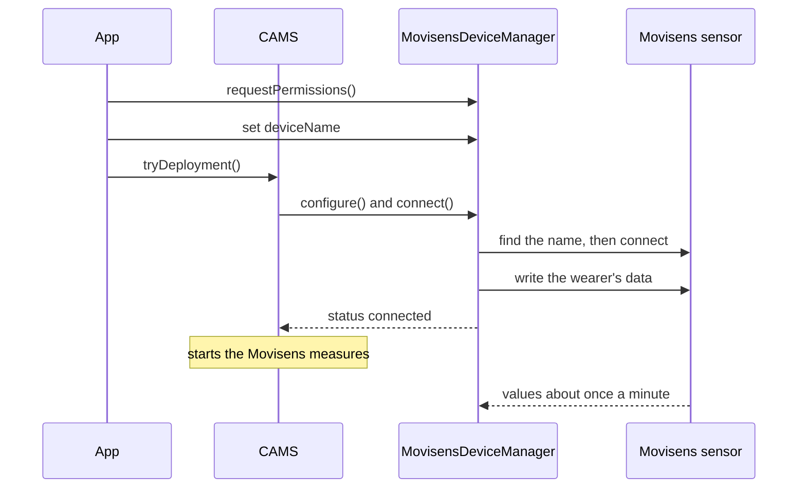

A study protocol names a Movisens sensor only by its role. To collect data, the app binds the role to a physical sensor on the phone. CARP Mobile Sensing (CAMS) then connects to the sensor over Bluetooth Low Energy (BLE):



1. The app asks for the Bluetooth permissions and gives `MovisensDeviceManager` the Bluetooth name of the sensor.
2. When CAMS deploys the study, it configures the device manager and calls `connect()`.
3. The `movisens_flutter` plugin finds the sensor by its name and connects to it. The device manager writes the wearer's data to the sensor, and the status becomes `connected`.
4. CAMS starts the Movisens measures, and the sensor sends its values about once a minute.

## Add the device to the protocol

Add a [`MovisensDevice`](https://pub.dev/documentation/carp_movisens_package/latest/carp_movisens_package/MovisensDevice-class.html) with the wearer's data to the protocol as a connected device of the phone. Add the Movisens measures to tasks that run on `movisens`, not on `phone`:

```dart
final phone = Smartphone();
final movisens = MovisensDevice(
  sensorLocation: SensorLocation.RightSideHip,
  sex: Sex.Female,
  height: 168, // cm
  weight: 62, // kg
  age: 34,
);

protocol
  ..addPrimaryDevice(phone)
  ..addConnectedDevice(movisens, phone);

protocol.addTaskControl(
  ImmediateTrigger(),
  BackgroundTask(
    measures: [Measure(type: MovisensSamplingPackage.TAP_MARKER)],
  ),
  movisens,
);
```

`MovisensDevice` takes these parameters:

| Parameter | Type | Required | Default | Description |
| --- | --- | --- | --- | --- |
| `roleName` | `String?` | No | `'movisens'` | The role of the device in the protocol. Each role in a protocol needs a unique name. |
| `sensorLocation` | `SensorLocation` | No | `SensorLocation.Chest` | Where the participant wears the sensor. |
| `sex` | `Sex` | No | `Sex.Male` | Sex of the wearer: `Male`, `Female` or `Intersex`. The sensor receives `Intersex` as unspecified. |
| `height` | `int` | No | `178` | Height of the wearer in cm. |
| `weight` | `int` | No | `78` | Weight of the wearer in kg. |
| `age` | `int` | No | `25` | Age of the wearer in years. |

The sensor uses the wearer's data to compute the metabolic equivalent of task (MET), MET levels and body position, so set it for each participant. [`SensorLocation`](https://pub.dev/documentation/carp_movisens_package/latest/carp_movisens_package/SensorLocation.html) has the values `RightSideHip`, `Chest`, `RightWrist`, `LeftWrist`, `LeftAnkle`, `RightAnkle`, `RightThigh`, `LeftThigh`, `RightUpperArm`, `LeftUpperArm` and `LeftSideHip`.

A `MovisensDevice` is always optional: `isOptional` is `true`, so the study can run without the device. Like every [`BLEDevice`](https://pub.dev/documentation/carp_mobile_sensing/latest/domain/BLEDevice-class.html), it also has the scan settings `serviceUuids`, `namePrefix`, `minRssi`, `allowDuplicates` and `timeout`, which CAMS does not use. The protocol does not identify the physical sensor: you bind it on the phone.

## Request Bluetooth permissions

CAMS does not ask for Bluetooth permissions by itself. Its automatic permission requests cover what the measures declare, and the Movisens measures declare none. After you configure `SmartPhoneClientManager`, and before the sensor connects for the first time, get the [`MovisensDeviceManager`](https://pub.dev/documentation/carp_movisens_package/latest/carp_movisens_package/MovisensDeviceManager-class.html) and call `requestPermissions()`:

```dart
final manager = SmartPhoneClientManager().deviceController.getDeviceManager(
  MovisensDevice.DEVICE_TYPE,
) as MovisensDeviceManager;

if (!await manager.hasPermissions()) {
  await manager.requestPermissions();
}
```

`requestPermissions()` shows the system dialogs one at a time, through `SmartPhoneClientManager().requestPermissions()`:

| Platform | Permissions requested | Checked before connecting |
| --- | --- | --- |
| Android | Bluetooth scan, Bluetooth connect and location while in use | Yes, on every Android version |
| iOS | Bluetooth | No |

On Android, `connect()` fails without these permissions: the log says that the permissions required to connect are missing, and the status becomes `disconnected`. On Android 12 or later, the location permission also needs the `ACCESS_COARSE_LOCATION` entry from [Installation](/docs/sampling-packages/movisens/installation). On iOS, the system asks for Bluetooth access the first time `flutter_blue_plus` uses Bluetooth.

## Bind the sensor

`MovisensDeviceManager` connects by the **Bluetooth name** of the sensor, not by its address. The name has the form `MOVISENS Sensor <serial>`, where `<serial>` is the five-digit serial number on the back of the sensor, such as `MOVISENS Sensor 03348`. The package binds by name because iOS gives each phone a different identifier for the same sensor.

Set `deviceName`, for example from a settings screen where the participant enters the serial number of the sensor:

```dart
manager.deviceName = 'MOVISENS Sensor 03348';
```

Setting the name does not change the status, so you can set it at any time, also before the study is deployed. `pair()`, which other Bluetooth devices use, does not set `deviceName`, and without a name the device manager cannot connect.

To bind another sensor, set `deviceName` to `null` and read `device` once before you set the new name. The device manager keeps the device it created for the first name, and drops it only when `device` is read while `deviceName` is `null`.

## Update the wearer's data

The device manager writes the wearer's data to the sensor when it connects. To change the data, for example after the participant enters their age and weight in the app, change the configuration before you call `connect()`:

```dart
final movisens = manager.configuration;
if (movisens != null) {
  movisens.age = 41;
  movisens.weight = 64; // kg
}
```

## Connect to the sensor

When CAMS configures the deployment, it connects to the sensor if the device manager has a name and the Bluetooth permissions are granted. If you bind the sensor later, call `connect()` yourself:

```dart
final DeviceStatus status = await manager.connect();
```

`connect()` returns with the status `connecting`. It does nothing while the device manager is connecting or connected, or before CAMS has configured it. The `movisens_flutter` plugin looks for the sensor in this order:

1. A sensor with that name that is already connected to the app.
2. On Android, a sensor with that name that is bonded with the phone, that is, paired in the Android Bluetooth settings.
3. A 10-second scan, which connects to the first sensor with that name.

Once the sensor is connected and its services are known, the device manager writes the wearer's data to it. It also turns on battery notifications and follows the sensor's connection state. When that state is connected, the status becomes `connected`, and CAMS starts the tasks that run on the sensor.

<Callout type="warning" title="Known issue">

When `connect()` returns, the device manager sets the status to `connecting`, even if the sensor connected during the call. If `movisens_flutter` has to scan for the sensor, the status never becomes `connected`, and CAMS collects no Movisens data. It scans unless the app is already connected to the sensor or, on Android, the sensor is bonded with the phone.

</Callout>

To disconnect, call `disconnect()`. It pauses the Movisens measures and disconnects from the sensor.

## Monitor the connection

`statusEvents` emits each new [`DeviceStatus`](https://pub.dev/documentation/carp_mobile_sensing/latest/runtime/DeviceStatus.html) of the sensor:

```dart
manager.statusEvents.listen((status) => print('Movisens: ${status.name}'));
```

The device manager reports these statuses:

| Status | Meaning |
| --- | --- |
| `unknown` | CAMS has not configured the device manager yet, or the sensor reported a connection state that the device manager does not know. |
| `configured` | CAMS has configured the device manager for the deployment. |
| `connecting` | `connect()` has run. See the known issue in [Connect to the sensor](#connect-to-the-sensor). |
| `connected` | The sensor is connected, and the Movisens measures run. |
| `disconnected` | The sensor is not connected: the link was lost, connecting failed, `disconnect()` was called or the permissions are missing. |

The Movisens device manager does not use the statuses `paired`, `reconnected` and `disconnecting`.

These properties of the device manager describe the sensor and the connection:

| Property | Type | Description |
| --- | --- | --- |
| `isConnected` | `bool` | `true` while the status is `connected`. |
| `canConnect` | `bool` | `true` once the device manager has a name. |
| `deviceName` | `String?` | The Bluetooth name of the sensor. |
| `device` | `MovisensDevice?` | The `MovisensDevice` of the `movisens_flutter` plugin, for services that CAMS does not wrap. `null` until the device manager has a name. To use it, add `movisens_flutter` as a dependency and import it with a prefix, because its class names clash with this package. |

## Read the battery level

`batteryLevel` holds the last battery level that the sensor reported, in percent:

```dart
// Battery level in percent, or null until the sensor reports it
final level = manager.batteryLevel;
```

The device manager turns on battery notifications only when `movisens_flutter` connects to the sensor without a scan, and it does not emit `batteryEvents`. The battery level is not a measure, so CAMS does not store it, and there is no heartbeat measure for the sensor.

## Handle disconnections

The Movisens device manager does not reconnect after a lost link, and neither does `movisens_flutter`. While the device manager follows the sensor's connection state, a lost link sets the status to `disconnected`. Listen to `statusEvents` to detect it, and call `connect()` to connect again.

## Use one sensor per phone

CAMS keeps one device manager per device type, so a phone connects to one Movisens sensor at a time. Add one `MovisensDevice` to a protocol.

## Restore the binding after a restart

`deviceName` lives in the device manager's memory, and CAMS does not restore it. After the app restarts, set it again for local deployments and for deployments from [CARP Web Services](/docs/data-storage/caws) (CAWS) alike. Store the name in your app:

```dart
// After the study is deployed
manager.deviceName ??= await loadSensorName(); // from your app's own storage
if (manager.deviceName != null) await manager.connect();
```

## Troubleshooting

<Accordions>
<Accordion title="The status stays configured">

Bind the sensor: set `deviceName`, and then call `connect()`. Without a name, CAMS does not connect to the sensor.

</Accordion>
<Accordion title="The status changes to disconnected right after connect()">

Grant the Bluetooth permissions with `requestPermissions()`, as [Request Bluetooth permissions](#request-bluetooth-permissions) describes. On Android, also check the location permission in the manifest; see [Installation](/docs/sampling-packages/movisens/installation#troubleshooting).

</Accordion>
<Accordion title="No data arrives">

Check that `deviceName` matches the sensor's Bluetooth name exactly, including upper case, and that the sensor is charged and near the phone. On Android 11 and lower, location must also be turned on in the phone's settings for the scan. If the status never showed `connected`, see the known issue in [Connect to the sensor](#connect-to-the-sensor).

</Accordion>
</Accordions>
