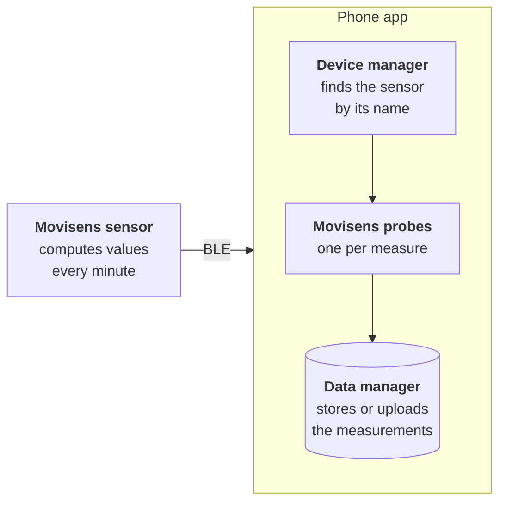

`carp_movisens_package` adds [Movisens](https://www.movisens.com/en/) sensors as connected devices to a [CARP Mobile Sensing](/docs/mobile-sensing) (CAMS) study. The sensor computes values such as step count, body position, heart rate variability (HRV) and electrodermal activity (EDA). It sends most of them to the phone once per minute over Bluetooth Low Energy (BLE).

The package uses the [`movisens_flutter`](https://pub.dev/packages/movisens_flutter) plugin, which talks to the sensor through [`flutter_blue_plus`](https://pub.dev/packages/flutter_blue_plus). No Movisens SDK is involved.

<Chips>
<Chip href="https://pub.dev/packages/carp_movisens_package" icon="Package" tone="primary">pub.dev</Chip>
<Chip href="https://pub.dev/documentation/carp_movisens_package/latest/" icon="Description" tone="tertiary">API reference</Chip>
<Chip href="https://github.com/carp-dk/carp.sensing-flutter/tree/main/packages/carp_movisens_package" icon="Code" tone="success">GitHub</Chip>
</Chips>

<Callout type="warning" title="Not medical devices">

Movisens sensors are research instruments, not medical devices. Do not use them or their data for medical purposes.

</Callout>

## Features

<Cards>
<Card title="Activity" icon="DirectionsWalk">

Steps, body position, inclination, movement acceleration, metabolic equivalent of task (MET) and time per MET level, computed by the sensor.

</Card>
<Card title="Heart rate and HRV" icon="Heart">

Mean heart rate and HRV as the root mean square of successive differences (RMSSD), computed per minute by an EcgMove4.

</Card>
<Card title="EDA and skin temperature" icon="VitalSigns">

Mean skin conductance level from an EdaMove4, and mean skin temperature per minute.

</Card>
<Card title="Tap markers" icon="TouchApp">

An event without delay each time the participant taps the sensor, for example to mark a moment in the day.

</Card>
</Cards>

## Measure types

The package provides six measure types in the `dk.cachet.carp.movisens` namespace:

| Measure type | Data | Android | iOS |
| --- | --- | --- | --- |
| [`dk.cachet.carp.movisens.activity`](/docs/sampling-packages/movisens/measure-types#physical-activity) | Steps, body position, inclination, movement acceleration, MET and MET levels | Yes | Yes |
| [`dk.cachet.carp.movisens.hr`](/docs/sampling-packages/movisens/measure-types#heart-rate-and-hrv) | Mean heart rate, RMSSD and HRV validity | Yes | Yes |
| [`dk.cachet.carp.movisens.eda`](/docs/sampling-packages/movisens/measure-types#electrodermal-activity) | Mean skin conductance level | Yes | Yes |
| [`dk.cachet.carp.movisens.skin_temperature`](/docs/sampling-packages/movisens/measure-types#skin-temperature) | Mean skin temperature | Yes | Yes |
| [`dk.cachet.carp.movisens.respiration`](/docs/sampling-packages/movisens/measure-types#respiration) | Respiratory movement | Yes | Yes |
| [`dk.cachet.carp.movisens.tap_marker`](/docs/sampling-packages/movisens/measure-types#tap-markers) | Taps on the sensor | Yes | Yes |

`ACTIVITY` and `HR` each produce several data types. See [Measure types](/docs/sampling-packages/movisens/measure-types) for the data types, fields, units and example data.

<Callout type="warning" title="Known issues in version 2.1.0">

`ACTIVITY`, `HR` and `RESPIRATION` collect no data. The other measures collect data only when the app is already connected to the sensor or, on Android, the sensor is bonded with the phone. See [Measure types](/docs/sampling-packages/movisens/measure-types) and [Connecting a device](/docs/sampling-packages/movisens/connecting#connect-to-the-sensor).

</Callout>

## Supported models

Not every sensor provides every measure. This table follows the signals that Movisens lists for each sensor:

| Sensor | Measures |
| --- | --- |
| Move4 | `ACTIVITY`, `SKIN_TEMPERATURE` and `TAP_MARKER` |
| EcgMove4 | `ACTIVITY`, `HR`, `SKIN_TEMPERATURE` and `TAP_MARKER` |
| EdaMove4 | `ACTIVITY` (steps and movement acceleration only), `EDA`, `SKIN_TEMPERATURE` and `TAP_MARKER` |

For the other measures on your sensor and firmware, see [Available signals per sensor](https://docs.movisens.com/BluetoothLowEnergy/#available-signals-per-sensor) in the Movisens documentation. A measure whose service the sensor lacks collects no data.

## Requirements

| Component | Requirement |
| --- | --- |
| Dart SDK | 3.10 or later |
| Flutter | 3.38.1 or later |
| `carp_mobile_sensing` | 2.2.0 or later |
| `flutter_blue_plus` | 1.x (`movisens_flutter` requires `^1.29.1`) |
| Android | API level 24 (Android 7.0) or later |
| iOS | 15.0 or later |
| Sensor | A Movisens Move4, EcgMove4 or EdaMove4 |
| Testing | A physical phone, because emulators and simulators cannot connect to the sensor |

See [Installation](/docs/sampling-packages/movisens/installation) for the platform setup.

## How it works

The sensor is a connected device of the phone. The phone connects to it by its name and stores the values that the sensor sends:

- **Movisens sensor:** computes values such as steps and mean heart rate. It sends each one over BLE 0–84 seconds after measuring it.
- **Device manager:** [`MovisensDeviceManager`](https://pub.dev/documentation/carp_movisens_package/latest/carp_movisens_package/MovisensDeviceManager-class.html) connects to the sensor by its Bluetooth name through `movisens_flutter`. It writes the wearer's age, sex, height, weight and sensor location to the sensor.
- **Movisens probes:** one probe per measure turns on the notifications of a service on the sensor. It turns each value into a measurement, stamped with the phone's time of arrival.
- **Data manager:** stores or uploads the measurements, as the data endpoint of the protocol specifies.

See [Connecting a device](/docs/sampling-packages/movisens/connecting) for how the app binds and connects the sensor.

## Next steps

<Cards>
<Card title="Installation" href="/docs/sampling-packages/movisens/installation" icon="Download">

Add the package to a CAMS app and configure Bluetooth on Android and iOS.

</Card>
<Card title="Quickstart" href="/docs/sampling-packages/movisens/quickstart" icon="Bolt">

Build an app that prints tap markers and skin temperature.

</Card>
<Card title="Connecting a device" href="/docs/sampling-packages/movisens/connecting" icon="Bluetooth">

Bind a sensor by its name, connect it and follow its status.

</Card>
<Card title="Measure types" href="/docs/sampling-packages/movisens/measure-types" icon="Dataset">

The six measure types, their data types, fields and timing.

</Card>
</Cards>
