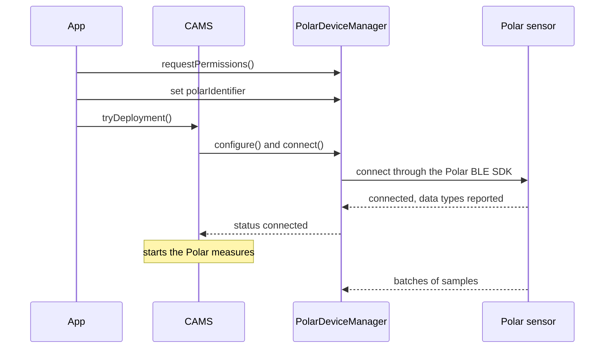

A study protocol names a Polar sensor only by its role. To collect data, the app binds the role to a physical sensor on the phone. CARP Mobile Sensing (CAMS) then connects to the sensor over Bluetooth Low Energy (BLE):



1. The app asks for the Bluetooth permissions and gives `PolarDeviceManager` the Polar ID of the sensor.
2. When CAMS deploys the study, it configures the device manager and calls `connect()`.
3. The device manager connects to the sensor through the Polar BLE SDK. When the sensor has reported the data types it offers, the status becomes `connected`.
4. CAMS starts the Polar measures, and the sensor streams batches of samples.

## Add the device to the protocol

Add a [`PolarDevice`](https://pub.dev/documentation/carp_polar_package/latest/carp_polar_package/PolarDevice-class.html) to the protocol as a connected device of the phone. Add the Polar measures to tasks that run on `polar`, not on `phone`:

```dart
final phone = Smartphone();
final polar = PolarDevice(roleName: 'Polar H10');

protocol
  ..addPrimaryDevice(phone)
  ..addConnectedDevice(polar, phone);

protocol.addTaskControl(
  ImmediateTrigger(),
  BackgroundTask(
    measures: [
      Measure(type: PolarSamplingPackage.HR),
      Measure(type: PolarSamplingPackage.ECG),
    ],
  ),
  polar,
);
```

`PolarDevice` takes these parameters:

| Parameter | Type | Required | Default | Description |
| --- | --- | --- | --- | --- |
| `roleName` | `String` | No | `'Polar HR Device'` | The role of the device in the protocol. Each role in a protocol needs a unique name. |
| `isOptional` | `bool` | No | `true` | Whether the study can run without the device. |
| `namePrefix` | `String?` | No | `'Polar'` | A name filter for a Bluetooth scan in your app. CAMS itself does not scan. |

Like every `BLEDevice`, `PolarDevice` also has the scan settings `serviceUuids`, `minRssi`, `allowDuplicates` and `timeout`, which CAMS does not use either. The protocol does not identify the physical sensor: you bind it on the phone.

## Request Bluetooth permissions

CAMS does not ask for Bluetooth permissions by itself. Its automatic permission requests cover what the measures declare, and the Polar measures declare none. After you configure `SmartPhoneClientManager`, and before the sensor connects for the first time, get the [`PolarDeviceManager`](https://pub.dev/documentation/carp_polar_package/latest/carp_polar_package/PolarDeviceManager-class.html) and call `requestPermissions()`:

```dart
final polarManager =
    SmartPhoneClientManager().deviceController.getDeviceManager(
      PolarDevice.DEVICE_TYPE,
    ) as PolarDeviceManager;

if (!await polarManager.hasPermissions()) {
  await polarManager.requestPermissions();
}
```

`requestPermissions()` shows the system dialogs one at a time, through `SmartPhoneClientManager().requestPermissions()`:

| Platform | Permissions requested | Checked before connecting |
| --- | --- | --- |
| Android | Bluetooth scan, Bluetooth connect and location while in use | Yes, on every Android version |
| iOS | Bluetooth | No |

On Android, `connect()` fails without these permissions: the log says that the permissions required to connect are missing, and the status becomes `disconnected`. On iOS with CocoaPods, the Bluetooth request needs the `PERMISSION_BLUETOOTH` macro; see [Installation](/docs/sampling-packages/polar/installation).

## Bind the sensor

`PolarDeviceManager` connects with the **Polar ID**: the identifier printed on the sensor, eight hexadecimal characters such as `B5FC172F`. It is also the last word of the sensor's Bluetooth name, for example `Polar H10 B5FC172F` or `Polar Sense B36B5B21`. The Polar ID is not the Bluetooth address, which the device manager does not use to connect.

Bind the sensor in one of two ways:

<Tabs items={['Polar ID', 'Scan result']}>
<Tab value="Polar ID">

Set `polarIdentifier`, for example from a settings screen where the participant enters the ID printed on the sensor:

```dart
polarManager.polarIdentifier = 'B5FC172F';
```

Setting the ID does not change the status, so you can set it at any time, also before the study is deployed. To find sensors nearby, `polarManager.polar.searchForDevice()` from the `polar` plugin streams a `PolarDeviceInfo` for each Polar sensor it finds, with the Polar ID in `deviceId`.

</Tab>
<Tab value="Scan result">

Pass the address and name of a Bluetooth scan result to `pair()`. It takes the Polar ID from the last word of the name and sets the status to `paired`:

```dart
polarManager.pair(
  bleAddress: '00:11:22:33:44:55',
  bleName: 'Polar H10 B5FC172F',
);
```

Call `pair()` only when the status is `configured`, that is, after CAMS has configured the device manager for the deployment. CAMS treats `paired` as configured, so it never configures a manager that was paired earlier. CAMS does not scan for devices; the [CAMS demo app](https://github.com/carp-dk/carp.sensing-flutter/tree/main/apps/carp_mobile_sensing_app) uses [`flutter_reactive_ble`](https://pub.dev/packages/flutter_reactive_ble) to find them.

</Tab>
</Tabs>

## Connect to the sensor

When CAMS configures the deployment, it connects to the sensor if the device manager has a Polar ID and the Bluetooth permissions are granted. If you bind the sensor later, call `connect()` yourself:

```dart
final DeviceStatus status = await polarManager.connect();
```

`connect()` returns while the connection is being set up, usually with the status `connecting`. It does nothing while the device manager is connecting or connected, or before CAMS has configured it.

When the Polar BLE SDK reports the connection, the status becomes `reconnected`. The SDK then reports the heart rate feature and, on sensors with online streaming, the online streaming feature as ready. The device manager adds the data types of each feature to `dataTypes`, and the first one sets the status to `connected`.

CAMS then starts the tasks that run on the sensor. A measure whose data type is not in `dataTypes` at that moment does not start. The log then says that the Polar device does not support the data type.

<Callout type="warning" title="Known issue">

In version 2.1.0, CAMS may start the tasks when only the heart rate feature is ready. The other Polar measures, such as ECG, then do not start until the sensor reconnects after a lost link. Once `dataTypes` lists their data types, pause and resume sampling with `SmartPhoneClientManager().pause()` and `SmartPhoneClientManager().resume()`.

</Callout>

To disconnect, call `disconnect()`. It pauses the Polar measures and tells the Polar BLE SDK to disconnect, so the SDK does not reconnect.

## Monitor the connection

`statusEvents` emits each new [`DeviceStatus`](https://pub.dev/documentation/carp_mobile_sensing/latest/runtime/DeviceStatus.html) of the sensor:

```dart
polarManager.statusEvents.listen((status) => print('Polar: ${status.name}'));
```

The device manager reports these statuses:

| Status | Meaning |
| --- | --- |
| `unknown` | CAMS has not configured the device manager yet. |
| `configured` | CAMS has configured the device manager for the deployment. |
| `paired` | `pair()` has bound a scan result. |
| `connecting` | A connection attempt is running, also while the Polar BLE SDK reconnects. |
| `reconnected` | The Polar BLE SDK reports the connection, but the sensor has not reported its data types yet. |
| `connected` | The sensor has reported its data types, and the Polar measures run. |
| `disconnecting` | The link to the sensor was lost. CAMS pauses the Polar measures and then sets `disconnected`. |
| `disconnected` | The sensor is not connected: the link was lost, `disconnect()` was called or the permissions are missing. |

These properties of the device manager describe the sensor and the connection:

| Property | Type | Description |
| --- | --- | --- |
| `isConnected` | `bool` | `true` while the status is `connected` or `reconnected`. |
| `canConnect` | `bool` | `true` once the device manager has a Polar ID. |
| `dataTypes` | `List<PolarDataType>?` | The data types the sensor offers. `null` until the sensor has reported them. |
| `polarDeviceType` | `PolarDeviceType?` | The model, read from the Bluetooth name: `H10`, `H9`, `Verity` or `Unknown`. |
| `bleName` | `String?` | The Bluetooth name of the sensor, such as `Polar H10 B5FC172F`. |
| `rssi` | `int?` | The received signal strength indicator (RSSI) of the sensor's advertisement in dBm, as reported when the sensor connects. |

## Read the battery level

`batteryLevel` holds the last battery level that the sensor reported, in percent, and `batteryEvents` emits each new level:

```dart
polarManager.batteryEvents.listen((level) => print('Polar battery: $level%'));
```

The battery level is not a measure, so CAMS does not store it. There is no heartbeat measure for the sensor either: the CAMS heartbeat covers the phone only.

When CAMS registers the sensor with the deployment, the registration records the level as a battery charging state. It maps 0–10% to `critical`, 11–20% to `low`, 21–90% to `normal` and 91–100% to `full`.

## Handle disconnections

When the link to the sensor is lost, the status becomes `disconnecting`. CAMS pauses the Polar measures, marks them to resume and sets the status to `disconnected`.

Unless the app called `disconnect()`, the Polar BLE SDK keeps trying to reconnect. When it succeeds, the status goes from `connecting` through `reconnected` to `connected`, and CAMS resumes the Polar measures. The data has a gap for the time the sensor was disconnected.

## Use one sensor per phone

CAMS keeps one device manager per device type, so a phone connects to one Polar sensor at a time. Add one `PolarDevice` to a protocol, and bind each participant's phone to their own sensor.

## Restore the binding after a restart

Each time the sensor connects, CAMS registers it with the deployment as a `PolarDeviceRegistration`. The registration holds the Polar ID, model, Bluetooth name, battery state and data types of the sensor. CAMS also stores the registration on the phone, with the deployment.

What happens after the app restarts depends on the deployment service:

| Deployment service | After a restart |
| --- | --- |
| On the phone (`SmartphoneDeploymentService`) | CAMS configures the device manager from the stored registration, which restores the Polar ID, and connects to the sensor again. Version 2.1.0 cannot read the stored registration; see the known issue below. |
| [CARP Web Services](/docs/data-storage/caws) (CAWS) | CAMS configures the device manager without the stored registration, because CAWS does not return it. Bind the sensor again after every start. |

<Callout type="warning" title="Known issue">

In version 2.1.0, CAMS cannot read back a stored Polar registration, because the package writes the data types in a format that it cannot read. At the next start, loading the stored studies fails, and the log shows "Failed to load studies". Add and deploy the study again at every start, and bind the sensor again.

</Callout>

## Troubleshooting

<Accordions>
<Accordion title="The status stays configured">

Bind the sensor: set `polarIdentifier` or call `pair()`, and then call `connect()`. Without a Polar ID, CAMS does not connect to the sensor.

</Accordion>
<Accordion title="The status changes to disconnected right after connect()">

Grant the Bluetooth permissions with `requestPermissions()`. On Android, also check that the manifest declares both location permissions without `android:maxSdkVersion`. See [Request Bluetooth permissions](#request-bluetooth-permissions).

</Accordion>
<Accordion title="The status stays connecting">

Check that the Polar ID matches the ID printed on the sensor, and that the sensor is worn, charged and near the phone. Until the phone finds the sensor, the status stays `connecting`.

</Accordion>
<Accordion title="Some measures do not start">

Check which data types the sensor offers: after the connection, `dataTypes` lists them. A measure that the sensor model does not offer does not start; see [Supported models](/docs/sampling-packages/polar#supported-models). With an H10, also see the known issue in [Connect to the sensor](#connect-to-the-sensor).

</Accordion>
</Accordions>
