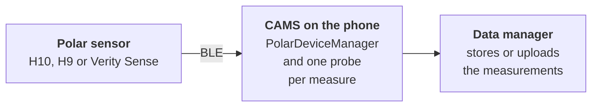

`carp_polar_package` connects a [CARP Mobile Sensing](/docs/mobile-sensing) (CAMS) study to Polar H10, H9 and Verity Sense sensors over Bluetooth Low Energy (BLE). It collects heart rate, ECG, photoplethysmography (PPG), pulse-to-pulse intervals (PPI) and motion data while the participant wears the sensor.

The package uses the [`polar`](https://pub.dev/packages/polar) Flutter plugin, an unofficial wrapper of the official [Polar BLE SDK](https://github.com/polarofficial/polar-ble-sdk).

<Chips>
<Chip href="https://pub.dev/packages/carp_polar_package" icon="Package" tone="primary">pub.dev</Chip>
<Chip href="https://pub.dev/documentation/carp_polar_package/latest/" icon="Description" tone="tertiary">API reference</Chip>
<Chip href="https://github.com/carp-dk/carp.sensing-flutter/tree/main/packages/carp_polar_package" icon="Code" tone="success">GitHub</Chip>
</Chips>

## Features

<Cards>
<Card title="Heart rate" icon="Heart">

Heart rate in beats per minute from all three sensors, with RR intervals from the H10 and H9.

</Card>
<Card title="ECG" icon="Ecg">

Single-lead ECG in microvolts at 130 Hz from the H10 chest strap.

</Card>
<Card title="PPG and PPI" icon="VitalSigns">

Raw optical signals and pulse-to-pulse intervals from the Verity Sense optical sensor.

</Card>
<Card title="Motion" icon="Motion">

Acceleration from the H10 and Verity Sense, and angular velocity and magnetic field from the Verity Sense.

</Card>
</Cards>

## Measure types

The package provides seven event-based measure types:

| Measure type | Data | Android | iOS |
| --- | --- | --- | --- |
| [`dk.cachet.carp.polar.hr`](/docs/sampling-packages/polar/measure-types#heart-rate) | Heart rate in beats per minute, with RR intervals | Yes | Yes |
| [`dk.cachet.carp.polar.ecg`](/docs/sampling-packages/polar/measure-types#ecg) | ECG voltage in microvolts | Yes | Yes |
| [`dk.cachet.carp.polar.accelerometer`](/docs/sampling-packages/polar/measure-types#acceleration) | Acceleration on three axes in milli-g | Yes | Yes |
| [`dk.cachet.carp.polar.gyroscope`](/docs/sampling-packages/polar/measure-types#angular-velocity) | Angular velocity on three axes in degrees per second | Yes | Yes |
| [`dk.cachet.carp.polar.magnetometer`](/docs/sampling-packages/polar/measure-types#magnetic-field) | Magnetic field on three axes in gauss | Yes | Yes |
| [`dk.cachet.carp.polar.ppg`](/docs/sampling-packages/polar/measure-types#photoplethysmography) | Raw PPG values of the optical channels | Yes | Yes |
| [`dk.cachet.carp.polar.ppi`](/docs/sampling-packages/polar/measure-types#pulse-to-pulse-intervals) | Pulse-to-pulse intervals in milliseconds, with error estimates | Yes | Yes |

For the fields and sample rates of each measure type, see [Measure types](/docs/sampling-packages/polar/measure-types).

## Supported models

Which measures produce data depends on the sensor model. A measure that the connected sensor does not offer does not start:

|  | H10 | H9 | Verity Sense |
| --- | --- | --- | --- |
| **Heart rate** | Yes | Yes | Yes |
| **ECG** | Yes | No | No |
| **Acceleration** | Yes | No | Yes |
| **Angular velocity** | No | No | Yes |
| **Magnetic field** | No | No | Yes |
| **PPG** | No | No | Yes |
| **PPI** | No | No | Yes |

## Requirements

| Component | Requirement |
| --- | --- |
| Dart SDK | 3.10 or later |
| Flutter | 3.38.1 or later |
| `carp_mobile_sensing` | 2.2.0 or later |
| Android | API level 24 (Android 7.0) or later |
| iOS | 15.0 or later |
| Sensor | A Polar H10, H9 or Verity Sense |
| Testing | A physical phone, because emulators and simulators cannot connect to the sensor |

See [Installation](/docs/sampling-packages/polar/installation) for the platform setup.

## How it works

1. The study protocol names the sensor only by its role: a `PolarDevice` connected to the phone.
2. On the phone, the app binds the role to a physical sensor with its Polar ID. `PolarDeviceManager` then connects to the sensor through the Polar BLE SDK.
3. Once the sensor reports the data types it offers, CAMS starts the Polar measures. Each batch of samples from the sensor becomes one measurement.
4. A data manager stores or uploads the measurements, as the data endpoint of the protocol specifies.

For the binding and the connection status, see [Connecting a device](/docs/sampling-packages/polar/connecting).

## Next steps

<Cards>
<Card title="Installation" href="/docs/sampling-packages/polar/installation" icon="Download">

Add the package and configure Bluetooth on Android and iOS.

</Card>
<Card title="Quickstart" href="/docs/sampling-packages/polar/quickstart" icon="Bolt">

Connect to a Polar sensor and print its heart rate and ECG.

</Card>
<Card title="Connecting a device" href="/docs/sampling-packages/polar/connecting" icon="Bluetooth">

Bind a Polar sensor, connect to it and follow its status.

</Card>
<Card title="Measure types" href="/docs/sampling-packages/polar/measure-types" icon="Dataset">

The seven Polar measure types, their sample rates and data fields.

</Card>
</Cards>
