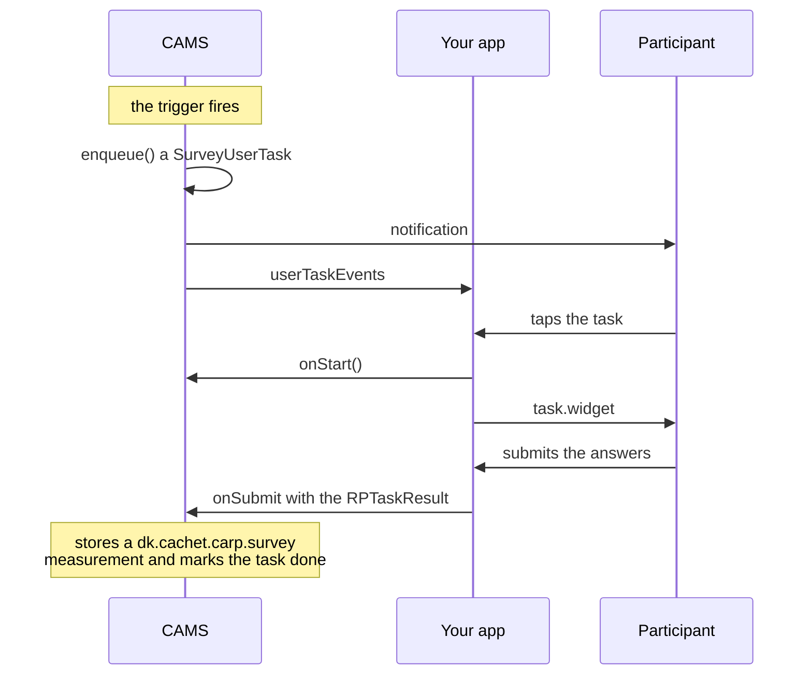

`carp_survey_package` runs surveys, cognitive tests and informed consent flows as [app tasks](/docs/mobile-sensing/app-task-model) in a [CARP Mobile Sensing](/docs/mobile-sensing) (CAMS) study. CAMS schedules each task, notifies the participant and stores the answers as measurements.

The questions and their screens come from [`research_package`](https://pub.dev/packages/research_package), and the cognitive tests from [`cognition_package`](https://pub.dev/packages/cognition_package). Use the package for questionnaires, ecological momentary assessment and repeated cognitive testing.

<Chips>
<Chip href="https://pub.dev/packages/carp_survey_package" icon="Package" tone="primary">pub.dev</Chip>
<Chip href="https://pub.dev/documentation/carp_survey_package/latest/" icon="Description" tone="tertiary">API reference</Chip>
<Chip href="https://github.com/carp-dk/carp.sensing-flutter/tree/main/packages/carp_survey_package" icon="Code" tone="success">GitHub</Chip>
</Chips>

<Callout type="warning" title="Research Package 3.x">

`carp_survey_package` 2.1.1 depends on `research_package` 3.x, so a CAMS app resolves `research_package` 3.2.0 and cannot use 4.0.0. The [Research Package](/docs/flutter-plugins/research-package) section documents 4.0.0; its pages on tasks, answer formats, results, branching, localization and theming also apply to 3.2.0. For permissions, which 3.2.0 asks for itself, see [Permissions](/docs/flutter-plugins/research-package/permissions).

</Callout>

## Features

<Cards>
<Card title="Surveys" icon="Quiz">

Build questionnaires from Research Package steps and answer formats, or start with the built-in WHO-5 well-being survey.

</Card>
<Card title="Cognitive tests" icon="Psychology">

Add any of the 14 tests in Cognition Package, such as Flanker, Stroop effect and Trail making, as steps of a task.

</Card>
<Card title="Notifications" icon="Notifications">

CAMS schedules each task with its trigger and can notify the participant when the task is due.

</Card>
<Card title="Survey data" icon="Dataset">

Each submitted or canceled task becomes a measurement that holds the full Research Package result.

</Card>
</Cards>

## Measure types

The package adds one measure type, which `RPAppTask` adds to every survey task by itself:

| Measure type | Data | Android | iOS |
| --- | --- | --- | --- |
| `dk.cachet.carp.survey` | The result of a survey, cognitive test or consent task | Yes | Yes |

See [Survey data](/docs/sampling-packages/survey/survey-data) for the fields, and for the `dk.cachet.carp.completedapptask.<type>` measurement that CAMS adds for every completed task.

## Requirements

| Component | Requirement |
| --- | --- |
| Dart SDK | 3.12 or later |
| Flutter | 3.44 or later |
| `carp_mobile_sensing` | 2.3.0 or later |
| `research_package` | `^3.0.0`, which resolves to 3.2.0, not 4.0.0 |
| `cognition_package` | `^1.9.0`, which resolves to 1.9.1 |
| Android | API level 26 (Android 8.0) or later, required by the `health` plugin that `research_package` 3.x depends on |
| iOS | 15.0 or later |

## How it works

A survey reaches the participant as an app task:



In detail:

1. When the trigger fires, CAMS creates a `SurveyUserTask` and puts it on its task queue. With `notification: true`, CAMS also notifies the participant.
2. Your app lists the tasks on the queue and rebuilds the list on `userTaskEvents`.
3. When the participant opens a task, the app calls `onStart()` and shows `task.widget`, a full-screen Research Package task.
4. When the participant submits the answers, the package stores them as a `dk.cachet.carp.survey` measurement and marks the task as done.

In a protocol, a survey is an `RPAppTask` with a trigger:

```dart
CarpMobileSensing.ensureInitialized();
SamplingPackageRegistry().register(SurveySamplingPackage()); // [!code highlight]

protocol.addTaskControl(
  RecurrentScheduledTrigger(
    type: RecurrentType.daily,
    time: const TimeOfDay(hour: 13),
  ),
  RPAppTask( // [!code highlight]
    type: AppTask.SURVEY_TYPE,
    name: 'WHO-5 Survey',
    title: 'Well-being survey',
    description: 'Five questions about how you have been feeling',
    notification: true,
    rpTask: who5Task, // [!code highlight]
  ),
  phone,
);
```

`who5Task` is the WHO-5 well-being survey that ships with the package.

## Next steps

<Cards>
<Card title="Installation" href="/docs/sampling-packages/survey/installation" icon="Download">

Add the package to a CAMS app and configure Android and iOS.

</Card>
<Card title="Quickstart" href="/docs/sampling-packages/survey/quickstart" icon="Bolt">

Build an app that schedules a daily WHO-5 survey.

</Card>
<Card title="Building surveys" href="/docs/sampling-packages/survey/surveys" icon="EditNote">

Build a survey from Research Package steps and add it to a protocol.

</Card>
<Card title="Scheduling and notifications" href="/docs/sampling-packages/survey/scheduling" icon="Notifications">

Choose triggers, notify participants and keep the task list in sync.

</Card>
</Cards>
